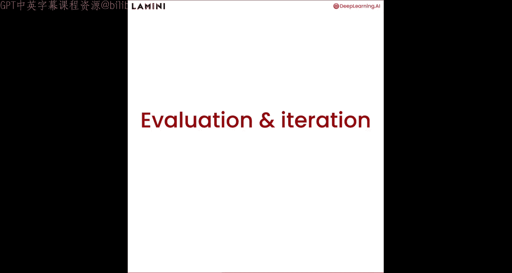
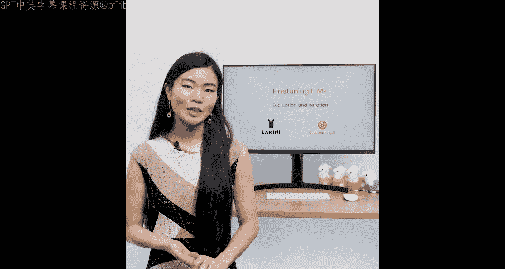
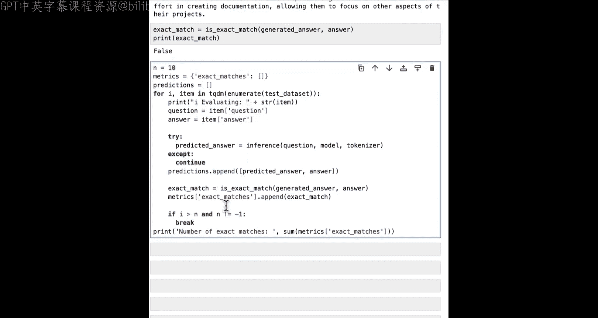
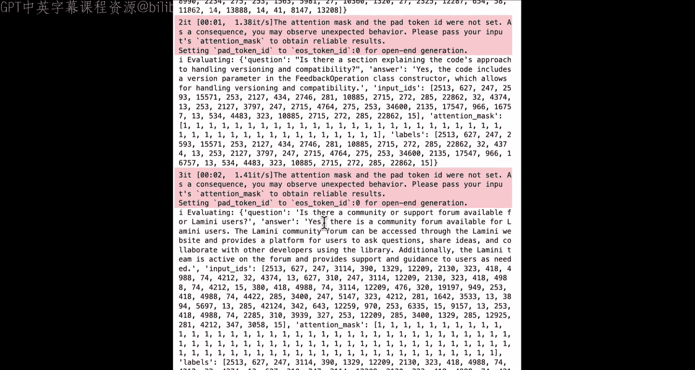
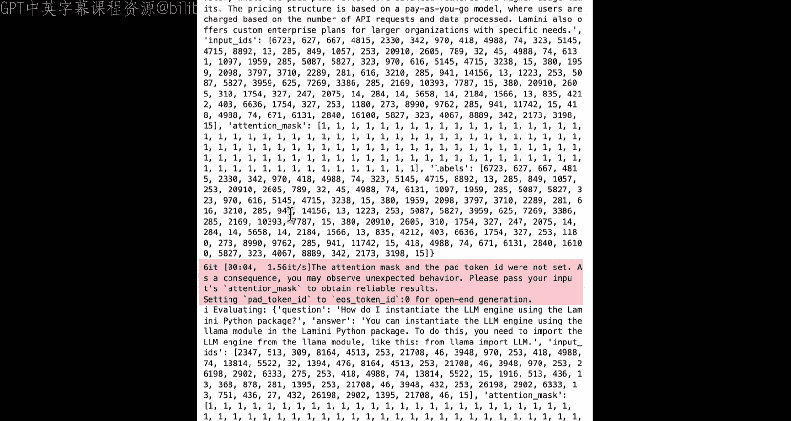
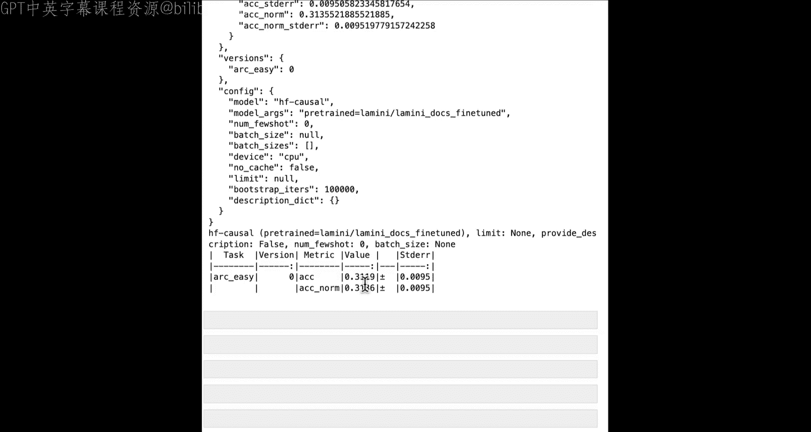

# 吴恩达《微调大型语言模型》｜ Finetuning Large Language Models（中英字幕） - P7：SC-Fine_Tuning_C1_L6.zh_en - GPT中英字幕课程资源 - BV1Rz4y1T7wz

Now that you finish training your model， the next step is to evaluate it， see how it's doing。

This is a really important step because AI is all about iteration。

This helps you improve your model over time。Okay， let's get to it。

Evaluating geneative models is notoriously very， very difficult you don't have clear metrics and the performance of these models is just improving so much over time that metrics actually have trouble keeping up so as a result human evaluation is often the most reliable way of doing so so that's actually having experts who understand the domain actually assess the outputs a good test data is extremely important to making this actually a good use of that person's time and that means it's a high quality data it's accurate so you've gone through it to make sure that it is accurate。

 is generalized so it actually covers a lot of the different test cases you want to make sure the model covers and of course it can't be seen in the training data Another popular way that is emerging is elo comparison so that's looking almost like an AB test between multiple models or tournament across multiple models eO rankings are used in chess specifically and so this is one way of also being able to。

stand which models are performing well or not So one really common open LOM benchmark is a suite of different evaluation methods so it's actually taking a bunch of different possible evaluation methods in averaging them all together to rank models and this one is developed by Luther AI and it's a set of different benchmarks put together So one is Arc it's a set of great school questions。

 Heawag is a test of common sense。 MMmLu covers a lot of elementary school subjects and truthful QA measures the model's ability to reproduce falsehoods that you can commonly find online and so these are a set of benchmarks that were developed by researchers over time and now have been used in this common evaluation suite and you can see here this is the latest ranking as of this recording but I'm sure this changes all the time Lama2' is doing well this is actually not necessarily sorted by the average here Lama2's doing well there's recently a freewillie model that was。

Fine tune on top of the Lama2 model using what's known as the OrRCA method。

 which is why it's called free Willie。Not going to go into that too much。

 there are a lot of animals going on right here， but feel free to go check it out yourself。

Okay so one other framework for analyzing and evaluating your model is called error analysis and what this is is categories and errors so that you understand you the types of errors that are very common and going after the very common errors in the very catastrophic errors first and this is really cool because error analysis usually requires you to first train your model first beforehand but of course with for fine tuning。

 you already have a base model that's been pretrained so you can already perform error analysis before you even finet the model。

 This helps you understand and characterize how the base model is doing so that you know what kind of data will give it the biggest lift for fine tuning and so there are a lot of different categories I'll go through a few common ones that you can take a look at so one is just misspelling this is very straightforward very simple。

 So here it says go get your liver or lever checked and it's misspelled and so just fixing that example in your data is important to just spell it correctly length。

A very common one that I hear about chat UPT or generative models in general。

 they really are very verbose and so one example is just making sure your data set is less verbose to make it so that it actually is answering the question very succinctly and you've already seen that in the training notebook where we're able to do a bit of that in the models less verbose and less repetitive。

And speaking of repetitive， these models do tend to be very repetitive。

 and so one way to do that is to fix it with either stop tokens more explicitly。

 those prompt templates you saw， but of course， also making sure your data set includes examples that don't have as much repetition and do have diversity。

Cool， no， so now onto a lab where you get to run the model across a test data set and then be able to run a few different metrics。

 but largely inspect it manually and also run on one of those LLM benchmarks that you saw Arc。Okay。

 so this actually can be done in just a line of code which is running your model on your entire test data set in a batched way that's very efficient on GPUs and so I just wanted to share that here。

 which is you can load up your model here instantiate it and then have it just run on a list of your entire test data and it's automatically batched on GPUs really quickly Now we're really largely running on CPUUs here so for this lab you'll get to actually just run it on a few of the test data points and then of course you can do more on your own as well。

Okay， great， so I think the first thing is to load up the test data that we've been working with。

And then。Let's take a look at what one of those data points looks like。

 so just going to print question answer pair。All right， so this is one that we've been looking at。

And then we want to load up the model to run it over this entire data。So this is the same as before。

 I'm going to pull out the actual fine tuned model from Huing face。Okay。

 so now we've loaded up our model and。I'm gonna load up one really basic evaluation metric just for you to get a sense of this generative task and it's gonna be whether it's an exact match between two strings or stripping a little bit of white space。

 but just getting a sense of whether it can be an exact match。

 This is really hard for those writing tasks because it's generating content there's actually a lot of different possible right answers So it's not a super valid evaluation metric for you know reading quote unquote tasks those reading tasks。

 you might be extracting topics out， you might be extracting some information out So maybe in those cases where it's closer to classification this might make more sense。

 but I just want to run this through you can run different evaluation metrics through as well。

 an important thing when you're running model in evaluation mode is to do model e to make sure things like dropout is disabled。

And then just like in previous labs， you can run this inference function to be able to generate output。

So let's run that first test question again。Again， you get that output and look at the actual answer。

 compare it to that， and it's similar， but it's not quite there。

 so of course when you run exact match， it's not perfect。

And that's not to say there aren't other ways of measuring these models， this is a very。

 very simple way， sometimes people also will take these outputs and put it into another LLM to ask it and grade it to see how well you how close is it really。

 you can also use embedding so you can embed the actual answer and actually embed the generated answer and see how close they are in distance。

 so there are a lot of different approaches that you can take。

Cool so now to run this across your entire data set this is what that might look like。

 so let's just actually run it over 10 since it takes quite a bit of time。

 you go on to iterate over that data pull out the question answers here I'm also trying to take the predictive answer and actually append it with the other answers so that you can inspect it manually later and then take a look at the number of exact matches。

And。

Just evaluating here。

So the number of exact matches zero and that's not actually super surprising since this is a very generative task and typically for these tasks you there again are a lot of different ways of approaching evaluation but at the end of the day what's been found to be significantly more effective by a large margin is using manual inspection on a very curated test set and so this is what that data frame looks like so now you can go inspect it and see okay for every predictive answer or what was the target and how close was it really。

Okay cool， so that's only on a subset of the data， we also did evaluate it on all of the data here that you can go load from Huging face and be able to basically see and evaluate manually all the data。

And last but not least， you'll get to see running Arc which is a benchmark so if you're curious about academic benchmarks。

 this is one that you just explored across that test suite of different LLM benchmarks and this Arc benchmark as a reminder is one of those four that Luther AI came up with and input put together and these are from academic papers and for this one。

 if you inspect the data you'll find science questions that may or may not be related to your task and these evaluation metrics especially here are just very good for academic contexts or understanding general model abilities sometimes around these in this case basic grade school questions。

 but I actually really recommend even as you run these to not necessarily be too caught up on the performance on these benchmarks。

 even though this is how people are ranking model。Now and that's because。

They don't correlate with your use case， they are not necessarily related to what your company cares about。

 what you actually care about for your end use case for that fine tune model。

 and as you can probably see， the fine tune models are able to basically get tailored to a ton of different tasks which require a ton of different ways of evaluating them。

Okay， so the Arc benchmark， which is finished running and the score is right here 0。31。

 and actually that is lower than the base model score in the paper， which is 0。

36 which is crazy because you saw it improves so much on this but it's because it improves so much on this company data related this company related to question answering for it and not grade school science so that's what Arc is really measuring of course。

 if you fine tunena model on general tasks So if you fine tune it on alpaca for example。

 you should see a little bit of a bump in that performance for this specific benchmark and if you use a larger model。

 you'll also see a likely bump as well， because it's learned much more and that's basically it so as you can see this arc benchmark probably only matters if you're looking at general models and comparing general models maybe that's finding a base model for you to use but not for your actual fine tuning task。

It's not very useful unless you're fine tuning the model to do grade school science questions。

All right， and that's a wrap for the notebooks in the last lesson you'll learn some practical tips for fine tuning and then a sneak peek of more advanced methods。

