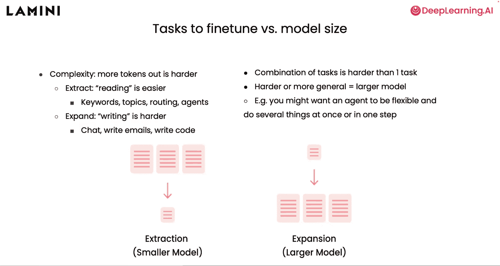
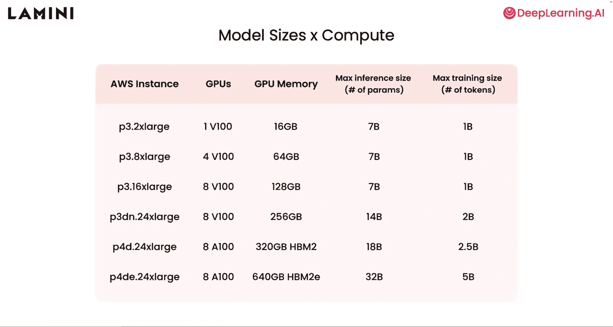
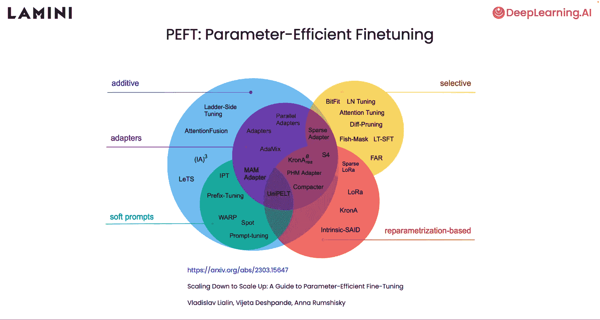
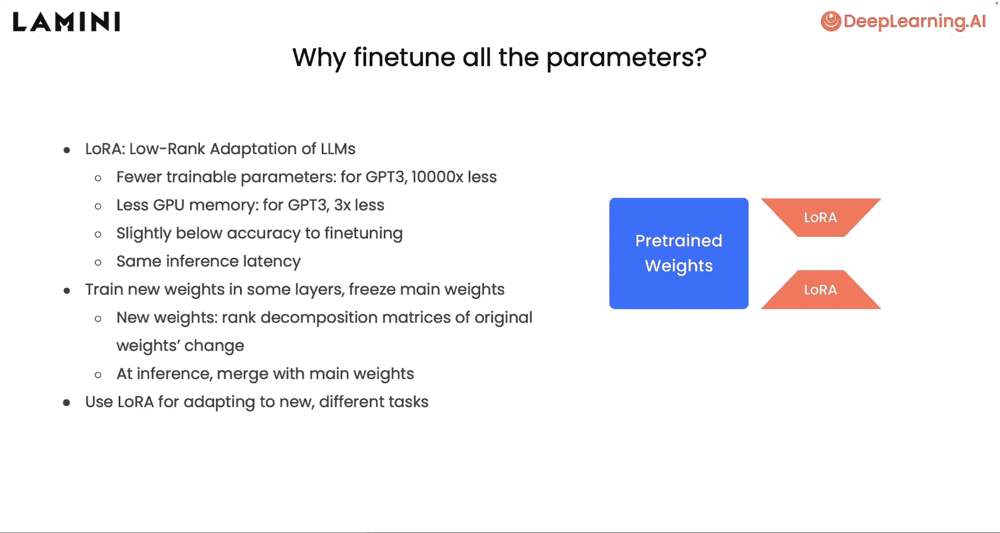

# 吴恩达《微调大型语言模型》｜ Finetuning Large Language Models（中英字幕） - P8：SC-Fine_Tuning_C1_L7.zh_en - GPT中英字幕课程资源 - BV1Rz4y1T7wz

All right， you made it to our last lesson and these will be some considerations you should take on getting started now。

 some practical tips and also a bit of a sneak preview on more advanced training methods。So first。

 some practical steps to fine tuning， just to summarize， first you want to figure out your task。

 you want to collect data that's related to your tasks inputs and outputs and structure it as such。

 if you don't have enough data， no problem just generate some or use a prompt template to create some more。

And first you want to fine tune a small model， I recommend a 400 million to a billion parameter model just to get a sense of where the performance is at with this model。

 and you should vary the amount of data you actually give to the model to understand how much data actually influences where the model is going and then you can evaluate your model to see what's going well or not and finally you want to collect more data to improve the model through your evaluation。

Now from there you can now increase your task complexity so you can make it much harder now。

 and then you can also increase the model size for performance on that more complex task。

So for task to fine tune you learned about reading tasks and writing tasks。

 writing tasks are a lot harder， these are the more expansive tasks like chatting， writing emails。

 writing code， and that's because there are more tokens that are produced by the model。

 so this is a harder task in general for the model。

And harder tasks tend to result in needing larger models to be able to handle them another way of having a harder task is just having a combination of tasks。

 asking the model to do a combination of things instead of just one task。

 and that could mean having an agent be flexible and do several things at once or in just in one step as opposed to multiple steps。

So now that you have a sense of model sizes that you need for your task complexity。

 there's also a compute requirement basically around hardware of what you need to run your models for the labs that you ran。

 you saw those 70 million parameter models that ran on CPU they weren't the best models out there and I recommend starting with something a little bit more perform in general So if you see yourless table the first row I want to call out of a 1 V100 GPU that's available for example an AWS but also any other cloud platform and you see that it has 16 gigabys of memory and that means it can run a 7 billion parameter model for inference。

 but for training training needs far more memory to store the gradients and the optimizers so it only can actually fit a 1 billion parameter model and if you want to fit a larger model you can see some of the other options available here Great so maybe you thought that that was not enough for you you want to work with。

Much larger models well there's something called PEft or parameter efficient fine tuning。

 which is a set of different methods that help you do just that。

 be much more efficient in how you're using your parameters and training your models and one that I really like is Laura。

 which stands for low rank adaptation。

And what Laura does is that it reduces the number of parameters you have to train。

 weights that you have to train by a huge amount for GPT3， for example。

 they found that they could reduce it by 10，000 x。Wwhich resulted in 3xs memory needed from the GPU and while you do get slightly below accuracy to fine tuning。

 this is still a far more efficient way of getting there and you get the same inference latency at the end。

 So what is exactly happening with Laura Well you're actually training new weights in some of the layers of the model and you're freezing the main pretrained weights which you see here in blue so that's all frozen and you have these new orange weights those are the Lauraura weights。

The new weights and this gets a little bit messy are the rank decomposition matrices of the original weights change。

But what's important is less so you know the math behind that here。

 it's that you can train these separately alternatively to the pretrained weights。

 but then at inference time， be able to merge them back into the main pretrained weights and get that fine tune model more efficiently What I'm really excited about to use Laura for is adapting it to new tasks。

 And so that means you could train a model with Laura on one customer's data and then train another one on another customer's data and then be able to merge them each in at inference time when you need them。

