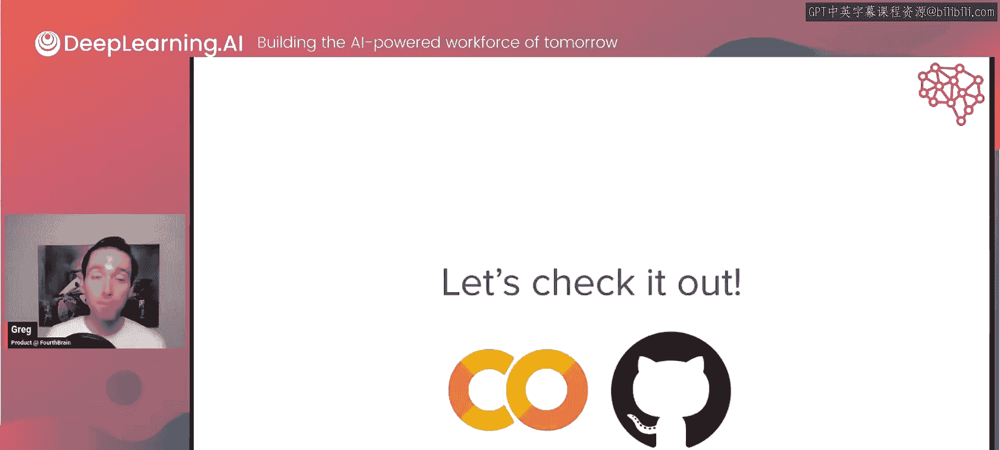
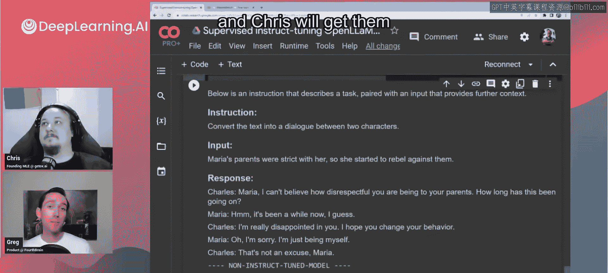
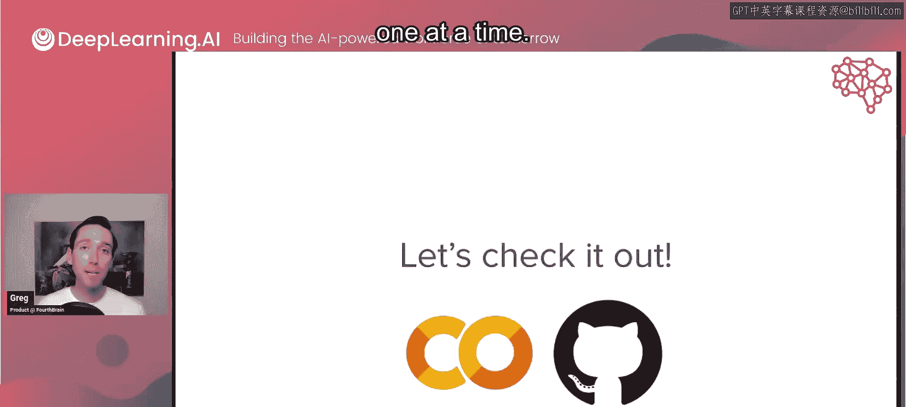
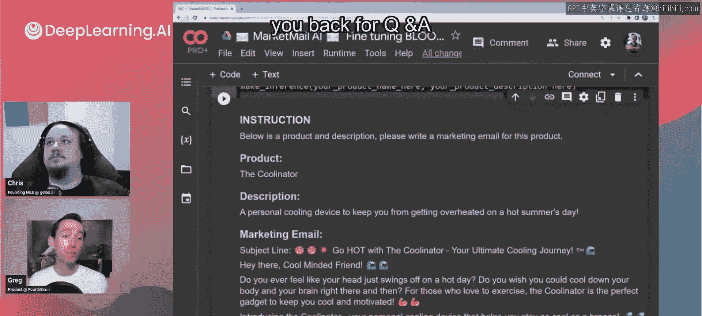
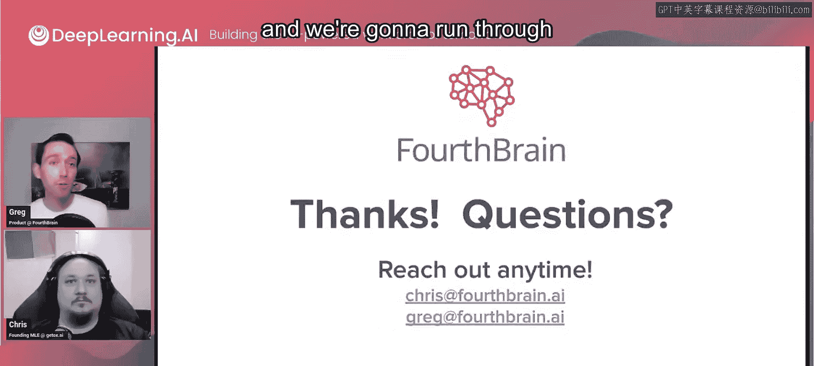

# 吴恩达《手把手构建经过指令调整的LLMs｜Building with Instruction-Tuned LLMs- A Step-by-Step Guide》 - P1：吴恩达《手把手构建经过指令调整的LLMsBuilding with Instruction-Tuned LLMs- A Step-by-Step Guide》 - GPT中英字幕课程资源 - BV1Mx42117aa

Hi everyone and welcome to building with InTd LLMs， a step by step guide。

 we appreciate you taking the time to join us for today's event。

 we're so glad to see you tuning in from all over the world if it's late thanks for staying up to join us today。

During our event， you'll learn how to differentiate between instruction tuning and fine tuning of LLMs we'll see how to use the latest models。

 data sets and training tools to both perform in tuning ourselves and to pick up instructionune models off the shelf to build powerful LLM applications designed for specific tasks through datacentric fine tuning techniques。

We're going to get right into it today if you hear anything during our event that prompts a question。

Then please follow the slido link in the description box on the YouTube page and put yours in Also upvote any that you see in there that you'd like to see answered at the end of the presentation My name is Greg Laknain and I'm the head of product and curriculum at FourthB I'm excited to welcome my friend and colleague Chris Alexic to the stage today as we'll be working as a team to deliver this lesson。

During the day， Chris is the founding machine learning engineer at OgeO。

aiI and by night he works as a fellow instructor and curriculum developer at Fourth Brain。

 he is also a solo YouTube creator who builds weekly with the latest and greatest generative AI and LLM tools。

 as you'll see him do today。One quick note on the flow of today's event。

 I'll be sharing slides and high level concepts as an introduction to coding demos that Chris will run。

But first， we'd like to get started by sharing a motivating example together。Instruction。

Identify the odd one out and explain your choice。Input。Orange。Green。Airplane。Chris。

 can you walk us through the responses that we get here。 Yeah， you bet。

 So so in the first you know half year we have our noninstruct tune。 that's our base model。

 It response is orange is the odd one out and the explanation is that orange is the odd one out because it's the only one that is not a plane。

 which is kind of a nonsensical and doesn't doesn't really help us at all。

 and then for our instruction tune model， we have a much better response， which is response。

 airplaneplan is the odd1 out， and then it gives some cogent kind of explanation here。

 airplaneplan has nothing to do with the color spectrum。

 it uses aerodynamics and other techniques to fly。 it does not on the ground。

 and it's made out of metal and durable materials。 So it's the improvements pretty。

 pretty clear between the two Sub improvement on this and many other questions that we can get with Instruct tanning。

 Super cool to see this。 We're gonna see lots of examples when we see you back in the demo that's coming up in just a few minutes。

 Chris， See you soon。😊，So today I want to provide a little bit of context before we jump right into the demos。

 we're going to talk about the big picture of LLMs and the big picture of fine tuning versus instruction tuning。

Then we're going to see some instruction tuning， we're going to see how to leverage some open source state of the art models。

 data sets as well as。Fine tuning techniques， and then we'll also see how we can take an instruct tuned model off the shelf。

And then fine tune that model and really dial in the input output schema to make it very good at a specific task。

Okay， so the context here is that if we look at the lineage of GPTs， if we look at open AIs， GP， GP2。

3， all of the LLMs that we've seen， they're really built on this foundation of unsupervised pretraining。

 this is really leveraging a selfupervised approach where there are no labels to the data and we're essentially scraping in a ton of information from the internet。

And beyond that unsupervised pre training first step。Then we do some supervised fine tuning。

 That's what allows us to really dial in how good we are at these benchmarks and the benchmarks。

Are the classic NLP benchmarks they're the question answering， the information retrieval。

 the sentence completion， and what we've seen over time is that if we just use more compute and more data。

 we can do better and better and better at each benchmark that exists and even include more benchmarks and get better at those as well。

So this is sort of the big picture of the LLM now when we go use the LLM。

 we want to make sure that it's good， not at everything anymore， not at every benchmark。

 but at one specific thing。And that's where we get into this idea of prompting or prompt engineering。

This idea of zero shot learning is simply writing a prompt and trying to get the LLM to respond to that prompt。

 as we saw in our motivating example。A few shot learning technique would be giving the LLM a few examples。

 maybe one， maybe several that would all be under the guise of few shot learning and then when we talk about fine tuning in this context we're talking about we're talking about fine tuning for a specific task so this time maybe we have many examples maybe it doesn't fit in the context window anymore and what we're really doing is we're changing the input output schema so it's no longer a model that does everything but instead it's a model that does one thing。

And this is sort of another way of thinking about getting started building applications。

Whether we're using zero shot or whether we're using few shot。

 we're really exploring that space of all possibilities within the LLM。

This is cheap and this is quick， and this is a great way to just develop your MVP。Now。

 as you want to really explore that particular area of the LLM。

 the latent space within that area of the LLM， what you're doing is you're carving out a region within the LLM that you want to work within。

And so there's a lot of ways you might visualize that。

 I offer one here that was created with midjoourney so if you want to sort of imagine that you're in this crazy space and you're trying to find one area of it that your application resides in。

 that's really what you're going to do when you're dialing things in with the fine tuning on top of the LLM。

Okay， so just sort of。Wraping up this idea of instruction tuning versus fine tuning before we get into it。

We're really asking what task do we want our LLM to have superpowers on。

 that's what this fine tuning of the input output schema when we're building apps is doing。

Whereas when we're talking about supervised fine tuning done on large language models in general。

 that's more akin to the instruction tuning that we'll see today。

Whereas instruction tuning is really。A way of doing better， not just on the classic benchmarks。

 but on being aligned with humans， being aligned with what we expect when we give instructions or direction。

 and importantly being aligned when it comes to bias， truthfulness。

 toxicity and other metrics and evolving benchmarks that we see coming onto the scene all the time。

So we're really saying， okay， I want to develop my LLM so that it could be any superhero aligned with any task that I might want to help a human out with。

 that's what we're doing with this instruction tuning。

And then with the fine tuning of the input output schema。

 when we're taking that general and making it specific。

 we're now saying we want to define how a user will interact with our application and we want to make sure that it's really clear what that interaction is like and what that superpower and what that single task that we want to get really good at is。

So in short instruction tuning enhances supervised fine tuning。

 it's really a subset of all possible fine tuning， it's focused on alignment with humans and it's concerned with following instructions and then fine tuning that input output schema is all about dialing things in very specific task we will see both today。

And first off， we're going to start with instruct tuning now we picked a couple of pieces of technology that are particularly relevant today that we want to show you how to how to work with。

Dolly 15K is a data set that was released with Dolly 2。0， the open source LLM， and it contains 15。

000 high quality human Databricks employee generated prompt response pairs。

The structure here is instruction， context response。

And each of these pieces of data falls into a different category of instruction。

 so you might see creative writing， closed or open question answering， summarization。And on and on。

 we see a quick brainstorming example of what to put in our PB&J if we don't have any J。

And these can also be used commercially we can leverage Dolly 15 k we can leverage Dolly 2。

0 for commercial purposes What we're going to do is we're going to leverage open Lama。

 which is a reproduction by open Lm research out of Berkeley that。Essentially recreates metatas Lama。

 which stands for the large language model meta AI as of May 22 just a little over a week ago。

 they released a new checkpoint for the open Lama 7 billion parameter model they expect their full 1 trillion token training run to be done here pretty soon this is trained on the red pajama data set。

The full one trillion tokens is associated with that data set and this again is a commercially available and can be used for commercial purposes model so we're going to use the open Lama model in addition to the Dolly 15 k data set and interestingly today what we're going to do is we're going to leverage a really new。

Addition of。How to do fine tuning very efficiently。And this is called Q Lauraura。

 so this is taking sort of this big idea that is sort of an emerging best practice with LLMs。

That downstream tasks， meaning more specific tasks have intrinsically lower dimensions than the higher upstream tasks。

 so all possible benchmark tasks， a lot of dimensions， one specific task， not very many dimensions。

 so when we're doing fine tuning we can get away with a lot less compute。And we're going to leverage。

Bits and bytes a library well hear more about for quantization we're going to leverage hugging faces parameter efficient tuning methods and we're also going to note because we' come back to this in the second demo that Q Laura it was released on May 23r so just again a little over a week ago is actually an improvement over the Laura method。

 the low rank adaptation of large language models method for training and so Chris is going to walk us through all of this today he's going to talk about quantization he's going to talk about how to think about each of these libraries and you're going to get a real feel for what's happening at the state of the art in code。

So with that， we're going to drop the link in the chat for you to follow along as Chris shows us how it's done。

 Chris。

Hey， thanks Greg， so today we're gonna to be looking at exactly what Greg said。

 which is supervised instruct tuning open Lama using the Dolly 15k data set。

 we're going to leverage a few very powerful libraries to get this done effectively and efficiently the whole fine tuning process can actually be run in coab with coab Pro that's kind of the the amazing power of especially Q Lauraura So let's just start going through this and see how how we can instruct tune as Greg said that's instruction tuning is a subset of fine tuning so we're using supervised fine tuning to let our model get better at instruction following tasks。

 First things first， we got to get our dependencies as always we will want to ensure that we're pulling right from the Githubs for these dependencies since some of these libraries are pretty new and they're evolving very quickly the resolving bugs or adding new features so pulling straight from the source is just going be easiest to make sure they。

😊，The most up to date version。In order to get our model to get better at instruction following we have to show it a lot of instructions and we've chosen to show instructions from the Dolly 15k data set now this data set is full of 15。

000 instructions they have three possible fields of a context a instruction and a response they also have a category column which we won't be leveraging today。

 but the idea is that this method of fine tuning for instructions works better if we let the model see many different varieties of tasks and so the category shows us tells us which task that particular row belongs to our instruction is straightforward enough it says what to do context is an optional field and then our response is the output。

😡，There are 15，000 rows in this data set， however， some of them are very long。

 too long even to be useful， so before we really get started we want to just pare the data down to sequences of more reasonable length and so we go ahead and do that just using the select method from our data sets library we pare that down to 14。

000 rows and we see it has a much more manageable range of sequence lengths。😡。

After that we are just going to do our train test split。

 we are going to use this test split for evaluation， not for testing， but we have 1。

4K rows worth of evaluation and 12 k worth of actual training。Now in order to get going。

 we have to convert our instructions from these three separate columns into one unified column that follows our desired prompt template。

 so that's all this formatting function is doing， we're basically converting it into two options。

 one is the context option and one is the without context option， very straightforwardly。

 the reason we do this is because the library we're relying on to do the supervised fine tuning expects it to be in this format。

 so that's the reason we have to convert it。😡，We just map this function over our data and then we can see that we have this new column called text。

 which contains our full text instructions。 So you see here below is an instruction that describes a task write a response that appropriately completes the request。

 We have an instruction and then we have a response。 There you go。😡。

Now that we have our model in a more reasonable state or our data sorry in a more reasonable state that the trainer we're using expects。

 we can go on to start setting things up on the model side。😡，We're gonna be using as Greg said。

 the open Lama 7 billion700 billion token preview so you know as stated this is being worked on constantly so you know next week there's probably going to be the 1 trillion version out the idea that I want to focus on here is that you can run this whole example in coab Pro you don't need anything more than that and that's to fine tune a 7 billion parameter model you can definitely get even more extra than that if you wanted to you can go up to 33 billion parameters but for the sake of this demonstration we're just going stick we're just going to stick with a 7 billion parameter model and then once we have our model picked we need to set up our Laura config now as Greg expressed we're using Q Lauraura the actual Laura part of Q Lauraura is the same so we're taking our large weight matrix that occurs on the attention layers and then we。

Going ahead and we're turning those into smaller matrices that can multiply together to represent the larger original weight matrix。

😡，The reason we do this is because it massively cuts down the number of parameters that we need to train so instead of having like a you know an absolutely huge like 1 thousand by thousand matrix we're cutting that down to a 16 by1 thousand and 100 by 16 matrix which has a significant reduction in trainable parameters。

😡，We have a number of hyperparameters in our Laurara config。 The first is rank。 The Laura paper。

 the Klorura paper both talk about rank。 if you want to learn a bit more。

 we'll talk about it in the next demo as well。 But for now we're just choosing 16 because it's kind of a default value。

 there's not a particular motivation here， you can play around with all kinds of ranks。

 including rank1 and find that the results are pretty pretty awesome。 Even that rank1。 next。

 these two values we're just kind of leaving as default， same with bias。

 This task type is entirely dependent on the kind of thing that you're training So if you're going to train。

 say for causal， which is what we're doing today， we just have to have causal Lm。

 if you wanted to do sequence to sequence， you would want to have to have sequence to sequence as the task type。

 So just pay attention to what you're trying to do。 this dictates what you set your task type to be。

And then we add the Q to Q Laura right so this is the bits and bytes config that's just been put out by Tim Demers。

 the guy who does bits and bytes is the Klorura paper right so。😡。

What we're doing here essentially is we're quantizing our information down to four bits。

 which is really tiny right so compared to the full 32 bits。

 four bits is like nothing you'll notice a few other parameters here so we have this use double quant as well as this quant type So the paper introduces the idea of this new kind of float。

 which is called a normal float which builds on some other methods and then this double quant piece enters because when you use this quantile。

😡，Quantization method you have some kind of overhead that's introduced sorry when you do the blockwise quantization。

 there's an overhead that's introduced and this double quant helps us quantize that overhead so that even our overhead is in a smaller format and then we have our compute D type。

 which is our B floatat or our brain float The idea here is that the models' weights are frozen and they are stored in this NF4 format。

 which is that normal float4 and then when we have to do computation on them we convert them or we unquantize them dequantize them sorry into these this brain float 16 so that we can do our computations safely and stably but the idea here is that we shrink we do two layers first of all we massively reduce the amount of parameters we're using with Laura then we also massively reduce the size every one of those parameters。

Takes with that quantization method here。Next up we just set up our model we have our model ID which is B or sorry which is the openLM model and then we pass it this quantization config so that it's all in for bit we scroll on down we're going also add our or load up our tokenizer we are going to add this special token of pad you don't have to do this for this particular model you've chosen we could use auto tokenizer but when you're using a lama tokenizer normally you do have to add some extra tokens so we just wanted to showcase that process。

😡，If we look at our model we can see everything's in four bit。

 we're very happy about that and you can see our layers here。

 the Q Laurara paper actually trade it uses the Laura technique on all of the layers。

 we're going to not do that today we are just going to use it on Q&V that's the default for Laura again。

 this is just to keep things manageable for coLab to ensure fewer people have problems with with the fine tuning experience。

😡，Next up is a big piece of technology that's fantastic this is our supervised fine tuning trainer this is absolutely amazing It's from this Trl you know library which is meant for that RLHF process however they also have this supervised fine tuning trainer which works beautifully for what we're doing today so we're leveraging that it handles a lot of what we need it to handle behind the scenes so we don't have to see it which is fantastic all we're doing is passing our original model we're passing our formatted data set we're passing our test set and then we're adding our hyperpara we are taking advantage of that paged optimizer this is something that。

helps prevent out of memory it's a really fantastic thing I definitely recommend reading about it in the paper。

 Q Laurara paper， but it's just another optimization that helps improve our experience and then our learning rate you know just kind of set standards you'll notice we only train this for 5000 iterations it's not very long the data set itself is you know 12K examples so you'll see all the results we're talking about today we're done with this process so you know imagine if you threw more compute at it and more iterations。

 more time I mean it can get it can get crazy。😡，And then here this is a very important particular parameter this is what points at our newly created text column in our data this is actually use behind the scenes and this FFT trainer to create the packed supervised data set so this is a critical step it's going to take that row and then process it into our supervised data set and it's going to be a packed data which means that say we have many small examples we stitch them all together in a single in a single you know trainable row and then we pass that through the model so this is just to help have more efficient training when when we're doing this fine tuning process our max length is just dictated by our tokenizer in our model selection so that's it and then we pass our Q config which is what lets all that magic happen behind the scenes and then we call dot train I mean this is you。

😡，Oh it's the part that does the magic but it's probably the least interesting you just call dot training in trains。

 you'll love to see it， you'll notice that the training。

 you know training loss goes down over the course of our training that's to be expected。

 we're training a model and yeah again this is only on 5K iterations and we still see a nice little learning curve there。

Next up we just export our model to the hub， this is just to make sure that we have it。

 you know model doesn't help if it does nothing outside of the notebook so we want to be able to export it to the hub so that we can leverage it in future projects when we're building some applications with these models。

😡，We're just going to reload it and then we're going to look at an example。

 so the benefit of instruction tuning right we have the instruction convert the text into a dialogue between two characters and the text is Maria's parents restrict with her so she started to rebel against them。

😡，When we pass this to the base model， we get just kind of rubbish output here right we just have it just repeats itself。

 it's not doing anything useful， it's not productive。

 but when we use the Inune model we see that it actually delivers us what we would like。

 which is a dialogue between two different characters we have this character of Charles and Maria they have a you know。

Back and forth that you can understand' it's in English and absolutely fantastic so with that example though I'm gonna kick it on back to Greg to go through some more of the high levell stuff Chris。

 awesome stuff love to see that instruct tuning seeing lots of great questions in the chat definitely drop those in slidlio and Chris will get them answered at the end we'll see you back in a little bit to show us how to do some fine tuning of that input output schema Chris thanks Laman and in case you've missed。

😊。

What Chris was kind of going through there some key takeaways are that what we just did was some additional supervised fine tuning on top of that open Lama model we used 15000 data points from Dolly 15k only 5000 steps of training and the total cost of this was about 75 Google Collab compute units that is less than a month of Google Collab Pro this is you know this is basically nothing you know for all intents and purposes of the scale of the things that we're doing here we used four bit quantization and we are going to use eight bit quantization in the next one using the classic Laura technique and the rule of thumb to take away from this is that you know we saw the conversation with Maria we saw orangegr airplane in general these instruction tune models are going to be better to pick up off the shelf when you're building AI applications。

Then the non instructioning base models。Okay， so recall that this instruction tuning was really about following instructions。

 it was really about doing good on new benchmarks and where we're going now is we're going into this space of okay now that I am going to pull an instruction to and model off of the shelf。

 I'm going to do some additional fine tuning。This is now not going to be supervised fine tuning that we're going to show but rather unsupervised fine tuning where we're going to fine tune the input output schema and really define the way the user interacts with our application。

 so we want our application to get really good at one thing。

This is the idea of fine tuning the structure。It's really important to think about how the user is going to use our app。

 what goes in， what comes out， this is sort of back to classic Ma learning 101 when we talk about this level of fine tuning。

And we want to make sure nobody gets poked in the eye when they're using our app and that's you know really important that's where instruction tuning can help out。

 but that's also where there is no substitute for。Thinking it through， getting the right data。

 even if it's a relatively small data set and really designing the right application from the outset。

So how we're going to do this is I'm going to sort of demonstrate the application。

 I'm going to pull an Int model off the shelf， and then we're going to see how Chris can fine tune an Inune model like Bloom Z or Blooms。

 as we've heard from Hugingface presenters in the past on this deep learning AI channel。

 and then we can use what's becoming really an industry standard method of training this PEft Laura approach for fine-tunning our AI marketing assistant。

So the big idea here is that let's imagine we're in a context where boss says leadership says the board says that writing direct email marketing copy is now considered tedious and it's something that really should be streamlined for the department。

We believe we can create a fine tuned AI marketing assistant to really help generate marketing copy for emails and for other marketing。

Activities that's going to be in the same voice and tone of everything that our company's been putting out。

There's obvious value here it's going to save people a lot of time and one keynote here is that in our example we're going to use data that's synthetically generated using OpenAI's GPT4。

 however， if you were going to do this in real life。

 you would want to leverage data from your company in your marketing voice and tone and really curate that data in a very datacentric way to ensure that your outputs were really dialed in and aligned with your brand。

But for us， we're just going to take some synthetically。Genderrated data for marketing emails。

 for made up products， and we're going to leverage。The Bloom model in particularly the Bloom Z model。

 which is the instructionted version of the Bloom model， which is huge model。

 it can do tons of languages we're just going to focus on English and we're going to just note here that the instruction tuning was done on Bloom's XP3 data set we've got a number of links here as well associated with this but the big idea here is that there's additional tasks just like the categories we saw in the Dolly 15K data that it's helping Bloom get better at。

So we're going to take Bom Z off the shelf and we're going to use peft Laurara。

Similar to how we saw in the previous example， and we're going to have Chris walk us through each step one at a time。

 Chris。

Take it away from here， demo2。You bet， okay， so down number two。

 we are talking about doing a similar process。 however， this time。

 instead of leveraging the you know， the supervised fine tuning method。

 we're just going to use unsupervised fine tuning。 We're not going to have any targets or labels。

 So we're just going let that data flow through our model。

 we're gonna leverage a few different libraries again。

 bits and bytes transformers and P Pft really does a lot of work here in letting us be able to do these kinds of tasks in coab you know。

 working in that limited compute space is absolutely fantastic， we are going to be， again。

 training like Greg said on that data that has the。You know， marketing information it's anyway。

 we're gonna Greg's already talked about that， so we're gonna get into the actual training process here。

 number one， of course， got to get your requirements without the requirements。

 you know we can't we can't do anything So guidance install those dependencies we're gonna do a much more manual process you'll notice you know in the first notebook the SF trainer was doing a lot of the work for us behind the scenes in this notebook we're gonna do a lot of it ourselves So first things first just make sure that we have GPU available like the last demo and Paa wasn't clear this is coab Pro with an a 100 GPU So both of them are gonna to be using that a100。

 You can definitely go smaller with a smaller model but for this process we're gonna use the a100。

We're going to use the Bloom 3B model， we're going to load it in eight bit。

 so we're still doing some reduction in order to get our model to a reasonable size and when it comes to our tokenizer。

 we can just use the straight up auto tokenizer from Bloom Z。😡。

Now the difference between the two models， so if you remember from our the last demo that model had the attention layers and there was our Qpro Vpro K Pro you know the bloom models a little bit different the selfat block actually has just this query key value module that we're going to target you know you can see here that we have 30 times these bloom blocks and each of those bloom blocks has the following you know layers in it。

😡，When we target this module， instead of just targeting one of these layers。

 we're actually targeting every layer called this and so when we do our Laura process。

 we're not just changing one weight matrix， we're actually impacting all of these。

 so that's going be 30 of them， which is what helps us get that massive reduction parameters。😡。

When it comes to our float you know for stability we need our small weights to be in float 32 so we just do this this is to ensure stability that's it we don't have to worry too much past that our other parameters that we set before training just makes the training process more efficient and then of course we're casting our output to float again it's a stability related reason there's not much to say about it other than you should do this when you're using this technique now we actually want to start talking about Laura I wanted to just take a brief pit stop here and talking about rank when it comes to Laura so our rank is。

😡，Basically how much are we reducing that original matrix by so what dimensions will our new decomposed matrix pairs have and you can see that even with rank equal to one which means that one of the dimensions of the decomposed matrix is one we have fantastic results right so rank is really something that you can play with you know definitely make sure that you you're keeping track of your metrics you don't wanted the grade model performance too much but you know this rank does can be taken to the extreme and maintain a lot of the original you function compared to some higher rank selection when it comes to Laurara so this is huge absolutely fantastic one thing to note as well in the Qlorra paper they did apply the Q process to all of the weights that we talked about in the Laurara paper itself they only apply them to the attention layers specifically。

😡，They chose Q and V， but with Bloom， we only have access to the one module。

 which is our queerki value layer。😡，So let's set up the Laura config we're gonna choose a you know rank of 16 here again just a default could be anything up to you to decide what you want test it evaluate as you're going through training this is a hyperpar you can tune Al dropout bias these are just default values you can play with them a bit。

 they don't have a significant impact but you can definitely tune them if you wish to you'll notice we have this extra parameter here which is our target modules again we need to make sure we're targeting the correct weights that we want to apply the Laura process too and so we point that at that query key value modules we discussed earlier and the task type again is causal LM for people who are like causal LM what does this mean we're just talking about the idea of plop and down tokens one after the other so it's that generative task you know causal can only look back can't look forward it's not a mass language model so。

😡，That's the idea of a causal language model if you're just hearing that term today。

 terminology is evolving very rapidly alongside the technology。

Then we have to convert our model from a normal model into a actual PEft model and we do that with the very complex get PEft model function where we passed the model in the config and it spits out the loified model if you want to call it that this is what I really want to draw your guys attention to though this is huge you know the original model called a 3B means 3 billion parameters and then we pair that down to less than 500 million。

 which is less than a percent right so this is why Laura is so effective。

 we go from 3 billion to less than 500 million which is less than a percent of the total tradable parameters。

 absolutely huge this is why we're able to do this stuff in coab3 billion parameter model in coab。

 you know what I mean like a year ago it would have been a little mind blowlowing。

We're just using synthetic data。You know， this is data we generated using G so it's you know we can't use this application commercially or anything。

 but just to demonstrate the idea。 I'll just walk you through the data set really quick。

 We have 17 rows， that's only 17 rows right each row has a product。

 a description and a marketing email。 We're gonna use our product， something like smart eyes。

 That's what it's called a description glasses with realtime translation。 Sure。

 and then it has a G generated marketing email， which includes like emojis and hype language and stuff like that。

 So and again， this is only 17 rows。 We're in coabab。 and we' see we'll see what happens。

Just like before we want to get our data into this format right our instruction， our product。

 our description and our marketing email， this is pretty important because we want this to flow through that model again we're just training it on the generative task right now it's unsupervised so we're not we don't have a target here right we're just letting that flow through the model and so the format we let it flow through and is important so that we can reproduce this format and then just don't give it the email right so we'll give it all of this information except the email and due to the fact that it's been trained on these examples。

 it will produce an email in the format we hope and expect。😡。

So just another example to make sure this is a clear point， you know if we wanted to go from。

 say natural language to SQL， we would have our instruction which would indicate what we're doing。

 then we would have context， which is our， you know， natural language， and then our SQL。

 which is the actual SQL representation of our context。😡，This is the idea。 again。

 We just need to set up our prompts so that they're， they're reproducible。

 We want to be able to feed everything but the response into the model and get out what we expect。

 So hopefully that's clear。 We're just going to map that prompt template to our data set。

 That's pretty straightforward。 Again， only 17， you know， rows。

We're just going to use the traditional trainer again。

 we're not no supervised fine tuning here so we can use the normal trainer， we pass in our model。

 we pass in our training data set， which is our 17 examples。

 We've beefed up the training batch size to6 here just because we have extra GPU memory with the a100 if you had a smaller instance you could use a smaller batch size though there's no guarantees it's going to work depending on the GPU get from Google If you had like really large context text。

 you would want to avoid using a large batch size as it would ho up more memory So if you have like resumes or papers。

 you want to reduce that batch size to stay within the limits We're only actually training a thing for 100 steps and we're using a rather aggressive learning rate。

😡，You know， the rest of these parameters are pretty much just stock and bear。

This particular parameter is important because we are using a causal language model which again is plopping those tokens down in order。

 we have to ensure that we set MLLM to false for our data coolator for language modeling since we're using a causal model we' are not using a mass language model so we must set this parameter to false that's about how it goes we just turn off warnings with this line and then it's dot train right and I just want to show you guys in 100 steps。

😡，We go from kind of this， you know， to one loss as we train through the 100 steps。

 only 100 steps on 17 samples。 So it's definitely some overfitting involved， please， you know。

 that's that's important to understand。 But the idea is that we are learning the task pretty well I mean I mean we we see a good loss curve。

 So very happy about that。Again， the next thing we're going to do is push these to the hub if you want to be able to deploy it right away with one click deploy。

 you will have to merge and unload your model， but if you're just comfortable with using the adapters。

 go you can use just the adapters， push them to the hub。😡。

Which is happening when we use modeled up push to the hub here。

We're going to reload them so we can play with them。And then we're going to look at a example， right。

 so we have the coolinator and then we say this is a personal cooling device to keep you from getting overheated on a hot summer's day。

We ask it to make an instruction or an email， and it gives us， you know， go high with the cooler。

 your ultimate cooling journey。 Hey， they're cool minded friend。

 You ever feel like your head just swings off on a hot day。 I mean， the idea here is that we get a。

Decent marketing email consider we gave it 17 examples and we transfer only 100 iterations you know we get the appropriate emoji you'll notice like we have sun themed emojis and water when it comes to cool the idea here is that the fine tune task is able to be learned quickly and it's much better than the original right going from zero to this is a massive step and that's what we we're trying to showcase today so with that example out of the way we're gonna pass it back to Greg。

Chris so cool man that was was that was awesome that was a tour de of fine tuning and instruct tuning thank you for that second demo we're going to close it out here and we'll see you back for Q&A in just a second Chris so in case you missed。

😊。

Some of those details that he was going over in that fine tuning notebook。I know it was a lot。

 it was definitely a lot。He was doing unsupervised fine tuning that was sort of the description of the SQL and the marketing email coming out at the end。

 17 data points and only 100 steps of training less than five Google Colab compute units。

And eight bit quantization in this case， so you know pennies。

 we're getting this done for pennies and we're using a really massive model to kick things off with and we could even take the quantization a bit further with the QL if we wanted to。

In general， this process of fine tuning the IO schema is going to give us single task superpowers we always want to start by deciding who we're building for and how they'll be interacting with our application we want to try zero shot and few shot prompting first with just a couple of examples and then we really want to be data centric about curating the data that we need in order to get that fine tuning done。

Beyond that， what are we taken away from today well instruction tuning is a subset of all possible fine tuning it's really about following instructions and you know giving instruction is the number one rule when you're prompting。

And it's about aligning with humans and aligning with some of the more subtle benchmarks that we see coming on the stage today。

 toxicity， truthfulness， bias， etc， fine tuning of an input output schema on the other hand。

 it really lowers the dimensionality of the LM that we're dealing with and allows us to focus just on one task versus a big set of different benchmarks。

The rule of thumb is to always pick up instruction tune models when you're building。

And this really means that what you're going to do is you're going to fine tune the input output schema on top of an instruction tuned model。

 which was already supervised， fine tuned after it was unsupervised， pretrained。

And so there's a lot of layers to this stack of LLMs as we're building with them。

 and it always helps to go back to the fundamentals。And remember， airplane。Is the odd 1L。

 that's the other thing that we learned today。We've got some shared resources for this event including some additional resources you didn't even see today in the main GiHub repo。

 we're going to share all the links today， including the slides。

 including everything you saw and more with you。Just as soon as the event is over and we send out the follow up。

So thank you any questions reach out at any time we're going to start taking questions now I'd like to invite Chris back up to the stage and we're going to run through。

The top voted questions on Slido。So number one， would it be possible to share the slides， Jorge， yes。

 we have the slides ready to share and I believe that we do have them to share in the chat with you now。

Number two， what ways Chris are there to prevent hallucinations and ensure that the answers are coming from your embedded data or documents？

Yeah， you bet， I mean， I think this is right now， the most succinct answer that I can give is putting this in an application that involves some amount of you know retrieval process so leveraging something like Lang chain to allow you to use source documents and then providing those source documents along with the LLM's response as far as it comes to hallucinations in the actual fineted model there's a lot of research about that。

 it's kind of deepen the weeds to get into at this exact moment。

 but I would say the unquote easiest way to get it on rails is to just put it inside an application and and leverage that ability to retrieve sources alongside your context to allow users to check or you to check and ensure that the quality of the generations is not fake yeah I like this idea of retrieving the sources alongside of whatever gets generated just as a way to sort of fact check whatever the else。

But of the LLM is， I think that's a great way of going about it。

 one that we're seeing more and more of。So we've got another question。

 I think you just mentioned sort of Lng chain here and we're getting some some more sort of chaining and indexing questions here。

 how to make an LLM learn from a PDF and answer from the given PDF。Yeah。

 I mean you know the repo that we're linking does provide some resources of how to get started with a tool called Langcha。

 which I believe is gonna be the lowest barrier to entry method to leverage your fine tune or instruct tune models to incorporate your own data we always get that question like how do I add my own data to this right how do I how do I add my own data man and the easiest way honestly is just let the LLM do what it's good at which is processing language and then let you classic machine learning do what it's good at which is finding similar things to the query marry those two together with something like Lang chain and I think that's the easiest way to to get that experience and there are examples provided on how you could do that in in the repo yeah so yeah and just to sort of triple down on that like we did not cover Lang chain today we did not cover indexing using vector databases we did not cover chaining we simply covered instruct tuning and fine tuning of the input output schema however。

When you go to build complex LLM applications， you're going to want to chain a few different things together and potentially use some really optimized database structures like vector databases。

 but that's for another event not for today， although that is。

 how do I put chat UT on top of my data， the number one question that everybody's asking everywhere from enterprise to everybody who's actually just building these for themselves？

Okay next up how do you handle confidential data in the LLM while still benefiting from the training Yeah。

 I mean， this comes down to a number of different things you can do so you can sanitize your outputs just check them for confidential data ensure you're not leaking anything another would be to remove and preprocessing steps all PPI or confidential information realistically though if you are really concerned about leaking potentially confidential information does involve extra processing steps without removing it from the data set it's hard to guarantee that it can never leak and so I would suggest you know some kind of pre or postproces in order to to achieve that goal。

Good stuff， good stuff。From Andy， we've got the question。

 why is fu shot learning called learning since it is not really an extension of the prompted model？

Yeah， it's in context learning so it is the way you can think about this is with those few shot examples。

 we can have the model perform these tasks that it was never trained on and so we're calling it learning because we are teaching the model how to do the task we wanted to do just through those few shot examples there's definitely some interesting discussions around you know in context learning。

 but the basic idea is that we're teaching it to do something that it can't do and so there is some learning it's not learning the way we might think about training because it's not learning it forever and this and that but it is learning how to do a task it can't do and so so we just call it it right yeah so that example is just something that it wasn't a benchmark that it was trained against it's just something new that we're teaching it that's sort of the big idea of in context learning is that right Chris Yeah Yeah great questions keep them coming when fine tuning with custom。

DaIs it better to do it on a base model？A supervised model like Dolly or add the custom instructions to databricks。

 That is a great research question。 There is not a definitive answer。

 there are some people who believe that actually you know bringing the the instructions on an already finet model is potentially actually not a great idea。

 there are some people who say it's like the best idea。

 it's just a question that's going to have to be answered more concretely through a lot of research right now I would say it kind of depends on what you're trying to do。

 if you're doing what we did in the second example。

 I would just straight up that seems fine you something like Blooms Z or a pre instructionune model we're trying on so few examples that nothing too crazy should happen but if you're talking about these big volumes of instructions。

 I would add those custom instructions to your Dbririck set or whatever instruction set you want and then let it rip let the model based model rip on that and。

Those tasks。Nice， nice。Yeah， so yes， this is being recorded。

 so you guys will have the recording no problem。Should one go about get getting started with LLMs and where do you see sort of the future of LLM's head we heard a lot from beginners today in the chat and in the questions a lot of people a little intimidated by some of the stuff that they saw today how would you recommend a beginner getting started and where should they think about where this is headed。

Yeah， I mean， I think honestly the best way to get started right now is just to get started on something I think the easiest place to get started is something like you know querying chatd GT through Python you know the building an application on top of that you know and then moving into this fine tuning and everything like that these fine tuning processes with Laura are great because they can be done in coabab if you use smaller models they can be done on the free version so I think those are the places where you want to get started and then build your way up to these more complex use cases you know but ultimately just getting started is the thing to do so find your favorite tutorial online。

 follow it， build it you know watch it fail， figure out how to fix it rinse repeat until until you're no longer getting started yeah get on chatd GT if you haven't yet。

 do some prompting understand zero shot， understand few shot and then go and get tapping into the API directly。

leeveraging GT 3。5 G4， if you start looking at the Da Vinci models。

 you'll actually have some understanding now of how those have been improved over time to create that GT 3。

5 turbo。Through instruction tuning and so you know I think just really digging in Chris takes more of a build build build mentality which is fantastic other people i've heard just offering this up for anybody that might be more interested in more conceptual approach is just really go back to studying kind of the fundamentals and the fundamentals of machine learning proper and then sort of build up with those foundational papers many of which have been released recently and you can sort of start from the old or start from the newer so there's a lot of ways to go about it but there's a ton of information there and it's really just important to get started。

I love this question that we have next here。Oh， I've actually got a new top voted question。

 how does the output compare it including 17 examples in the prompt to chat GPT？It was worse。

Of course， Chad GT is an absolutely massive huge model that's very good at lots of things。

 The difference is that fine tune model can run on like a single consumer grade GPU that that you keep in your garage。

 And so I think when it comes to resource expenditure you wind up being able to see the benefit of a and with 17 examples。

 the output's already not tremendously worse than GP for right it's just not there yet。

 So you can imagine training a bit longer using more examples you know maybe using supervised fine tuning instead that you can push it to be very comparable and still run on a consumer grade GPU in your garage。

 that's like the you know so I would say the output compares poorly。

 but the performance compares astronomically。 Yeah and you know I guess in studying benchmarks。

 one of the huge things to consider is efficiency of the model and performing the task at hand so how much does inference cost。

 how much does training cost and so。😊，or if privacy is an issue。

 this is a great dovetail into the next question， Chris， which I absolutely love。

 is it possible for normal humans to build LLMs without many computational resources？You bet。

 thank you， Tim Demer， the guy single handedly carrying the the ability to do that。 Yeah， for sure。

 I mean， processes like Laura and Q Laura bring these， like I said， you know。

 not everyone might have GBT pro， but we use a 7 billion parameter model and it could be better optimized。

 right， We can spend more time optimizing it absolutely， to get a run on the free version of coabab。

 I mean。😊，The idea is that if you have just the free version with something like Q， Laura。

 you can absolutely， you know， train these 3 billion。

7 billion parameter models you could buy a RTx 4090 for whatever it is like 2k or something and and you can train these models yourself if you're in your house right so it's the barrier to entry for LLM's fine tuning inference has never been lower and the performance shows that its you know the models run well despite being tiny to compute with So yes it is possible great segue Chris last question this one been climbing the ranks here and I think you segued into it nicely。

When should we use4 bit Q Laura and when should we use8 bit Laura， pros and cons？Yeah。

 I mean the pros and cons are at this point probably not super well understood you know K Laurara is a very new process I would say that as always the most important thing to do is monitor metrics so when you're trading on your downstream tasks make sure you're evaluating with whatever methods you use to evaluate and sure that you're getting response from your users but right now I would say that there doesn't seem to be a huge performance difference between the two and there's a pretty significant compute reduction so I would lean towards leveraging Q Laura at this moment in time but again the research isn't there so I'm just saying this based on my experience please way for the research you heard it here first Chris is gonna be Q Laura you know it's up to you which one to pick up we're certainly seeing Laura emerge as a best practice it's been around longer but we'll see if Q Lauraura takes the spot Chris awesome thank you for answering all these questions。

Thank you for those sweet demos and thank you everyone out there for your participation today this brings us to the end of today's event brought to you by deep learningarning。

A and fourthbrain。In addition to our GitHub repo that we shared with you today。

 that includes Langcha and chatbot examples for even more gender AI app building。

Fourth Bra has also put together some resources for all things prompt engineering and fine tuning that we discussed in our recent community event perhaps we'll see you at our next community event on indexing and chaining taking place this afternoon at 3 pm Pacific Deep learning that AI is also going to send a followup email with a survey for all attendees we would love to hear about how to make these events even better。

A select 100 will receive a promo code for 50% off a one month subscription to any deep learningarning。

AI course on courseursera once again huge thank you to Chris and to all of you joining us today we'll see you next time and until then。

Keep learning。Bye， everybody。See you next time。