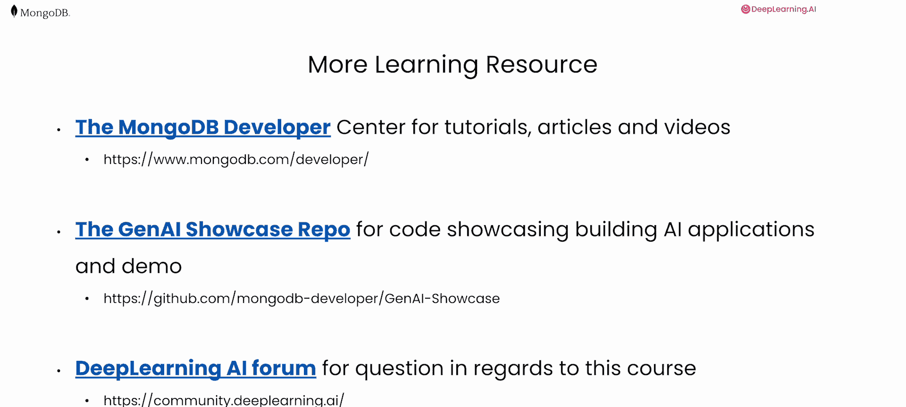
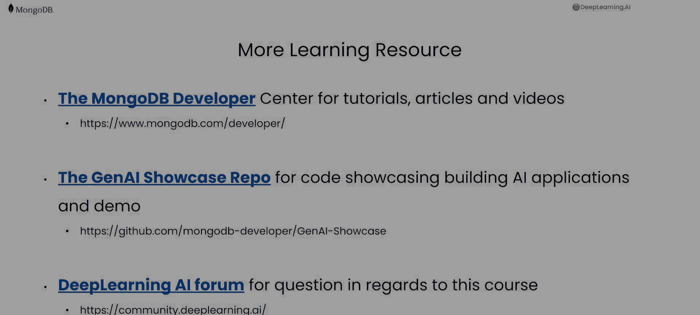

# 吴恩达《提示压缩和查询优化｜Prompt Compression and Query Optimization》中英字幕 - P7：7.conclusion - GPT中英字幕课程资源 - BV11x4y1x7m9

恭喜你完成了这门课程。在这门课程中，你实施了向量搜索。你通过使用元数据和一个 MongoDB 聚合管道来优化机架，系统，以提高系统效率和输出相关性。最后，你学会了如何通过使用提示压缩来降低大型语言模。

型应用的运营成本。我期待看到你自己会构建什么。这里有一些额外的资源，我建议你在完成这节课后看一看，第一个资源是 MongoDB 开发者中心，它包含了教程、文章，和视频，涵盖了与人工智能相关的各种主题。

接下来，你有生成式人工智能展示库。这里包含不同的代码，是一个展示 RAG 和智能体系统不同，用例的资源库。最后，深度学习人工智能论坛，在那里你可以就这门课程提。

