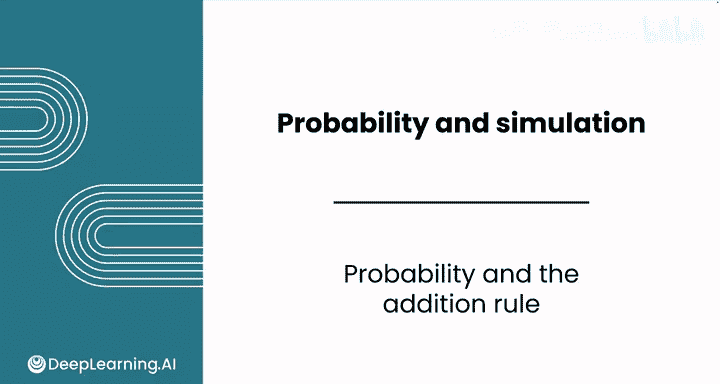
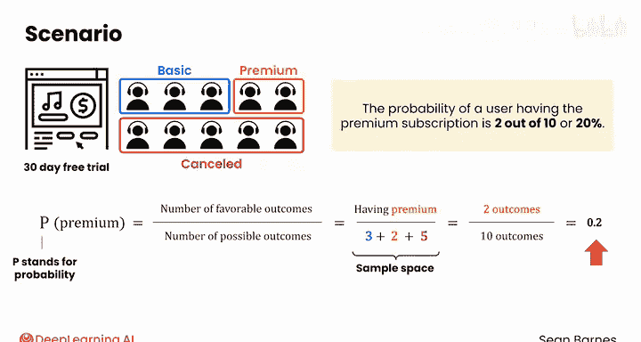
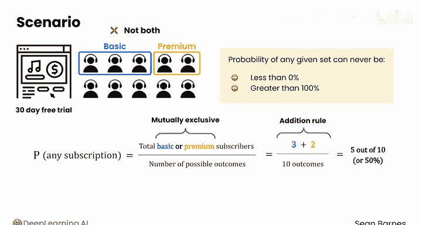

# 吴恩达《数据分析（数据分析基础／应用统计学，1-2课／共5课）｜DeepLearning.AI Data Analytics》中英字幕（claude-4-s - P100：29_概率与加法规则.zh_en - GPT中英字幕课程资源 - BV1SCXrYuEwr

Probability is the chance of an event occurring。

Whenever the outcome of an event is uncertain， you can use probability to talk about the chance of it occurring。

 If you flip a coin， the probability it lands on heads is  one and 2 or 50%。

 You have an intuition about the probabilities associated with this object。

 Let's formalize that intuition about probability using a real world example。

 Consider a music subscription service that offers a 30 day free trial to 10 customers at the end of the free trial。

 Custom can either continue with the basic subscription Upgrade to a premium subscription or cancel their subscription。

 You found that three customers chose the basic subscription。

2 chose the premium subscription and5 cancel their subscription。

 You'll meet three terms to talk about probability Exp event an outcome。

 say you choose a customer at random to interview about their experience。

 What is the likelihood that they chose the premium subscription。

 choosing a customer is called an experiment and probability。

 You are observing which outcome out of a set of outcomes actually occurred。

 a customer having the premium subscription is called the event。😊。

Civific set of outcomes you're interested in measuring there are two different customers with the premium subscription and choosing each of these customers is called an outcome of the experiment for the event。

 customer has a premium subscription。 There are two possible outcomes because you can pick either of the two customers at random What is the likelihood that they chose the premium subscription。

 Here's how you can write the probability of this event。P of premium P stands for probability。Now。

 how do you estimate this probability The probability of this event having the premium subscription is the number of favorable outcomes over the number of possible outcomes。

 The favorable outcomes are just the ones you're looking for In this case having the premium subscription you'll want to add up the number of possible outcomes in the denominator three people have basic two have premium and five canceled so in total 10 possible outcomes This set of outcomes is sometimes called the sample space your sampling from all these different outcomes and the event that you're interested in is having premium So in the numerator you have those two outcomes that make up this event so the probability of a user you chose at random having the premium subscription is two out of 10 or 20% Pro can be represented either as a proportion a number between 0 and1 like 0。

2 or as a percent like 20%。

What is the likelihood that you randomly pick a customer to interview with any subscription。

 The denominator stay the same with 10 possible outcomes in a sample space。 but in this case。

 you're interested in two different events。 So the total number of basic and premium subscribers Since these two groups are distinct from each other。

 Either someone shows the basic subscription or the premium one not both you can add them together in the numerator being separate in this way where an event can't be both outcomes at the same time is called being mutually exclusive if you got basic you couldn't have gotten premium So the outcomes you should include in the numerator are the three people with a basic subscription plus the two people with premium or 5 out of 10 or 50%。

 This is called the addition rule。 Not that you can only use the additional rule for mutually exclusive events。

 Notice that the probability of any given set of conditions can never be less than 0 or 0%。

 nor can it be greater than 1 or 100%。 there's nothing more frequently than literally always happening。

 which is what a probability of one means nor can there be a negative1。😊。

That something will happen。Probabilities can be combined in many different ways。

 follow me to the next video to learn about the multiplication and complement rules。

