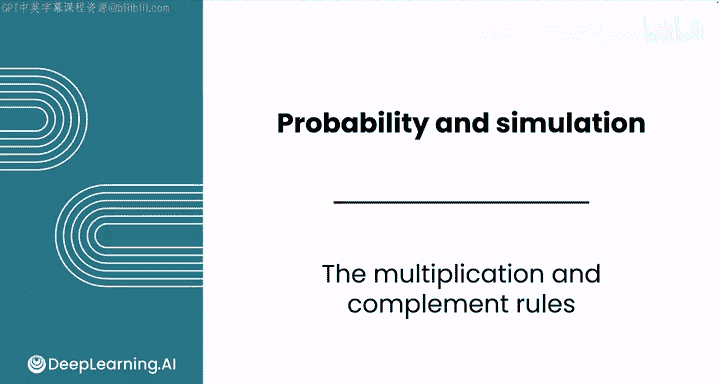
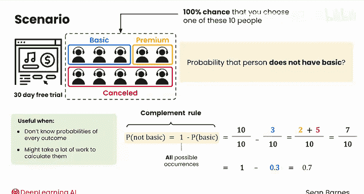

# 吴恩达《数据分析（数据分析基础／应用统计学，1-2课／共5课）｜DeepLearning.AI Data Analytics》中英字幕（claude-4-s - P101：30_乘法与补集规则.zh_en - GPT中英字幕课程资源 - BV1SCXrYuEwr

How can you determine the likelihood of two events occurred or of the opposite of an event occurring。

 Proability rules will help you reason mathematically about these cases。

 recall that in the previous videos， you were working with customers who received a free trial。

 You select one of these customers at random to interview。

 say you're collaborating with the marketing team and they plan to interview a user as well。

 What's the probability that you and the marketing team choosing users at random。

 both pick people with premium。 you can visualize this experiment in a table。 in each row。

 you have one of the 10 people you can pick for the data team。

 So three basic two premium and five cancelance。 and in each column。

 you have the people the marketing team can pick to interview with the same options。

 So B means both teams pick someone with basic B P means you pick someone with basic and marketing pick someone with premium and so on。

 This is the sample space with 10 times 10 or 100 possible outcomes。

 The outcomes you're interested in are where both people that were selected have the premium subscription。

 Can you spot those outcomes。😊。

In this case， there are four， you pick the fourth person and marketing picks them two， you pick four。

 marketing picks five， then five， four， and finally five and five。To calculate this probability。

 here's the notation P of premium premium， the probability that you choose a customer with premium and that marketing chooses someone with premium。

 you know that there's a two and1 chance that the customer you select chose premium and there's a  two and 10 chance that the customer selected by the marketing team chose premium so you can multiply these probabilitybabilities together2 over 10 times 2 over 10 equals 4 over 100 like you saw on the table or two over 50 or one over 25。

 This is called the multiplication rule， which applies to estimating the probability of independent events it's formally written as the probability of a and B equals the probability of a times the probability of B In this scenario。

 your selection of a person to interview is completely independent of the marketing team selection。

 Therefore， you can multiply the probabilitybabilities together。

 to calculate the probability of both outcomes happening together In the end。

 only one of every 25 experiments is likely to include two people who both had the premium subscription。

That makes sense because choosing premium was a relatively rare outcome in the first place。

 the probability of picking two people who both chose the premium subscription is lower than the chance of just picking one person with the premium subscription because there are so many possible outcomes that involve at least one person without premium。

Say you and your colleagues on the marketing team want to make sure not to pick the same person。

 In this case， you can't use the multiplication rule because these two events are independent。

 Your colleagues's choice depends on yours。 You'll learn much more about independence later in this lesson。

 For now， you can find the probability using this table First， define the sample space。

 count out the outcomes that fit the conditions。 So you and your coworker do not choose the same person。

 That includes all the outcomes except these 10 and this diagonal line。 So the denominator is 90。

 Then find the favorable outcomes。 previously， you had four favorable outcomes。

 But now two of these outcomes have been removed because they involve the same person twice。

 so you're left with two outcomes。 Therefore， the probability of selecting two different users with premium for the interviews is two out of 90 or about 2。

2%。 Finally， let's say you want to determine the probability that the person you randomly select to interview does not have the basic subscription。

 You can use the complement rule， which is essentially that the probability of not basic。

Is the same as one minus the probability of basic Since one represents all the possible occurrences。

 if you subtract out the probability of basic you're left with everything else。

 The complement rule is useful when you don't know the probabilities of every outcome or if it might take a lot of work to calculate them all to illustrate this example of p of not basic here are two probabilities the first is all 10 people in the numerator and the denominator which represents the one in this equation。

 there's 100% chance that you choose one of these 10 people。

 then you want to subtract the probability that you choose someone with basic。

 so in the denominator again you have all 10 people that's the sample space。

 then in the numerator the three people with basic and when you subtract these numbers what you have left。

 the same denominator， but with the two people who had premium plus the five people who canceled in the numerator so a 7 and10 chance of getting someone without the basic subscription or 70% and mathematically you can say P of not basic equals 1 minus p of basic which is 1 minus0。

3 which is 0。70% Now that you're familiar with the addition， multiplication and complement rules。

 join me in the next video to learn more about conditional probability。

