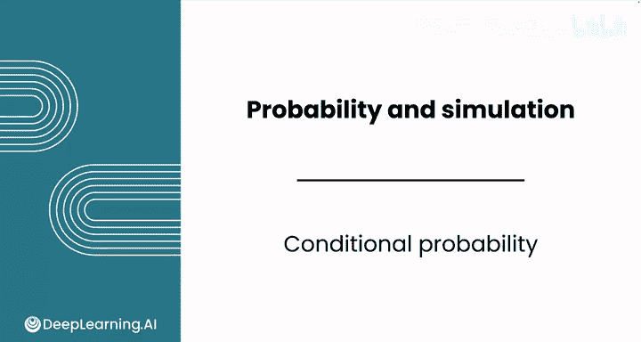
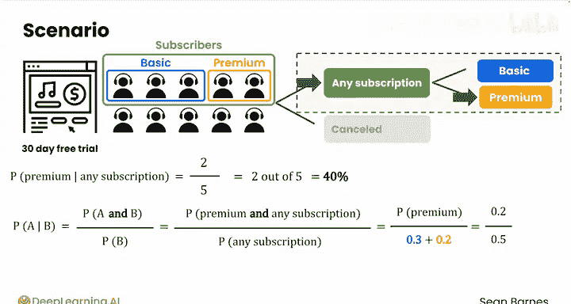
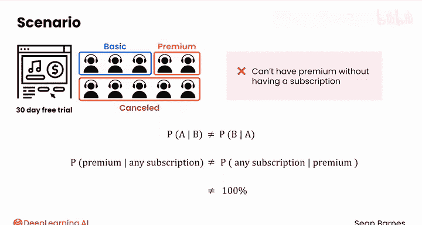
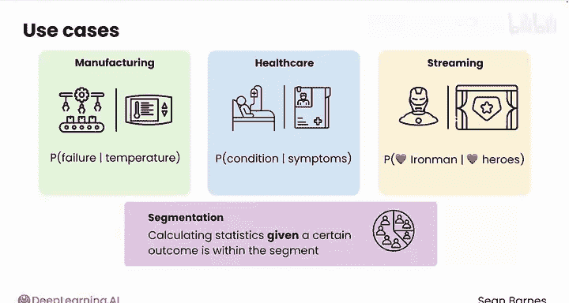

# 吴恩达《数据分析（数据分析基础／应用统计学，1-2课／共5课）｜DeepLearning.AI Data Analytics》中英字幕（claude-4-s - P102：31_条件概率.zh_en - GPT中英字幕课程资源 - BV1SCXrYuEwr

Oftentimes in the real world， two events aren't just ran on separate events。

 Some events can influence the probability of other events。

 and you can actually calculate the probability of one event happening。

 given the other already occurred。 That's conditional probability。

 Let's return to the idea of interviewing subscribers。

 sayy you want to calculate the probability that a person shows the premium subscription。

 if they got a subscription at all。 So ignoring the people who canceled。

 Here's how you formalize this concept。 You'd say the probability of premium， given any subscription。

 So this vertical line also called the pipe character is read as given。 more generally。

 conditional probability is represented as P of a， given B。

 A flowchar can help you visualize what's happening。 There are two branching events here。

 for the first， either the person got a subscription or they canceled。

 Then only if they got a subscription they either got basic or premium。

 What conditional probability does is it just looks at this branch of the diagram and asks。

 what's the chance that some。😊。

One in this group of subscribers got the premium subscription intuitivetuitively。

 you have narrowed down your sample space to just five people。 the subscribers。

 That's your denominator。 And now your numerator is the premium people of which there are2 giving you a probability of premium given any subscription of2 out of 5 or 40% Let's formalize and generalize that P of a given B is equal to P of a and B over P of In this case。

 P and B is the probability of having premium and having a subscription So in other words。

 the probability of having premium since you have to have a subscription to have premium So that's 0。

2 then the P of the probability of having any subscription。

 this includes the people with basic and premium So 0。3 plus 0。2 equals 0。5 that gives you 0。

2 over 0。5 which reduces to25s or 40% a quick note that P of a given B is not the same as P of B given a in the example here P of B given a would be the probability of having。

Subscription， given that you have a premium subscription， which is 100%。

 that's because you can't have a premium subscription without having a subscription in the first place。

 Conditional probability is widely they used in data analytics。

 You just saw the example with subscribers。 but you might also use conditional probability to address business questions like in manufacturing。

 what's the probability of equipment failure， given a certain temperature in the factory or in healthcare care。

 What's the probability a patient has a particular condition。

 given they exhibited specific symptoms or in streaming。

 what's the probability a given user will enjoy the new Ironman movie if they often watch other superhero movies。

 conditiondal probability is also related to segmentation。

 you learn previously that segmentation involves calculating your statistics。

 given that a certain outcome is within the segment of data you defined。 In other words。

 given that a certain condition is true。😊。

Some events in the world depend on each other。 So the outcome of one affects the probability of another。

 but some events are independent。 Their probabilities are completely separate。

Join me in the next video to learn more。