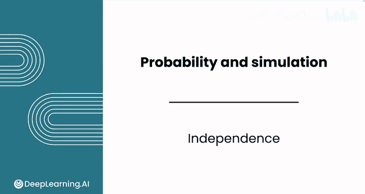
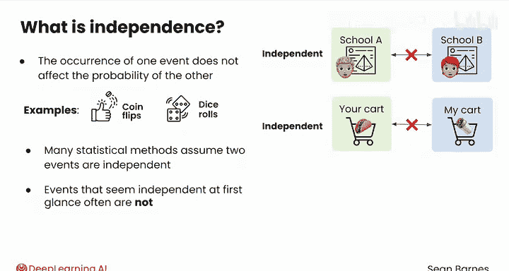
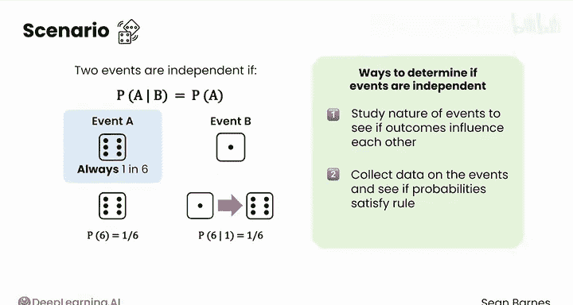
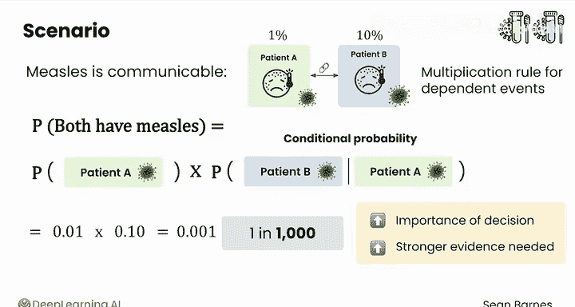

# 吴恩达《数据分析（数据分析基础／应用统计学，1-2课／共5课）｜DeepLearning.AI Data Analytics》中英字幕（claude-4-s - P103：32_独立性.zh_en - GPT中英字幕课程资源 - BV1SCXrYuEwr

Imagine you're playing a dice game and you're on a winning streak。

 Your last four rolls have all been sixes。😊。

What's the chance that your next role is also a6。 It's high， right？ Well， no。

 your chance enrolling a 6 is one and6。 Always， that's because the roles are independent。

 The previous four rolls have no effect whatsoever on the next one。

 In and statistics means that the occurrence of one event doesn't affect the probability of the other。

 Coin flips and dice roles are independent。 So are some realro events。 For example。

 two students are taking a geometry test at different high schools。

 Their scores won't affect each other。 You and I are shopping for groceries in our own cities。

 What you buy and what I buy are independent。 We both made our own decisions got different coupons and so on。

 whether or not two events are independent is a critical distinction。

 Many statistical methods rely on the assumption that two events are independent。

 Even though subtle connections may exist between the two of them。

 Event that seem independent at first glance often aren't。 For example。

 say you're testing two different patients for measles。 At first， the tests may seem independent。

 It's two different people， after all， how。😊。

However， measles is a highly communicable disease。 So if someone at a local clinic tests positive。

 it's more likely that others at the same clinic will have measles too。

 Let's return to dice for a moment。 Two events are considered independent and probability。

 If they satisfy or follow this rule。 The probability of a given B equals the probability of a。

 Here's an example。 say that your event A is rolling a6。 An event B is rolling a1。

 The probability of rolling a6。 P of a is one and6。

 Now say you roll two dice and the first role is a1。 the probability that you roll a6 and X。

 given that you just rule a one， or P of a given B is still one in 6。 no matter what you just roll。

 the probability of rolling a 6 is always one in 6。

 So these events follow the rule above and are considered independent。

 you can determine if events are independent in a couple of ways。 First。

 you can study the nature of the events to see if the outcomes influence each other。

 In the case of a die， the outcome of one rule doesn't provide any information to help you predict the next one however。

😊，In the real world， proving independence is rarely as easy as it is for dice。

 your other option is to test for independence by collecting data on the events and seeing if the probabilities satisfy this rule。

 non-independence affects many statistical calculations like the multiplication rule you saw earlier。

 if two events are independent， you can multiply their probabilitybabilities together to get the probability of both events occurring。

 However， if the events are not independent， like two measles tests at the same clinic。

 then the multiplication rule cannot be applied。 In the case of the measles tests。

 what's the chance of two people testing positive for measles at the same clinic。

 Imagine the probability of the first person having measles is 1%。

 If you assume the tests are independent， you'll conclude that the probability of the second person having measles is also 1% and multiplying these together gives you 0。

01 times 0。01 equals 0。00011 and 10000。

However， measles is highly communicable。 If the first person tests positive。

 the probability of the second person having measles might increase， to say 10%。 In this case。

 you would need to use the multiplication rule for dependent events。

 you would calculate p of both have measles equals P of first person has measles times p of second person has measles。

 given first person has measles。 The last term the conditional probability quantifies how much the first person having measles affects the chance that others around them have measles2。

 This equation comes out to 0。01 times 0。10， which equals 0。001 So one in 1000。

 So assuming that the two measles tests were independent gives you an estimate that's off by an order of magnitude or 10 times different。

 Remember， the more important a decision， the stronger the evidence you need。

 and determining whether two events are independent is one part of establishing rigor。😊。

So that's independence。Join me in the next and final video of this lesson to learn more about representing events using random variables。

