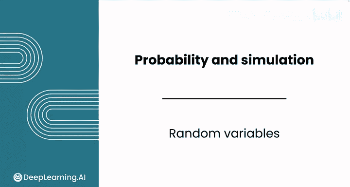
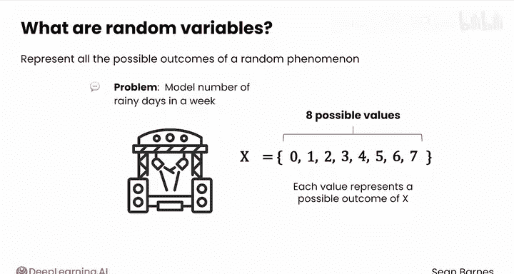
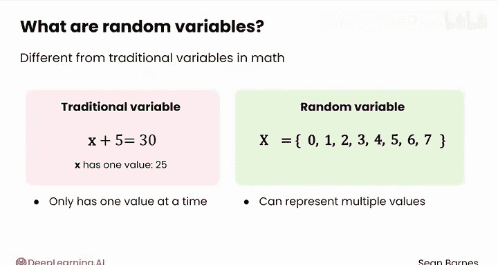
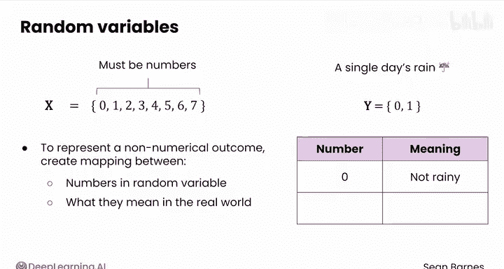
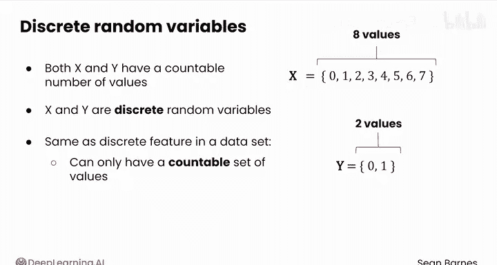
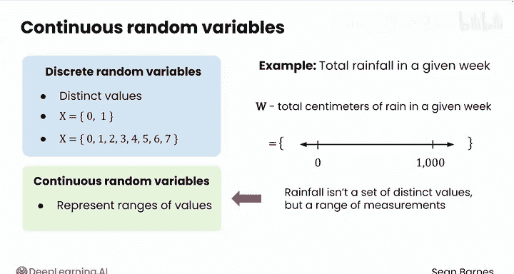
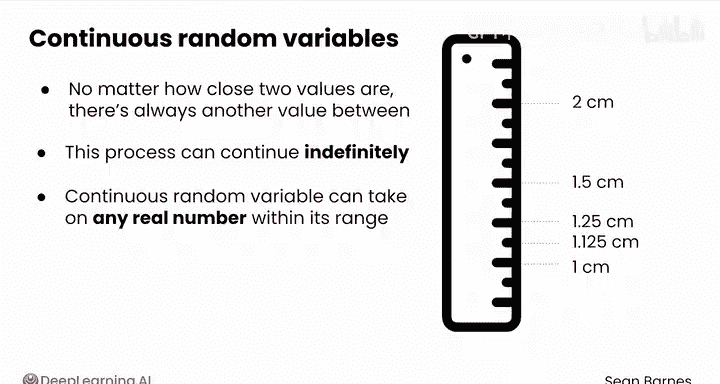
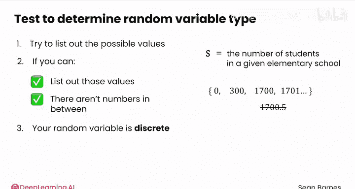
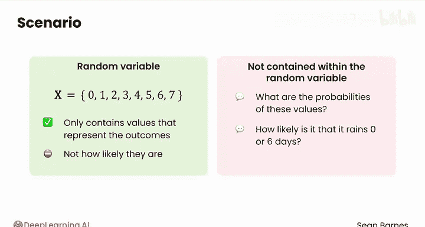

# 吴恩达《数据分析（数据分析基础／应用统计学，1-2课／共5课）｜DeepLearning.AI Data Analytics》中英字幕（claude-4-s - P104：33_随机变量.zh_en - GPT中英字幕课程资源 - BV1SCXrYuEwr

How do you represent all the possible outcomes of an event in a way that allows you to work with those outcomes mathematically For that purpose。

 data analysts use random variables。 Let's take a look。

Random variables represent all the possible outcomes of a random phenomenon。 As an example。

 say you're working with an outdoor event space， and they ask you to help model the number of rainy days in a week。

 You could do so with a random variable。 let's call it capital X。

 random variables are typically represented with capital letters。 weather is unpredictable。

 So a random variable makes sense here， What are all the possible outcomes of this random variable。

 Well， it could rain0 days in a week， one day， two days， all the way up to  seven days in that week。

 So there are8 possible values，0 through 7。 and each of these values represents a possible outcome of this random variable。

 You can see this type of variable is quite different from a traditional variable in math。

 which only has one value at a time。 if you have an equation like x plus5 equals 30。

 then x only has one value 25 randomand variables on the other hand can represent multiple values。

 Each corresponding to a possible outcome。 random variables make your probability notation much easier。

 when you want to say something like the probability of three days。😊。

Of rain instead of saying P of three days of rain， you can say P of x equals 3 or the probability that x takes on the value 3。

 the values represented by a random variable must be numbers。

 Otherwise you wouldn't be able to work with them mathematically。 However。

 if you want to represent a nonnu outcome you can create a mapping between the numbers in the random variable and what they mean in the real world。

 for example， you could represent a single day's rain with a random variable。

 capital y and have 0 represent not rainy and1 represent rainy。

 Not that both x and y have a countable number of values。

 X has8 y has2 because they each have a set of distinct values。

 Both x and y are what's called discrete random variables。

 This concept of discrete is the same as a discrete feature in a data。

 It can only have a countable set of values。 Since some phenomena in the real world can't be represented with distinct values。

 you can also have continuous random variables which represent ranges of values。 So， for example。

 for the same event company。

You might be interested in the total rainfall in a given week。

 You could have a random variable W represent the total centimeters of rain in a given week。

 In this case， W would add up 7 individual daily rainfall measurements each day could have any amount of rainfall including 0。

 So W could be any non-neg number。 Thely up to a very large amount。

 if you had an extremely rainy week。 W is considered a continuous random variable because rainfall isn' in a set of distinct values。

 but a range of measurements。 One way to think about why rainfall is continuous is that no matter how close two values are。

 there's always another value between them。 For example， take two rainfall amounts。

1 and two centimeters。 those are pretty close together， but between those values， you could have 1。

5 centimeters， and between one and 1。5 centimeters。 you could have 1。25 centimeters。

 and between those values， you could have 1。125 and so on。 this process can continue indefinitely。

 and this is really what is meant by the term continuous。😊。

In practical terms， your measurement precision might be limited by your tools。

 but in theory a continuous random variable can take on any real number within its range。

 so to figure out if the random variable you're working with is discrete or continuous what you can do is try to list out all the possible values it can take on and if you can actually list out those values and their art numbers in between then your random variable is discrete here's an example here's a random variable S representing the number of students in a given elementary school do you think S is a discrete or continuous random variable。

Well， let's try counting the values。 so you could have  zero students，300 students， maybe 1700。

 maybe 1701， but there couldn't be 1700。5 students。

 So these are separate values that you could actually list out with no other numbers in between。

 That makes us a discrete random variable。 Let's return to the random variable X。

 The number of days of rainfall in a given week。 You previously saw that the values of x can take on are 01 all the way through 7。

 but what are the probabilities of these values。 How likely is it in any given week that it rains zero days or six days。

 That information about the probabilities is not contained within the random variable itself。

 This distinction is a common point of confusion。 The random variable only contains the values that represent the outcomes。

 Not how likely they are。 You'll learn more about the probabilities associated with random variables in the next lesson。

 That sneak peak takes you to the end of this lesson on probability。 You defined it。

 learn its core rules and learn to represent。

Real world phenomena with random variables once youve finish the practice assessment and practice lab for this lesson。

 I hope you'll join me in the next one， which is all about estimation and discrete probability distributions I'll see you there。

