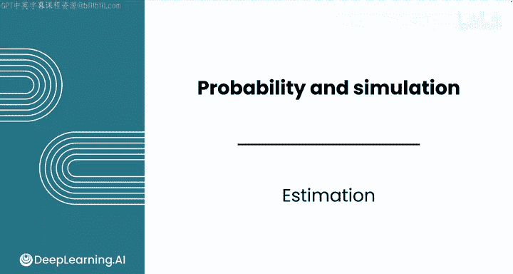
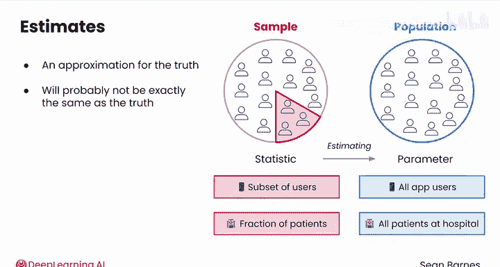
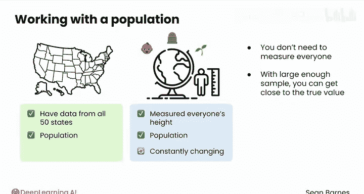
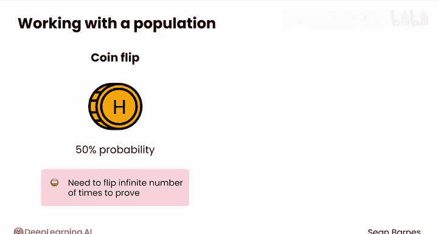
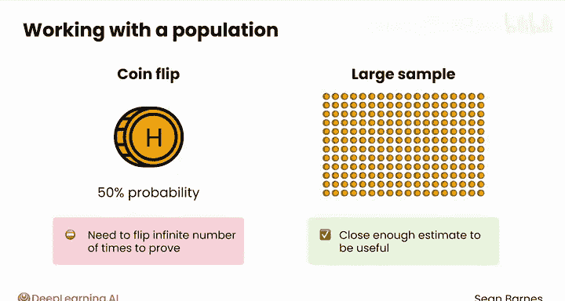
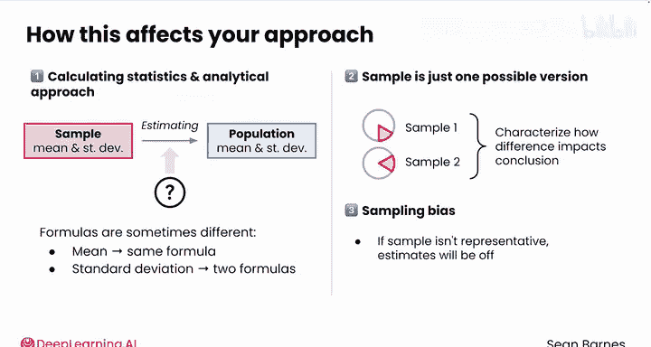

# 吴恩达《数据分析（数据分析基础／应用统计学，1-2课／共5课）｜DeepLearning.AI Data Analytics》中英字幕（claude-4-s - P105：34_估计.zh_en - GPT中英字幕课程资源 - BV1SCXrYuEwr

As you move forward in your statistics journey， it will become much more crucial for you to remember one key thing when working with your data。

 Is this a population or a sample， As you learned in the previous module。

 it's more than likely going to be a sample。 This matters because most statistics have different formulas and interpretations for samples and for the population。

😊。

When you calculate a statistic from a sample， what you're really doing is estimating the true population value。

 which statisticians call a parameter。 The estimate， the statistic is an approximation for the truth。

 the parameter。 you hope that your estimate is accurate but it will probably not be exactly the same as the truth。

 For example， you might be trying to understand the behavior of all app users using just a subset of those users or trying to understand healthcare outcomes for all patients at a hospital using just a fraction of them。

 any statistics you calculate on these samples will be an estimate for the true population parameter When might you be working with the population。

 Here's an example if you need information about all 50 US states and you have data from all 50 that's a population There's no guesswork about the other states that you did not include in your analysis。

 but it's usually more nuanced than that let's consider a thought experiment。

 imagine measuring everyone's height on earth put aside the logistics for a second and say you did it you measure everyone's heights。

 That's a population but even if you could do it。

By the time you finished， babies would have been born。 People would have died。

 Others would have grown taller。 You might know exactly the average height at that moment。

 but it would be constantly changing。 The beauty of statistics is that you really don't need to measure everyone with a large enough sample。

 you can get remarkably close to the true value。 It's the same with coin flips。 Theoretically。

 a fair coin has a 50% probability of landing on heads。

 but you need to flip in an infinite number of times to prove this fact absolutely。 In practice。

 a large sample gives you a close enough estimate to be useful。

 So how does this difference between populations and samples affect your approach as a data analyst。

 First， it has implications for the statistics you calculate and your analytical approach。

 when you calculate a mean or standard deviation from a sample， know that it's an estimate。

 There's some uncertainty about how well it represents the true population parameter。

 Note that the formulas you learn for mean and standard deviation and the previous module were all for samples。

 The formulas for populations are sometimes different。 For example， the population mean and。😊。

Sample mean or calculated the same way。 But the standard deviation has two different formulas。

 Second， when working with samples， it's important to remember that the data you're analyzing is just one possible version of that data。

 If you were to take another sample， you get slightly different results。

 Your job is to characterize how that difference impacts your conclusions。 Finally。

 you must be aware of the kinds of bias that your sampling method can introduce。

 If your sample isn't representative of the population， your estimates will be off。

 As the data analyst， you're often playing detective。

 you're using the clues from your sample to piece together the bigger picture of the population。

 Com up， you'll explore how sample distributions can help you estimate population distributions。

 Jo me in the next video to learn more。😊。

