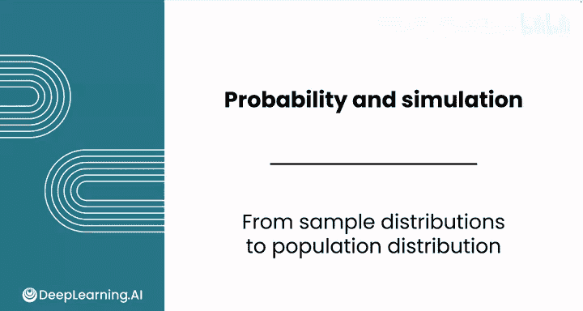
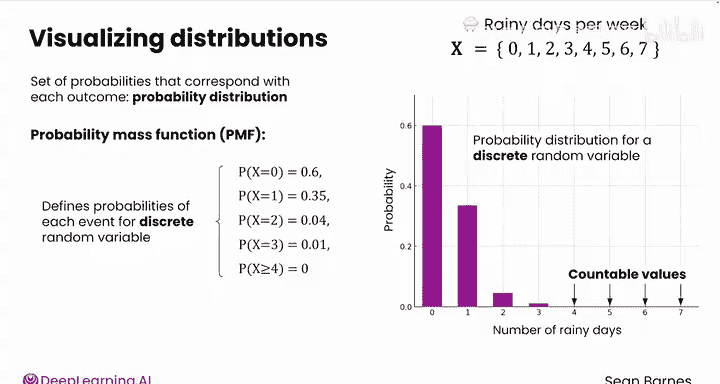
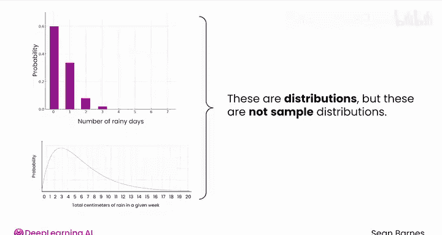
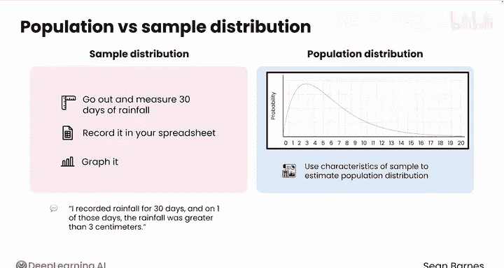
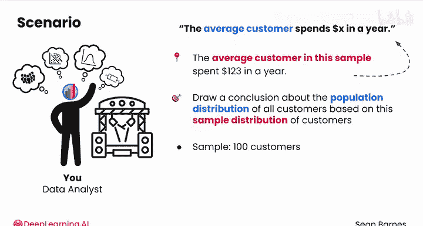

# 吴恩达《数据分析（数据分析基础／应用统计学，1-2课／共5课）｜DeepLearning.AI Data Analytics》中英字幕（claude-4-s - P106：35_从样本分布到总体分布.zh_en - GPT中英字幕课程资源 - BV1SCXrYuEwr

In the previous module， you worked extensively with sample distributions and learned that a distribution tells you how often different values occur in your sample data。

 But what's the next step， How can you use those sample distributions to draw conclusions about the broader population。

 sayy you're working with the random variable x from the previous lesson Ray days per week。

 recall that x could take on the value 0 all the way through 7。

 You want to visualize how common it is for a week to have each number of rainy days。

 The set of probabilitybabilities that correspond with each outcome in the random variable is called the probability distribution。

 If you were to visualize this probability。 You would have all the possible values of your random variable0 through 7 on the x axis and the probability of each of these outcomes on the y axis。

 say it's most common for there to be0 days of rain。 So for the value 0， the probability is 0。

6 for one， it's 0。35 for2， it's 0。04 for3， it's 0。01。 and maybe for4 and above the probability is 0。

 those events。😊。

this function， P of x equals 0 equals 0。6 P of x equals 1 is 0。

35 and so on is's called the probability mass function or PMmf。

 It defied the probabilities of each event occurring for a discrete random variable By the way this chart looks familiar right It's just a column chart with probability on the y axis。

 This is one example of a probability distribution for a discrete random variable。

 You have countable values on the x axis for your random variable x and you're visualizing how likely those events are on the y axis。

 here is the continuous random variable you saw in the previous lesson measuring rainfall。

 You can visualize this one too add the possible values for the random variable w to the x axis So starting with zero since you can't have negative rainfall and going up。

 let's just go up to 20 centimetersm of rainfall which is a decent amount of rain。

 Anything beyond that is increasingly unlikely。 Can you guess what will be on the y axis。

Annalogous to the columns in the discrete case， you can plot a curve where the points that are higher are more likely to occur。

 This curve is called the probability density function or Pdf。

 You can use the pdf to calculate the probability for a specific range of values。 In this case。

 you can't have individual bars because as you saw in the previous lesson。

 there are an infinite number of possible values。 As a result。

 you actually use a curve to represent the pdf for a continuous random variable。

 Now that you've seen these two probability distributions。

 There's one key distinction here that gets to the heart of statistics。

 These are distributions but these are not sample distributions。

 You didn't go out and measure 30 days of rainfall and record it in your spreadsheet and graphic。

 This is a model for a population distribution of rainfall。

 how all days of rainfall behave in a mathematical way。 Once you've taken a sample。

 you can use the characteristics of that sample distribution to estimate this population distribution。

 It's the difference between saying I recorded rainfall for 30 days and on one of those days the rainfall was greater than three centimeters。

😊。

And saying in general， there is a 4% chance that there will be three or more centimeters of rain on any given day。

 The first statement is about a sample distribution。 The second is about a population distribution。

 You took your sample data and drew a conclusion about the population。 It's exciting。

 This is the entire goal of statistics。 This is really what you've been building up to throughout this course and the previous one。

 Let's look at another concrete example。 say you're working with the same outdoor events company from earlier videos。

 and they've asked you to characterize how much each of its customers spends on tickets in a year。

 You take a simple random sample of 100 customers and tally up their spending for the year。

 You're able to characterize your sample distribution with descriptive statistics。

 So you calculated that the mean amount spent as $123 with a standard deviation of $15。

40 and the median amount spent is $100。 What now。😊。

You can use the sample distribution as is to communicate insights like the average customer in this sample spend $123 in a year。

 That's certainly useful。 but what you really want to say is something like the average customer spends X dollars in a year period you want to draw a conclusion about the population distribution of all customers based on this sample distribution of customers？

 How does the population of customers behave overall when it comes to spending。

 do the amounts cluster around some central point， If so， what is that central point。

 Is it a heavily skewed distribution， Is it highly variable or are the amounts quite similar to each other。

 Remember that your sample of 100 customers is your window into the truth。😊。

And ultimately， the point is to see the view， not to see the window。

 keep in mind that you can only ever estimate the truth。

Your window will always be at least a little dirty。

What's interesting about probability distributions is that both discrete and continuous populations often follow distributions with known behavior。

 followow me to the next video to take a look at one discrete probability distribution。

