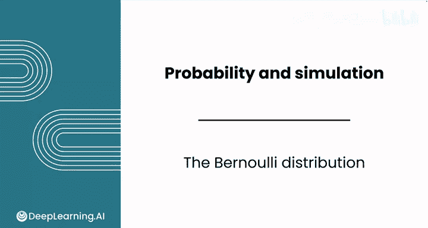
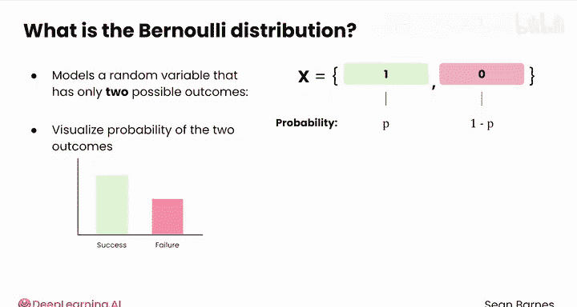
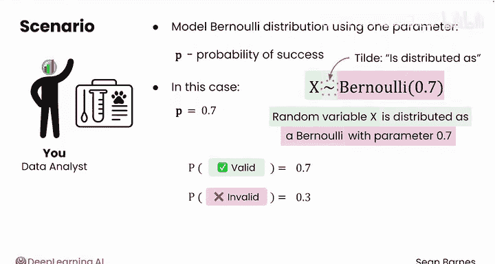
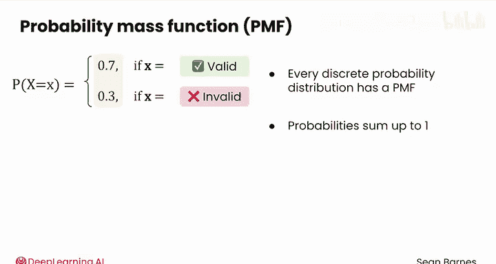
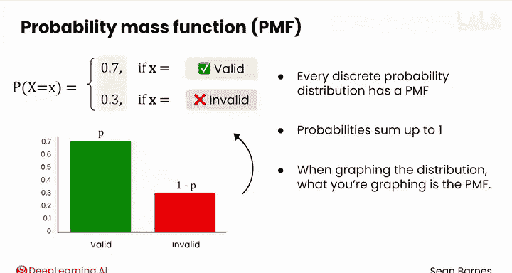
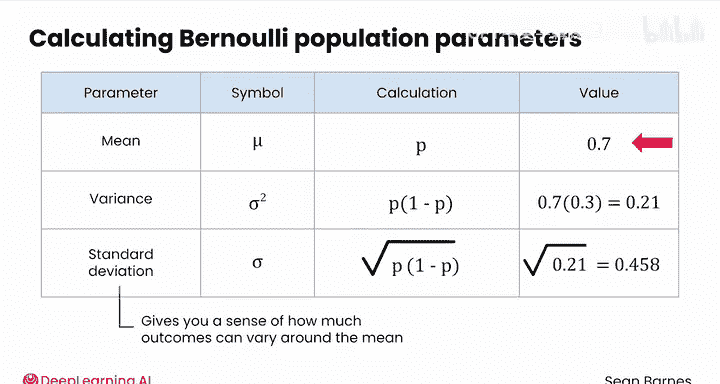

# 吴恩达《数据分析（数据分析基础／应用统计学，1-2课／共5课）｜DeepLearning.AI Data Analytics》中英字幕（claude-4-s - P107：36_伯努利分布.zh_en - GPT中英字幕课程资源 - BV1SCXrYuEwr

In data analytics， your goal is often to predict the behavior of a population of interest when you suspect your population follows certain patterns。

 you can use a known probability distribution to modeling their Bnolia distribution models a random variable that only has two possible outcomes success usually written as one with probability P and failure usually written as zero with probability 1 minus p。

 noticeice the complement rule in the definition of the probabilitybabilities for the two outcomes。

 similar to any other discrete probability distribution。

 you can visualize the probability of the two outcomes using a bar or column chart as well as calculate the population mean population variance and population standard deviation。

 Imagine you're working with K9 DNA samples collected using home test kits Comp offer these K9 DNA kits to identify genetic predispositions or a dog's breed You're working with the test lab to understand the distribution of invalid K9 DNA samples in the kits either a sample is valid or invalid usually because it was collected incorrectly by the owner。

Your partners at the lab tell you that the rate of which samples are valid is 70%。

 The lab is asking you， can you model the distribution of each sample's validity。

 modeling the probability distribution of valid and invalid samples allows the lab to set realistic expectations for its testing process you can model this distribution using the Bnoulli distribution。

 The Bnoulli distribution is appropriate for this scenario because first you have two possible outcomes。

 Each sample is either valid a success or invalid a failure。 And second。

 each sample has the same 70% chance of being valid。

 you can model your data using the Berulli distribution using only one key parameter P the probability of success。

 In this case， the probability of success represents the probability of getting a valid sample and is equal to 0。

7 to express this distribution you'll commonly see notation like this。 some random variable。

 say X is distributed as a Bnoulli with parameter 0。

7 more generally for any random variable you'll see。

Theilde for is distributed as followed by the distribution。

 then the parameters for that distribution。 Bernoulli only has one parameter。

 Let's look at the probabilities of each outcome in this distribution。 P of valid is 0。7。

 And can you guess P of invalid。P of inV is 0。3 using the complement rule。

Recall that this set of outcomes and their probabilities is called the probability mass function or PMmF。

 It's not unique to the Bernoulli distribution。 Every discrete probability distribution has a probability mass function。

 Notice that the probabilities across all of the outcomes sum up to one。

 Can you imagine what a column chart of this distribution would look like。

Here's a column chart of this Bnoly distribution。 This is a graph of the two outcomes。

 valid or success， an invalid or failure with probabilities P and 1 minus p respectively。

 notice that when graphing the distribution， what you're actually graphing is the PMmF。

You can also calculate mean variance and standard deviation for this distribution。

 which are all population parameters and have different notation than the sample statistics you calculated previously。

 The mean of the bernourli distribution， represented by the s mu is equal to p。

 The probability of success。 intuitively， thinking about the K9 DNA sample validity。

 If the chance of a sample being valid as 0。7， then for many samples over time。

 the probability of each sample being valid is the same。

 you can also calculate the variance of a bernourli distribution Sigma squared。

 which is p times 1 minus p， or in this case，0。7 times 0。3 or 0。21。 Finally。

 you previously learn that the standard deviation represented by sigma is the square root of the variance。

 So here， sigma is about 0。458。 the standard deviation gives you a sense of how much outcomes can vary around the mean In this case。

 the outcomes are either 0 or1。 So it makes sense that there is some variation around the mean。😊。

To recap mu， Sigma squared and Sigma are population parameters while x bar as squared at S are only for sample distributions。

What's cool about the Bernoulli distribution is that it can be extended into the binomial distribution。

 which models multiple trials。 So， for example， out of 10 random DNA test kits。

 what is the probability that all 10 are valid samples follow me to the next video to take a look。😊。

