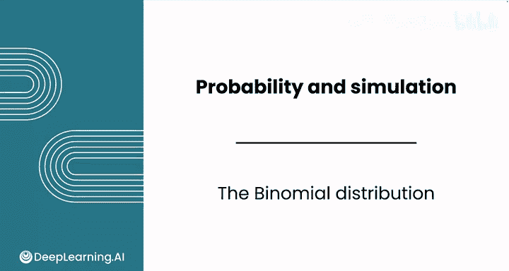
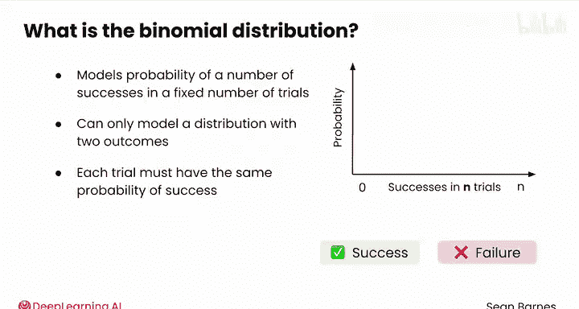
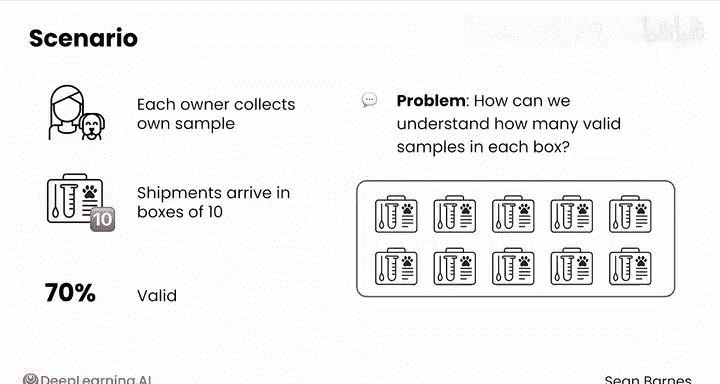
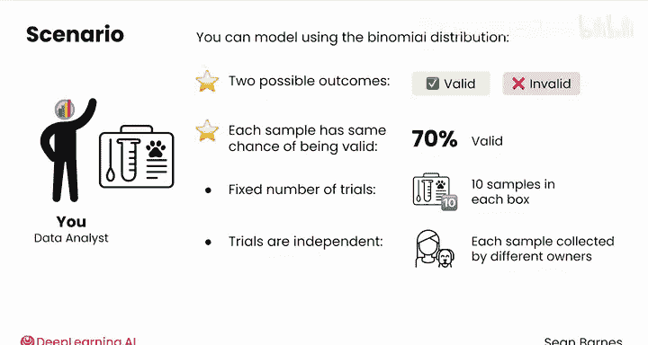
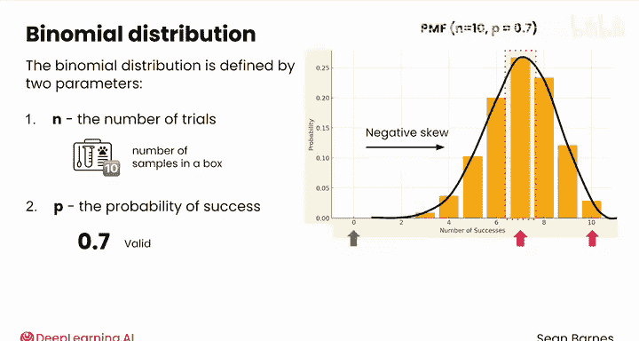
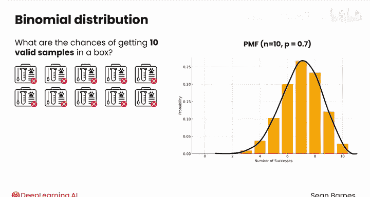
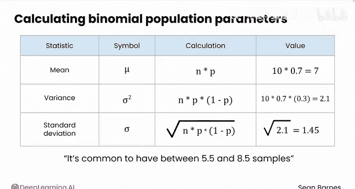
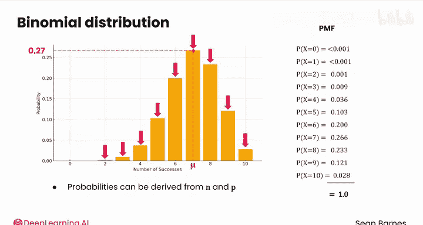
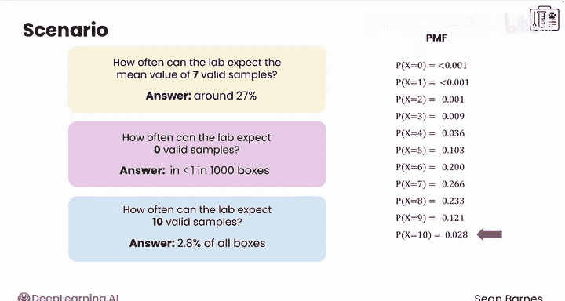

# 吴恩达《数据分析（数据分析基础／应用统计学，1-2课／共5课）｜DeepLearning.AI Data Analytics》中英字幕（claude-4-s - P108：37_二项分布.zh_en - GPT中英字幕课程资源 - BV1SCXrYuEwr

In the previous video， you model the distribution of sample validity for a single DNA test kit。

 Now you'll model the distribution of validity for many samples using the binomial distribution。

 The binomial distribution models the probability of a specific number of successes in a fixed number of independent trials。

 It can only model a distribution with exactly two outcomes like success and failure by means2。

 After all， An each trial must have the same probability of success。

 The binomial distribution as a discrete probability distribution。

 and the number of successes can range from zero to the number of trials。

Say your partners at the K9 DNA lab tell you that each individual owner collects their own sample。

 but shipments arrive in boxes of 10， These are the same samples that you previously learned are valid at a rate of 70%。

 The lab is asking you， how can we understand how many valid samples are in each box？

Moodeling the DNA test kit scenario with a probability distribution will allow the lab to estimate how many valid samples they're likely to get in each box on average。

 determine the probability of getting a critically low number of valid samples and set realistic expectations for their testing process。

 You can model this distribution using the binomial distribution。 Here's why。 First。

 you have two possible outcomes。 Each sample is either valid， a success or invalid a failure。

 Each sample has the same 70% chance of being valid。

 You have a fixed number of trials since there are 10 samples in each box。 And finally。

 you assume the trials are independent， because the validity of one sample doesn't appear to affect the others。

 They are each collected by different pet owners note that independent is just an assumption。

 and you can't be 100% certain。 the samples are truly independent。

 Do these conditionss look familiar。Two of them match the Bernoulli distribution。

 having two possible outcomes and having a fixed chance for success。

 That's because the Bernoulli distribution is a special case of the binomial distribution。

 where there is only one trial。 The binomial distribution is defined by two parameters and the number of trials。

 In this case， the number of samples in a box。 and P。

 the same probability of success from the Brnoulli distribution 0。7。

 You can write this distribution as x is distributed as a binomial with parameters n equals 10 and p equals 0。

7。 These two parameters defined the shape of the distribution。

 Let's visualize the probability mass function or PMmF。

 Here's what it looks like for n equals 10 and p equals 0。7。

 Each possible outcome is on the x axis from 0 valid samples to 10。

 and on the y axis is the probability of any given box containing that number of valid samples。

 The distribution is centered around 7。 and forms a roughly symmetrical bell shaped distribution。😊。

On that center， there are some negative skekuws of the distribution because you can't get values higher than 10。

 The rough bell shaped distribution reflects the idea that it's increasingly more unlikely to get a box of samples with increasingly greater or smaller numbers of valid samples。

 What do you think is the chance of getting all 10 valid samples in a box。

You can use the multiplication rule to calculate the probability of 0。7 times itself 10 times or 0。

7 raised to the 10， which judging by the graph is around 0。025 What about getting 0 valid samples？

Similarly，0 valid samples is 0。3 times itself 10 times or 0。3 to the 10th。

 which is a vanishingly small number for cases other than 0 in 10 valid samples。

 their probability becomes much more complicated since you have to account for all the different ways samples can be configured in a box As with any other probability distribution。

 you can calculate various population parameters such as the mean variance and standard deviation。

 First， the mean。

In the binomial distribution， the mean is n times p。 In this case，10 samples per box times 0。

7 equals 7。 You expect 7 valid samples on average。 Then the variance。

 which is calculated as n times p times 1 minus p。 the variance measures the spread of your distribution。

 In this case， you multiply 10 times 0。7， So 7， which is the same as the mean。

 then multipied by 1 minus-0。7 or 0。3， which gives you 2。1。

 the standard deviation is calculated from the variance in the same manner as you've seen before。

 just by taking the square root， giving you the square root of 2。1 and a standard deviation of 1。45。

 Since the standard deviation is in the same units as our data， in this case。

 samples and the distribution is roughly symmetrical。

 you can say with relative confidence that it's common to have between 5。5 and 8。

5 valid samples or within one standard deviation of the mean the binomial distribution also allows you to calculate the probability。

That a specific number of samples in the box is valid or invalid。

 which corresponds to each of these bars， approxiating from the graph。

 you can see that the mean of 7 is most common at a probability of around 0。27。

Here is the full probability and mass function for this binomial distribution。

 If you add up all these values， they sum to one for the binommial distribution。

 you'll never need to calculate these values by hand since computers make the process much easier。

 but just know that all these probabilities can be derived from just N& P。

 Let's use these probabilities to analyze the DNA testing outcomes。

 I encourage you to pause the video and try answering the questions。 First。

 how often can the lab expect the mean value of seven valid samples。

That would be around 27% of the time， What about zero valid samples？That outcome is very rare。

 occurring in less than one and1 thousand boxes of samples。

Having all 10 valid samples is a relatively rare outcome， but not as rare as zero valid。

 occurring in about 2。8% of all boxes。

You can answer so many interesting questions using the binomial distribution in the next video。

 you'll see how to answer even more using its cumulative distribution function。

 follow me to the next video to learn more。