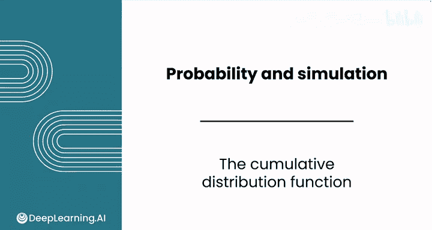
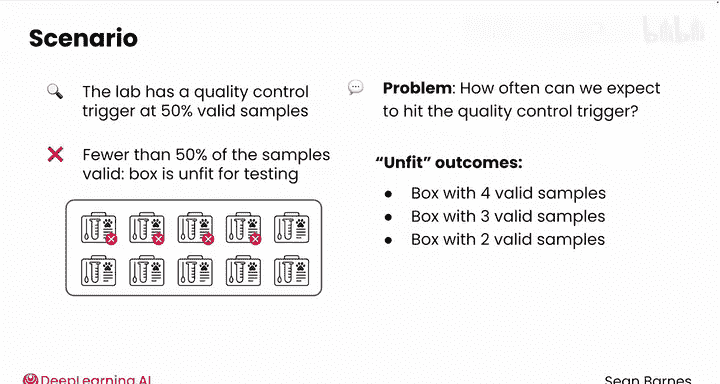
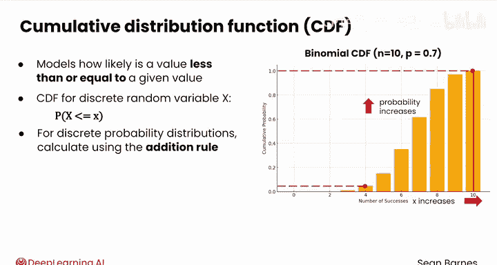
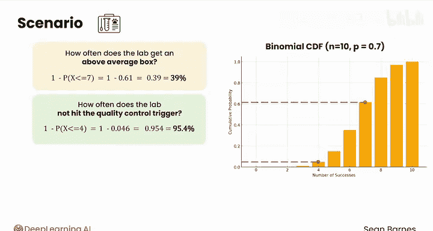
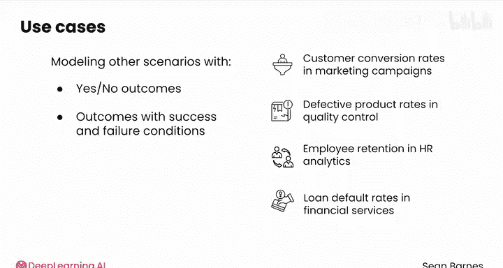

# 吴恩达《数据分析（数据分析基础／应用统计学，1-2课／共5课）｜DeepLearning.AI Data Analytics》中英字幕（claude-4-s - P109：38_累积分布函数.zh_en - GPT中英字幕课程资源 - BV1SCXrYuEwr

In some cases， you're interested in the probability of a range of outcomes。

 not just the probability of a single outcome to calculate these probabilities。

 you'll need a new tool。 Imagine that the lab from the previous video has a quality control trigger at 50% valid samples If fewer than 50% of the samples are valid then the box is deemed unfit for testing and customers are reissued a new kit your friends at the lab might come to you and say how often can we expect to hit that quality control trigger。

 In this case， you're not just interested in the outcome with four valid samples。

 A box with three valid samples would also be unfit for testing as with boxes with21 or zero valid samples to answer this question you can use the cumulative distribution function or CDf of the binomial distribution the CDf models how likely it is for a random variable to take on a value less than or equal to a given value Forly。

 the CDf for a discrete random variable capital X is defined as P of capital X is less than or equal to lowercase X。

 Here's what the CDf looks like。

For the binomial distribution with n equals 10 and p equals 0。7。 it has the same axes as the P andF。

 you can see that as x increases， the probability only goes up endingning at x equals 10 or less with the probability of1 the CDF makes it clear that the probability of getting a box with4 or fewer valid samples is less than 5% for discrete probability distributions you can calculate the CDf using the addition rule for the probability of getting4 or fewer valid samples in a box Add the probabilitybabilities of each outcome occurring。

 ignoring the probabilitybabilities of 0 and1 valid samples， which are extremely rare。

 you can add up p of x equals 2 which is 0。001 P of x equals3 at 0。

009 and p of x equals 4 which is 0。036 and you get about 0。046 about 4。

6% of the time By summing probabilities， you can also answer questions like How often does the lab get an above average box。

What do you think， pause the video and see if you can estimate it。In that case。

 you can use the complement rule，1 minus P of x less than or equals to 7， which is around 0。61。

 so you might estimate about 0。39 or 39% of the time， and similarly。

 you can apply the complement rule for the question。

 how often does the lab not hit the quality control trigger？

The answer is one minus the chance of hitting it， so 1 minus 0。046 or 0。954。

Since the DNA sample boxes fit the conditions for modeling with the binomial distribution。

 you were able to answer a lot of useful questions， like where is the center of this distribution。

 what is the variability and how common are different outcomes or ranges of outcomesBeyond DNA testing kits in data analytics the binomial distribution is incredibly useful for modeling other scenarios with yes or no outcomes or outcomes with success and failure conditions like customer conversion rates and marketing campaigns。

 defective product rates and quality control employee retention and HR analytics and loan default rates and financial services both the Bernoulli and binomial distributions are useful discrete probability distributions how can you determine the many possible outcomes of sampling from these distributions you'll find out in the next video。

😊。

