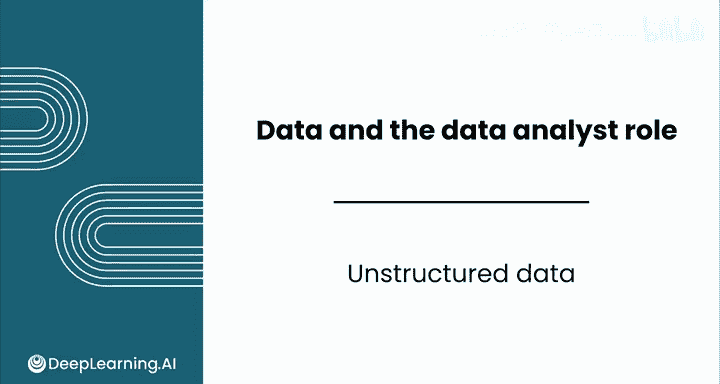
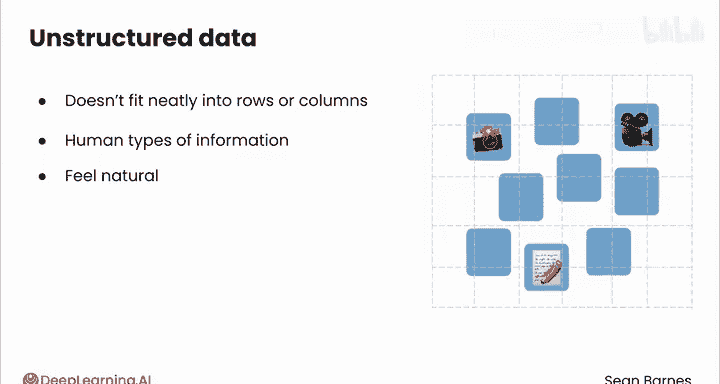
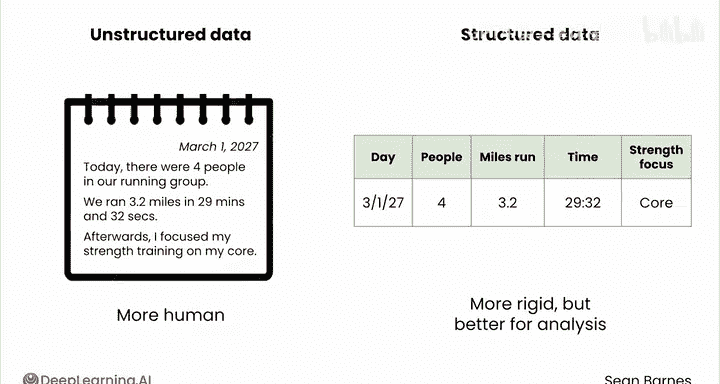
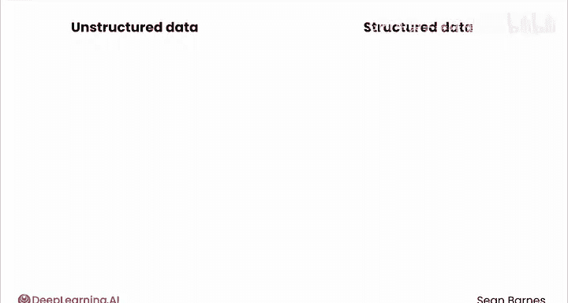
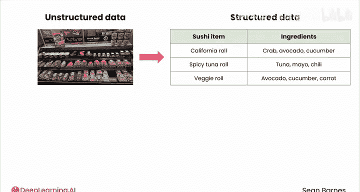
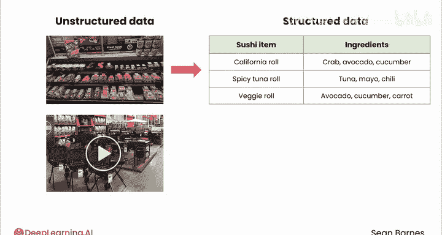
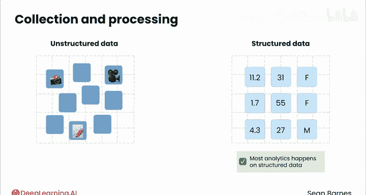
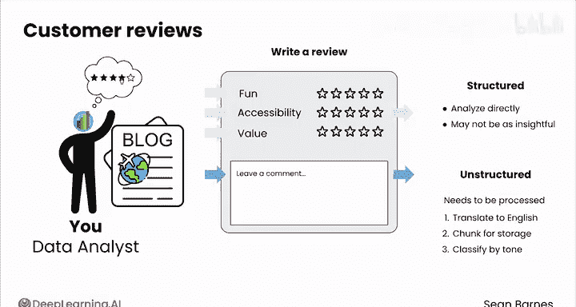
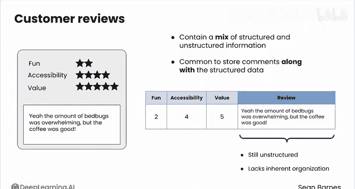

# 吴恩达《数据分析（数据分析基础／应用统计学，1-2课／共5课）｜DeepLearning.AI Data Analytics》中英字幕（claude-4-s - P10：9_非结构化数据.zh_en - GPT中英字幕课程资源 - BV1SCXrYuEwr

Close your eyes for a second， No， like actually do with me and picture your data。Okay。

 open your eyes what did you think of Was it something like this。

 a table of numbers and meet rows and columns， it's the most stereotypical depiction of data。

 but the reality is a lot of the data you will encounter in the real world doesn't start out that way it's what we call unstructured data。

To get more specific unstructured data means data that doesn't fit neatly into rows or columns。

 It's all around us。 When you snap a photo， record a video or jo down notes in a journal。

 you're creating unstructured data。 these are human types of information and they feel very natural to us。

 In fact， if you're just a person collecting data for yourself you'll probably do it in an unstructured way without even thinking about it。

 Maybe you just keep a journal to track your workouts with friends。

 it might look something like this Today there were four people in our running group。 we ran 3。

2 miles and 29 minutes and 32 seconds。 and afterwards， I focus my strength training on my core。

 This information could be organized in a structured way too like in this table where each exercise detail is a column and each day is a row。

 you can see the one on the left is more human and natural while the one on the right is more rigid but better for analysis So to summarize text data like your original journal entry is considered unstructured。

Here are some more examples of unstructured data Earler this week。

 I took a photo of the sushi options at the grocery store so my wife could pick one。

 That's unstructured。 if it was structured， maybe it would be more like a menu with each item and its ingredients listed neatly I also recorded a video of several potential grill options at the hardware store which is unstructured data as well if I had to put it in rows and columns What would I put maybe I could record each option in a row including the price。

 warranty link and a score from one to5 representing how much I liked each one to summarize photos and videos are unstructured Why does this distinction between structured and unstructured data manner。

 It's all about how the data gets collected and processed At some point all of this unstructured data usually needs to be converted into a structured format to be analyzed effectively most data analytics is happening onstructured data although modern techniques are getting better at analyzing unstructured data directly We'll talk more about structured data in。

Since most data doesn't start out in rows and columns。

 it often undergoes a transformation into a structured form as a data analyst。

 you should be mindful of the origins of your data because whether it's structured or not often affects how easy it it is to preprocess and analyze unstructured data typically requires more steps before it becomes useful but it's also more natural for a person to generate and can contain unexpected insights due to its level of detail let's say you're working with customer reviews from a travel blogging site My aspirational job reviewers can rate locations one through five on fun accessibility and value then leave a comment the common data is being generated in an unstructured way。

 it's just freeform text behind the scenes that text will need to be processed with steps like translating to English chunking for storage in a database and classifying by positive or negative tone Meanwhile the one through five ratings can be analyzed pretty directly say to find an average rating。

Each location but may not be as insightful as the comments where reviewers can offer insights like yeah the amount of bedbugs was overwhelming。

 but the coffee was good these reviews contain a mix of structure and unstructured information even though the comments are unstructured it's common to store them along with the structured data for example you could store your review data like this with each row representing a review numbers for the different ratings and then a column that contains the comment this comment is still unstructured because it lacks an inherent organization people can write whatever they want more on this technique and the next video。

Unstructured data is a natural byproduct of how we capture and communicate information as humans。

 it's a raw material that needs to be organized before it can generate insights in the next video we'll discuss structured data and why it even exists in the first place。

 I'll see you there。