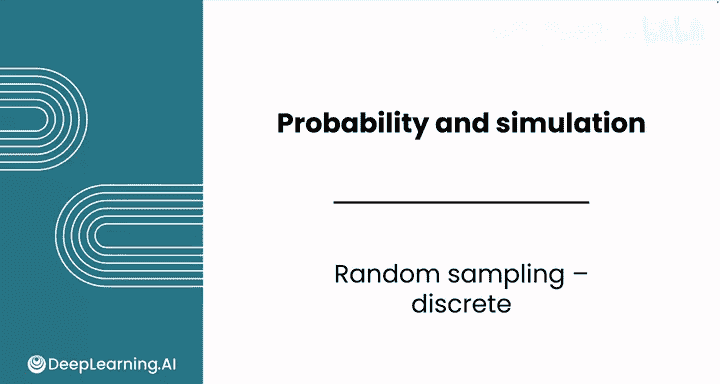
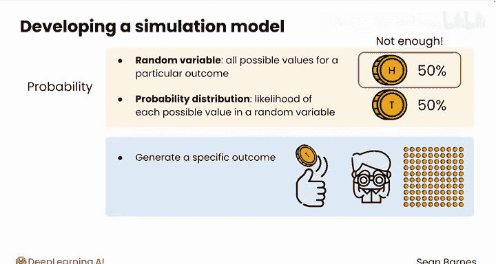
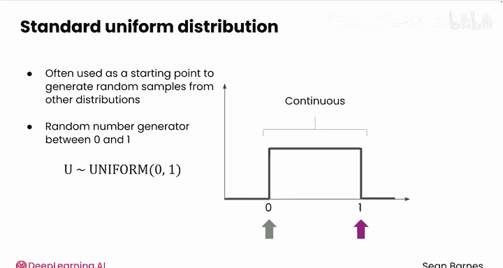
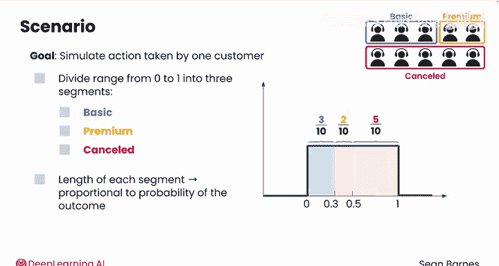
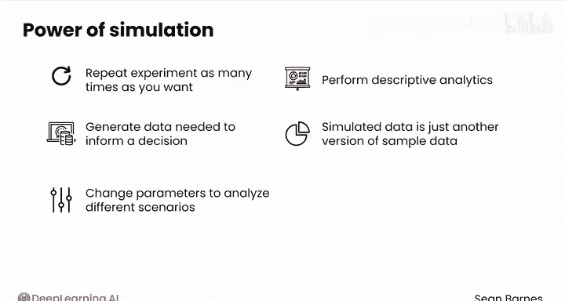

# 吴恩达《数据分析（数据分析基础／应用统计学，1-2课／共5课）｜DeepLearning.AI Data Analytics》中英字幕（claude-4-s - P110：39_离散型随机抽样.zh_en - GPT中英字幕课程资源 - BV1SCXrYuEwr

Just like you can sample from a population in the real world。

 you can also sample from a known probability distribution to generate simulated data。

 You can then analyze that simulated data to inform business decisions。

 This process is known as random sampling。

At the end of the first lesson， you learn the concept of a random variable。

 which represents all of the possible values for a particular outcome of interest。 In this lesson。

 you extended the idea of random variables into probability distributions。

 which represent the likelihood of each possible value for a given random variable in order to develop a simulation model。

 you need to generate a specific outcome that represents the real worldl behavior that you are trying to model。

 For instance， it's not enough to know that there's a 50% chance of flipping a coin and landing on heads。

 You want to simulate that coin flip and observe the actual outcome， Was it heads， or was it tails。

 And if you simulated a coin flip 10 times。 How many heads did you get without the individual outcomes。

 you can only analyze what might happen。 not what actually happens in the simulation。

 randomom sampling allows you to simulate outcomes that behave according to a probability distribution。

 So if you know that a given outcome follows a binomial distribution。

 you can simulate outcomes according to the given probability of success P the standard。😊。

For distribution is often used as a starting point to generate random samples from other distributions。

 The standard uniform distribution is basically a fancy term for a random number generator between 0 and1。

 More formally， the standard uniform distribution is continuous and it has a minimum of0 and a maximum of 1 inclusive。

 you can represent a uniform random variable as u is distributed as uniform01。

 it even has its own function in spreadsheets R Here's an example of the random function in action。

 you can see that it generates values between 0 and1。

 This function simulates one outcome from the standard uniform distribution。

 The standard uniform distribution can be used to generate random samples for many other distributions。

 For example， to simulate the validity of 19 DNA test kit。

 you can first generate a random sample between 0 and1 using RA。

 Then if the number is less than or equal to 0。7。 consider the test valid。 Otherwise。

 the number is greater than 0。7 and the test is。

あ？This method works because the uniform distribution has equal probability throughout its range of potential values。

 So the probability that a generated random value is less than or equal to 0。7 is 0。7。

 which is exactly the probability for valid test。 and similarly。

 the probability that the value is greater than 0。7。

 is the same as the probability of an invalid test，0。3。

 You can extend this principle to simulate more complex discrete scenarios。 For instance。

 Think back to the music subscription service that offered its customer a free trial。

 recall that customers could either subscribe to the basic plan。

 upgradegrade to premium or cancel their subscription at the end of the trial。

 to simulate the action taken by one customer， you could divide the range from 0 to 1 into three segments。

 each representing one of the three decisions made by the customer。

 basic premium or cancel The key to making this work is that the length of each segment needs to be proportional to the probability of the associated outcome。

 So the length of。😊，The basic segment should be three tenths of the range。

 The premium segment should be two tenths of the range and the cancel segment should be the remaining five1s of the range specifically you could draw from the standard uniform distribution and if the value is less than or equal to 0。

3 then you simulate a basic subscription。 If the value was between 0。3 and 0。

5 inclusive then you simulate a premium subscription。 Otherwise， if the value is greater than 0。5。

 you simulate a cancellation。 the power and simulation is that you can repeat or replicate the individual experiment as many times as you want you can't say the same for the real world where collecting samples is often costly and time consuming。

 This capability to replicate provides you as a data analyst with the opportunity to generate the data needed to inform a decision。

 you can also change the simulation's parameters in order to analyze different scenarios Once you have generated your desired sample size。

 you can then perform any of the descriptive analytics that you have learned so far。 your simulate。

Data becomes just another version of sample data that you can analyze using all of these techniques。

Let's see this in action。 join me in the next video to create Bnoulli and binomial simulations in a spreadsheet。

