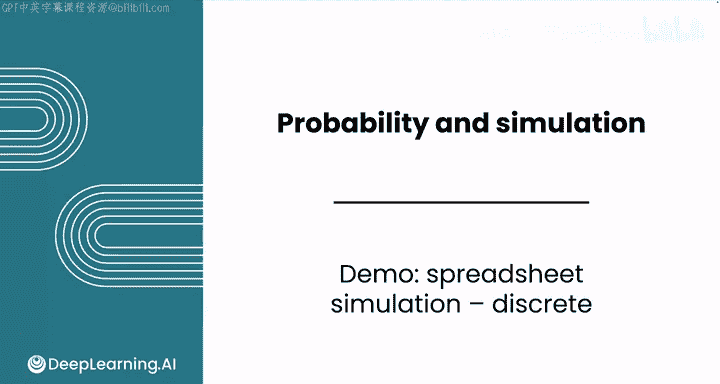
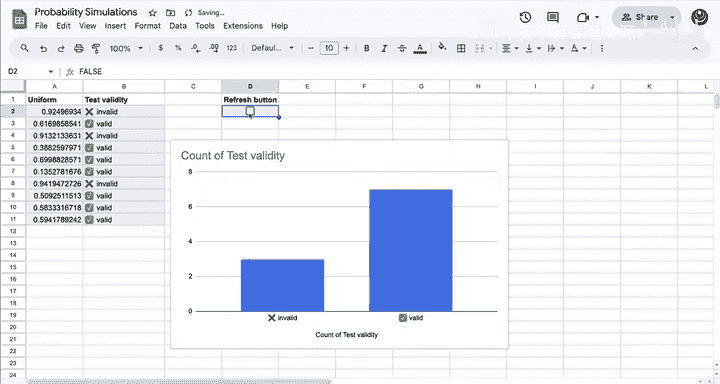
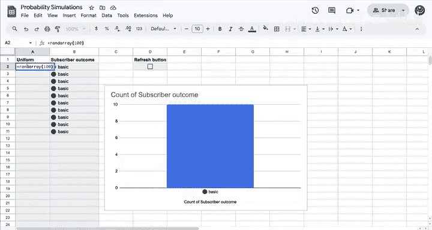

# 吴恩达《数据分析（数据分析基础／应用统计学，1-2课／共5课）｜DeepLearning.AI Data Analytics》中英字幕（claude-4-s - P111：40_演示：电子表格模拟离散分布.zh_en - GPT中英字幕课程资源 - BV1SCXrYuEwr

Let's see how you can actually run simulations using a spreadsheet。 There's a lot you can do。

 and as you get more familiar with tools like Python。

 you'll be able to simulate more and more complex scenarios as well。

 Let's start off with the DNA test kit scenario。 if you test the samples validity there's a chance that it's destroyed in the process which is inconvenient and expensive since you know the probability of validity you can instead simulate the outcomes of many boxes mathematically to help your friends at the lab understand the likelihood of hitting their quality control trigger。

 you are developing a simulation model for this scenario。

 remember if you'd like to follow along with the demo you can find the spreadsheet and the solution in the downloads tab。

 So suppose you've set up a sheet like this to run your simulation model you have a column for the random samples from your standard uniform distribution and then you have a column for the outcome of your test use the random function which will generate a random sample from the standard normal distribution。

😊。

In this case， you can see a result of around 0。80。 Anytime you execute a function or a formula in the spreadsheet。

 the random function will generate a new value， which falls between 0 and 1， as you'd expect。

 Now you want to use this number to simulate the validity of a single test。

 Here's an expression you can use。 The first condition in the if statement is checking to see if the random sample you generated is less than or equal to 0。

7， which is the probability of a valid test。 if this condition is true。

 then you would simulate a valid test。 Otherwise， you would simulate an invalid test。

 let's execute the cell and see what the result says。

Notice that the random sample in the a column reset to a different number。

 the result of the test is invalid since the random number itself is greater than 0。7 Great okay。

 you've now simulated your first test result Next you actually want to replicate the simulation for 10 DNA test kits so you can drag this formula down Now you can see a variety of random samples produced by the function extend your if condition down to the same 10 rows you have a mix of valid and invalid tests Sose you wanted to regenerate these results for another 10 tests you can actually enter a checkbox into a cell and use that to trigger new results。

You can see that new results are generated， so suppose you wanted to visualize these results。

 you could create a data visualization for this purpose。Notice that as you refresh the results。

 you'll get different mixes of valid and invalid tests as you refresh the results。

 the Y axis scale actually changes as there's different maximum amounts of valid and invalid tests。

 so one thing you can do to fix this is to go back into your chart settings and fix the Y axis limits to range from 0 to 10。

Now， when you refresh the results， the counts of valid and invalid tests change。

 so the scale does not change based on the results that you're seeing。

 recall the music subscription service that offered its users a free trial where users can continue with basic upgrade to premium or cancel。

 Here's one way that you could simulate outcomes using a spreadsheet。 In this case。

 it may be difficult to repeatedly interview sets of 10 users。

 let's simulate the decision of the first user you can use the random function and the uniform column to generate your first random sample。

 your if condition is going to have three possible outcomes。

 So this formula will be a little bit more involved。 Here's a function that does this。

 if the random sample is less than or equal to 0。3。

 This will simulate a user that chose the basic subscription or else you have a second condition。

 In that case， if the random sample is less than or equal to 0。5。

 the user will have chosen the premium subscription。 Otherwise。

 the user chose to cancel the user chose the basic subscription because the random sample was less than or equal to 0。

3。 Now， suppose you want to simulate 10。Users and their decisions。

There's a mix of basic and premium subscribers， as well as users who chose to cancel again。

 you can insert the checkbox so that you can easily refresh your results。Wow。

 look at this case where nine users chose to cancel Now let's visualize this distribution。

You may notice that each time you refresh the results。 they actually change a lot。

 This is because we have three outcomes， and all the outcomes have a moderate amount of probability。

 So you may want to simulate more subscriber decisions so that you can get more stable results。

 There's two ways to do this。 The first ways is that you can continue to drag down your random samples。

 all the way down to get 100 results。 This is a little bit tedious。 So instead。

 you can use the ran array function to generate exactly 100 results。😊，That's interesting。

 You can see that you've got an error。 It says that the array result was not expanded because it would overwrite data in a3。

 So once you clear out the results， you can use the random array function and tell it that you want to simulate 100 values。

 Once you do that， you can then fill in your subscriber outcome if condition all the way down。

 You'll notice that your chart does not automatically update so you'll also have to edit the data range in your chart setup You'll also need to update your Y axis scale so that you can see all the results for this particular simulation you had around 30 basic results 40 cancellations and around 25 premium subscribers。

 you can select and deselect your refresh button to simulate 100 results multiple times Last step you could use an array formula to do this and array formula just simply copies down a formula down as many rows as you want。

 saving you the trouble of having to fill the formula yourself。

 Here's what the array formula would look like applied to the cells a2 to a101。

Okay， there you have it。Great work simulating those outcomes。

 You can see how it's much more convenient than going out and testing dozens of boxes In the next video you'll see how to use a large language model for simulation via a random sampling I'll see there。

