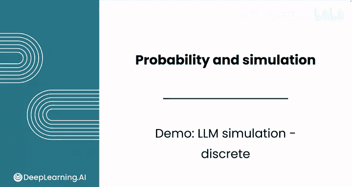
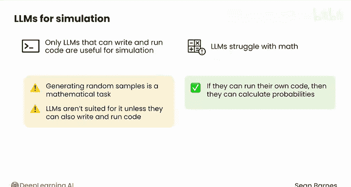
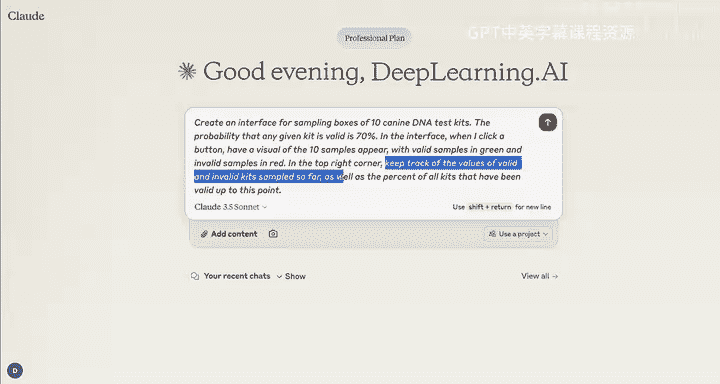
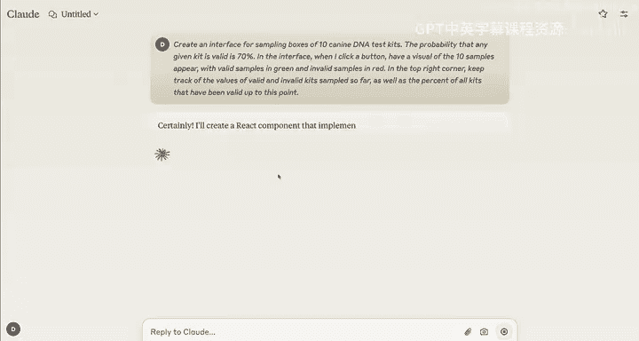
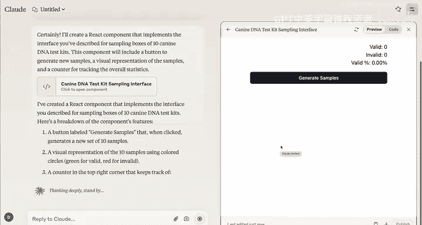
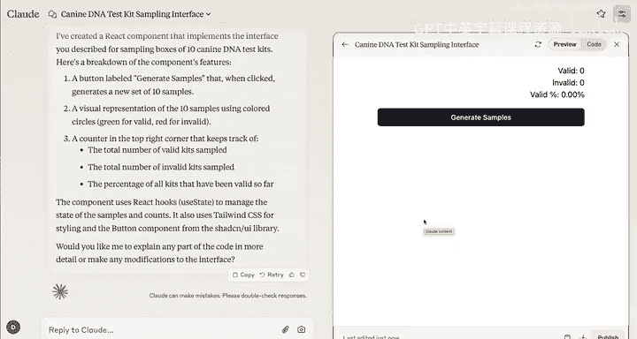

# 吴恩达《数据分析（数据分析基础／应用统计学，1-2课／共5课）｜DeepLearning.AI Data Analytics》中英字幕（claude-4-s - P112：41_演示：LLM模拟离散分布.zh_en - GPT中英字幕课程资源 - BV1SCXrYuEwr

So how can you use large language models for sampling？ They're an incredibly powerful tool。

 with some key limitations。

Before getting into using LLMs for simulation， it's important for you to know that only LLMs that can write and run code are useful for simulation。

 you'll learn more about the nature of this limitation and see it in action in the next lesson In short。

 remember that LLM struggle with math because generating random samples is a mathematical task。

 LLMs aren't suited for it unless they can also write and run code if they can run their own code then they do have the ability to actually calculate these probabilities。

 so let's take it over to Claude， which is capable of running some really cool simulations。

 Claude has this feature called artifacts that allows it to write and run code let's see what it can do to start your simulation you can give it this prompt。

 create an interface for sampling boxes of 10 canine DNA test kits。

 Tell it that the probability that any kit is valid is 70%。

 Then you're gonna tell it how to configure the interface。

 When you click a button you want to have a visual of the 10 samples appear with the valid samples in green and invalid samples in red。

 you also want it to keep track。😊。

Of the values of the valid and invalid kit sampled so far。

 as well as the percent of all kits that have been valid up to this point。

You're going to see it generating all this code。Which essentially creates a website inside a website。

 The fact that Claude is writing this code tells you that it does have a way to actually sample randomly from a distribution compared to an LLM without disability。

 which can only guess what word comes next， with no guarantee that the guess is truly random。

 You can see here in the code that this is where its actually generating the random samples。

 You don't have to understand what all this code means。

 but this is just validation that it can't actually write code to achieve the task that you asked it。

 If you try generating a new sample， It does exactly what you asked it to do。

 It has this image of different samples in red and green。

 And it shows you how many valid kits there were and how many invalid kits there were。

 as well as the overall percent of valid samples。 So 80% is valid and 20% as invalid。

 And that's reasonable since you and I both know that the probability of a valid test kit is 70%。

 So you can generate many samples from this interface。

 So this is an interesting example where9 of the test kits were actually valid。😊。

Notice that at first， there were 80% valid tests。 And now， after many samples。

 the valid percentage has converged much closer to 70%。 The actual probability of validt。

 This kind of interface can help you visualize what these different scenarios would look like。

 You can see that it's relatively common to get kits with many a valid tests。 Here's one。

 for example， with five invalid tests。Great work creating a simulation with the large language model that takes you to the end of this lesson and there's only one more to go once you've completed the practice assessment and practicee lab for this lesson。

 follow me to the next one to continue to learn about continuous probability distributions。

