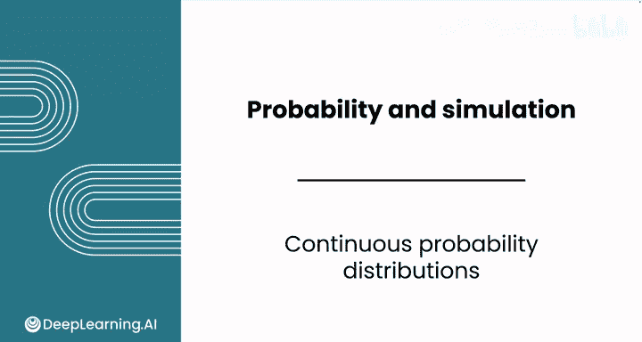
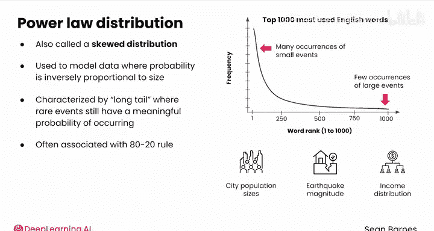

# 吴恩达《数据分析（数据分析基础／应用统计学，1-2课／共5课）｜DeepLearning.AI Data Analytics》中英字幕（claude-4-s - P113：42_连续型概率分布.zh_en - GPT中英字幕课程资源 - BV1SCXrYuEwr

Similar to the Berulli and binomial distributions you saw in the previous lesson。

 there are known probability distributions for continuous random variables as well。

 the most important continuous probability distribution in data analytics is the normal distribution。

 and you'll also learn more about the uniform and power law distributions。

The major differences between continuous and discrete probability distributions are related to how the probabilities of different outcomes are represented and how the statistics are calculated。

 First， you saw previously that continuous distributions don't have countable values。

 because of this difference， continuous distributions are typically visualized with a smooth curve rather than a column chart。

 The smooth curve reflects that there are outcomes in between each outcome whereas the column chart for discrete distributions。

 shows that there are distinct countable values。 This curve is called a probability density function or Pf。

 which is analogous to the probability mass function or PMf for a discrete probability distribution。

 rather than calculating the probability of specific values like you would in a discrete probability distribution for a continuous distribution。

 you calculate the probability of a value falling within a range Since there are infinitely many value in between each value for a continuous probability distribution。

 The probability of any exact value is 0。Cumulative distribution function or CDf for a continuous probability distribution is also a smooth curve compared with the column chart you saw for a discrete CDf。

 However， the two are similar in that they are both strictly increasing functions as x increases and they range from0 to1 because the Pf is a smooth curve the area under that curve between two points represents the probability of a value falling within that range calculating the probability of values falling within a range was straightforward with the discrete probability distribution Since you can just sum the different probabilities for a continuous random variable the probability is more complex to calculate。

 requiring calculus to define the area under the curve。 you won't see the calculus here。

 since you are rarely， if ever need to calculate these values by hand。 However。

 you will learn the intuition for these calculations in a moment Let's start with the uniform distribution which you can use to model a distribution where all outcomes within a specified range are equally likely to occur。

 you use the uniform distribution。InThe previous lesson for generating random samples。

 it has a constant probability density over its defined range。

 The uniform distribution is often used when you have little information about the behavior of the random variable。

 other than an estimated minimum or maximum value。 otherwise， it's useful for simulation。

 as you saw earlier。 In most scenarios， the distribution of outcomes is not uniform。 For example。

 take a look at this distribution of the frequencies of the top thousand most used words in English。

 This is a fairly typical power law distribution， sometimes also called a skewed distribution。

 This distribution can be used to model data where the probability of an outcome is inversely proportional to its size。

 In other words， there are many occurrences of small events。 and few occurrences of large events。

 The power law distribution is characterized by its long tail。

 where rare events still have a meaningful probability of occurring。

 It's quite common in nature and can be used to model not just word frequencies but city population sizes。

Earthquake magnitudes， income distribution and more the power law is often associated with the 8020 rule where 80% of effects come from 20% of causes。

 for example， a small number of words are used very frequently while most words are used rarely。

Great work examining those distributions followow me to the next video to learn more about the most important continuous distribution in data analytics。

 the normal distribution。

