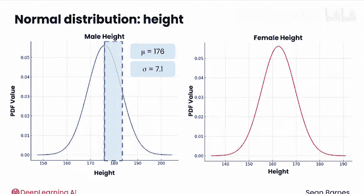
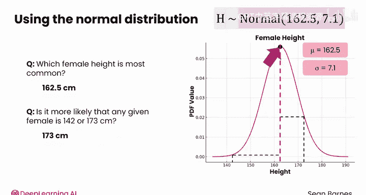
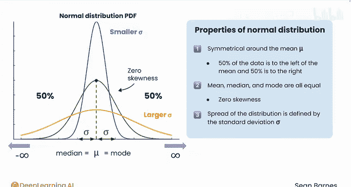
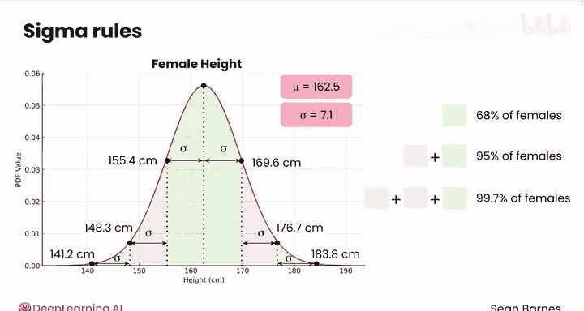
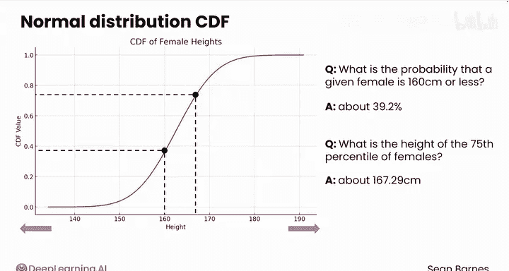

# 吴恩达《数据分析（数据分析基础／应用统计学，1-2课／共5课）｜DeepLearning.AI Data Analytics》中英字幕（claude-4-s - P114：43_正态分布.zh_en - GPT中英字幕课程资源 - BV1SCXrYuEwr

It turns out that many real world phenomena follow a distribution that looks roughly like this。

The values are cluster symmetrically around the mean， farther out。

 outcomes on either side of the mean become increasingly more rare。This is the normal distribution。

One real world phenomenon that follows the normal distribution is human height。 Here are two curves。

 Both graphs of the normal distribution probability density function。

 The one on the left shows male heights on the x axis you have the height and on the y axis the value of the probability density function the male height distribution has the mean of 176 centimeters which is about 5 foot9 inches for all U imperial users out there and a standard deviation of 7。

1 centimeters， about 2 and half inches This box represents1 standard deviation of heights above the mean notice that these are population parameters。

 not sample statistics。 Now take a look at the female heights， same axes with a mu of 162。

5 c about 5。4 inches and the same standard deviation as the distribution for male heights。

 The distribution for female heights just as an example can be written as H for heights is distributed as normal with parameters mu equals 162。

5 and s。

Equal 7。1 Notice how they're symmetrical and centered around their respective means Heights。

 blood pressure readings and test scores are often normally distributed Beyond natural phenomena。

 many statistical methods assume that data follows a normal distribution。

 the normal distribution can also help you answer questions like which female height is most common Can you guess。

That would be the mode， which in the case of a normal distribution also happens to equal the mean and medium at 162。

5 centimeters。 Is it more likely that any given female is 142 or 173 centimeters。

142 centimeters is 20。5 centimeters away from the mean， while 173 centimeters is 10。

5 c away from the mean， So 173 centimeters is more likely as it's closer to the mean。

Let's break down the key features of a normal distribution。 First。

 it's symmetrical around the mean mu。 The left side is a mirror image of the right side。

50% of the data is on the left of the mean and 50% is to the right。 Second， the mean。

 median and mode are all equal and located at the center of this distribution。

 which means there is zero skewness。 Finally， the spread of the distribution is defined by the standard deviation sigma。

 The tails of the distribution technically extend out to positive and negative infinity on either side。

 The mean determines where the peak of the curve is located while the standard deviation determines how spread out the data is。

 a larger standard deviation means a flatter， more spread out curve like this one。

 While a smaller standard deviation results in a taller， narrower curve like this one。

 This curve you've been looking at is the probability density function or Pf of the normal distribution as a reminder for continuous distributions。

 the height of the curve in the Pf shows you the relative likelihood of any given range of values。

One useful property of the normal distribution is the set of sigma rules。

 sometimes called the empirical rule or the 68，95-99。7 rule。

 This rule tells you that about 68% of the data falls within one standard deviation of the mean。

 This is the one sigma rule。 About 95% falls within two standard deviations。 The two sigma rule。

 and about 99。7% falls within 3 standard deviations。 The three sigma rule。 together。

 these are called the sigma rules。 This rule can help you understand probabilities in a normal distribution。

 Here is a distribution for female heights again。 the mean is 162。5 centimeters。

 the standard deviation is 7。1 centimeters。The height1 sigma below the mean is 155。4 centimeters。

 while the height1 sigma above the mean is 169。6 centimeters。 So using the1 sigma rule。

 you know that 68% of females have a height between those two values。

 two standard deviations below the mean is 148。3 centimeters。 while two above is 176。7 centimeters。

 So by the two sigma rule， you know that 95% of females are between those two heights。

 And according to the 3 sigma rule，99。7% of females will be between 141。2 and 183。8 centimeters tall。

 so between about 4 foot8 and slightly above 6 feet。 That said，0。

3% of females is still more than 11 million people globally while heights above or below these values are rare。

 millions of people will fall within these tails of more unusual values。

 here is the cumulative distribution function or CDF for female heights。

 It looks like an s shaped curve。 remember that。

The CDf shows the probability that a random variable will take on a value less than or equal to a given value on the x axis。

 you have the values of a random variable in this case， heights with the mean of 162。

5 at the center and on the y axis， you have the cumulative probability of obtaining at most that value。

 Imagine the X axis extending from negative to positive infinity beyond this image。

 The cumulative probability never quite hit0 on the left。 nor does it quite hit one on the right。

 There's always a nonzero chance of some slightly more extreme value occurring in the real world there are constraints on human height。

 For example， you can't be negative centimeters tall。

 but the normal distribution includes infinitely long tails。

 The CDf helps you answer questions like What is the probability that a given female is1 hundred60 centimeters or less。

 Can you approximate it using the CDf。This probability corresponds to this height of the CDF at 160 centimetersm。

 which is about 39。2%。 What is the height of the 75th percentile of females。

This line represents the 75th percentile of females， about 167。29 centimeters。

Great work exploring heights and the properties of the normal distribution。

 follow me to the next video to explore a special case of the normal distribution。

