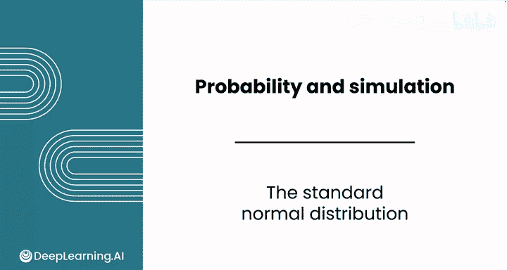
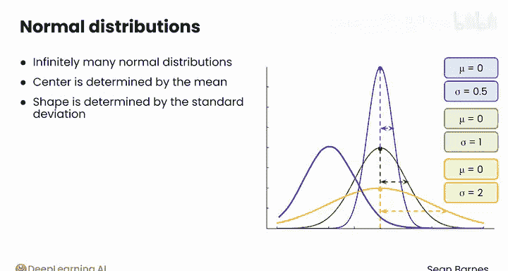
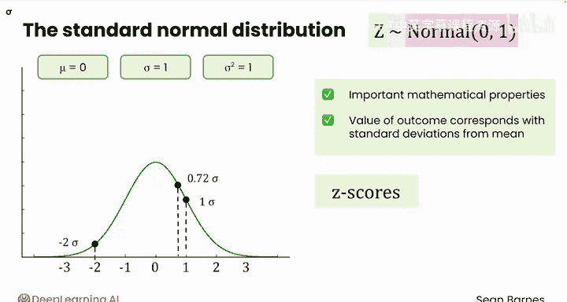
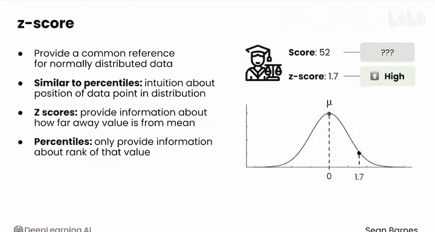
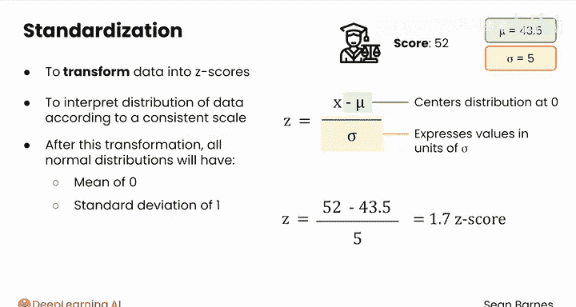
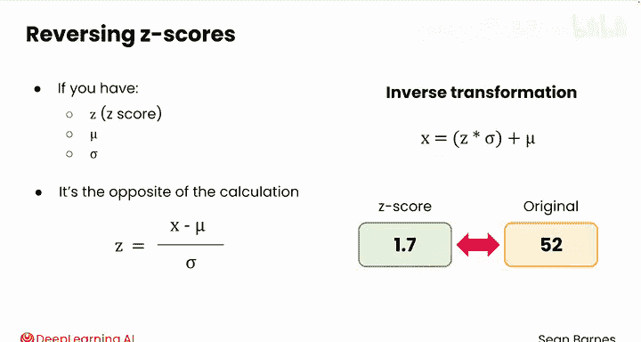

# 吴恩达《数据分析（数据分析基础／应用统计学，1-2课／共5课）｜DeepLearning.AI Data Analytics》中英字幕（claude-4-s - P115：44_标准正态分布.zh_en - GPT中英字幕课程资源 - BV1SCXrYuEwr

The standard normal distribution It might seem redundant at first standard normal。

 but let's take a look at why the standard normal distribution is so important。

 There are infinitely many normal distributions as the center is determined by the mean parameter and the shape is determined by the standard deviation suppose you have a normal distribution with the mean of 0 and a standard deviation of 1 represented by the green probability density function curve in this chart Now suppose you have a mean of 0 and a standard deviation of 2。

 your normal distribution is wider and flatter and looks like the yellow curve and if instead you have a mean of 0 and a standard deviation of 0。

5 your normal distribution is taller and has less variability like the blue curve in this chart you can also have a normal distribution with the different mean that is shifted from the previous examples you've seen like the purple curve with the mean of negative2 and a standard deviation of one all of these distributions have a mean that equals the median that equals the mode and all of these follow the set of sigma rules。

where 68% of the data is within one sigma of the mean，95% is within two sigmas and so on。

 But which normal distribution is the most normalist of them all It turns out that the normal distribution with the mean of0 and a standard deviation of1 is called the standard normal distribution you can represent this distribution using the notation the random variable z is distributed as normal with the mu of0 and a sigma of1 Now remember from the previous module that the variance is the square of the standard deviation sigma so the standard normal distribution also has a variance of one despite its humble name the standard normal distribution is actually quite special all these distributions you just saw or normal distributions It's just that the standard normal distribution has some important mathematical properties that can help you in a variety of ways one interesting property of the standard normal distribution is that the value of any outcome in this distribution also corresponds to the number of standard deviations it is away from the mean Let's break that。

Visually on this graph of the standard normal distribution。 For example。

 the value 1 in this distribution falls here and represents one standard deviation above the mean of 0。

 If you have a value of negative 2， that value falls here and represents 2 sigmas below the mean。

 A value of 0。72 falls here on the distribution and represents 0。

72 sigmas above the mean because the standard normal distribution is often represented using the random variable capital Z。

 this value is also commonly referred to as a z score。

Z scores provide a common reference for normally distributed data。

 say you have some data you suspect is normally distributed。

 but it's really difficult to evaluate how big or small any given value is。 For example。

 suppose your friendin- law school comes to you and says they score a 52 on their recent midterm。

 Is that high low， it's hard to tell。 I certainly wouldn't know however。

 if you hear that your friend score has a z score of 1。7。 while you know it's 1。

7 sigmas above the mean。 and that they did well above the average。

 Z scores are similar to percentiles in this way。 they both give you an intuition about the position of a data point relative to the rest of the distribution。

 if a test score is in the 95th percentile then it's higher than 95% of the data。 However。

 the advantage of Z scores is that they provide more information about how far away a given value is from the mean。

 whereas percentiles only provide you with information about the rank of that value。

 now that you understand how z scores can help you interpret data points。

 let's see how to transform your original data。

Z scores， which is called standardization。 you can perform standardization when you are looking for a way to interpret the distribution of your data according to a consistent scale to calculate the Z score for a given value。

 take your observed value X subtract mu and divide by sigma， this process has two different effects。

 First， by subtracting the mean， it centers the distribution at0。 Then by dividing by sigma。

 it expresses all the values and units of standard deviations。 After this transformation。

 all normal distributions will have a mean of0 and a standard deviation of1。

 regardless of their original parameters。 This standardization process is crucial in many statistical analyses and it allows you to compare values from different normal distributions on a common scale。

 For example， to find the Z score for the test score from a moment ago。

 assume the scores are distributed as normal with a mean of 43。

5 and a standard deviation in a5 So to calculate the Z score， take your friend score of。

And subtract the mean of 43。5 then divide by the standard deviation of 5。

 This calculation produces a z score of 1。7， which again represents 1。

7 standard deviations above the mean Z score transformations are also reversible If you know the z score mean and standard deviation。

 You can calculate the original value using this equation X equals z times sigma plus mu。

 It's the opposite of the calculation you just did and it's called an inverse transformation。

 you can always transform your data between z scores and the original scale。

It's okay not to remember all the details for now you'll use Z scores in the next two modules to construct confidence intervals and conduct hypothesis testing for now。

 just know that Z scores represent the number of standard deviations from the mean and the standard normal distribution follow me to the next video to see how you can generate random samples from the normal distribution。

