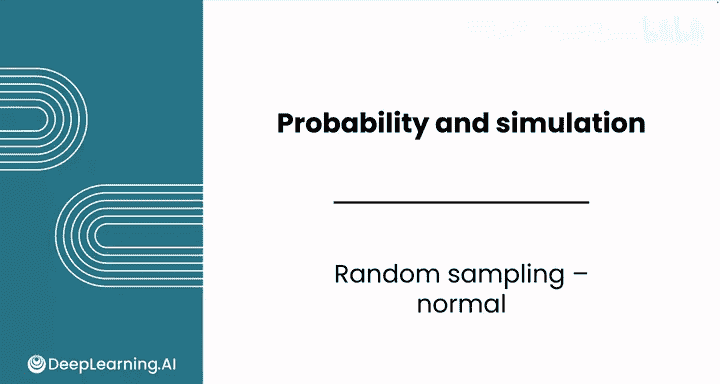
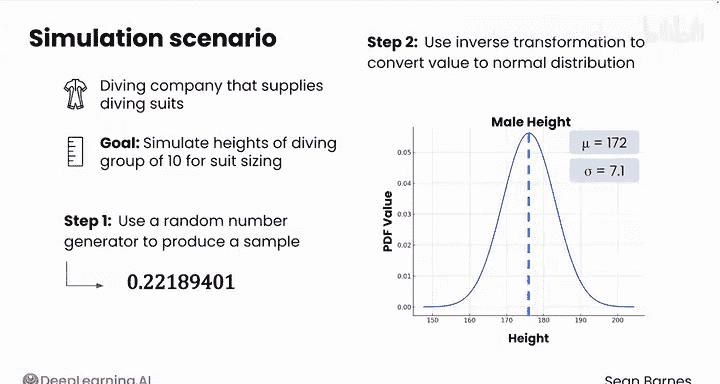
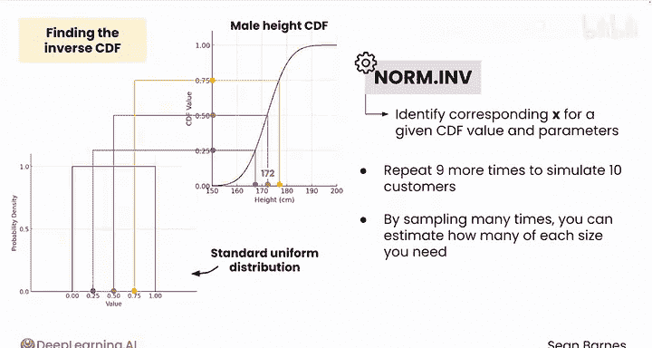

# 吴恩达《数据分析（数据分析基础／应用统计学，1-2课／共5课）｜DeepLearning.AI Data Analytics》中英字幕（claude-4-s - P116：45_正态随机抽样.zh_en - GPT中英字幕课程资源 - BV1SCXrYuEwr

Let's take a look at sampling from the normal distribution。

 which starts from the standard normal distribution。

 then uses the inverse z score transformation from the previous video。

Say you're working for a diving company that supplies diving suits for customers。

 You want to simulate the heights of customers in a diving group of 10 for suit sizing。

 You want to randomly generate heights， but the problem is that heights aren't evenly distributed。

 So unlike a uniform distribution。 where every value has the same chance of being generated。

 you need a more complicated function to map the random number from the uniform distribution onto probabilities of the normal distribution。

 here's one way to sample from the normal distribution。 First。

 use a random number generator to produce a sample from a standard uniform distribution。

 just as you did for the discrete examples in the previous lesson。 For example， you might get 0。2218。

 Then use an inverse transformation to convert the value from step 1 to the normal distribution value of interest。

 In the case of male heights， you've already seen that it has a mean of 172 c and a standard deviation of 7。

1 c。 Let's see how the step works。 Here's the cumulative density function or CDF for male height。

 Now remember。😊。

The CF ranges from 0 to 1， representing the cumulative probability as you move from minus infinity to plus infinity。

 That's interesting。 The standard uniform distribution also ranges from 0 to 1。

 Suppose you were to generate a random value from the standard uniform distribution， let's say ats 0。

5。 If you were replace this random sample on the y axis of the Cf， it would land right in the middle。

 Now， imagine drawing a line across to the CDf curve and then down to the x axis。

 What height would it correspond to The mean height，172 c。

 The probability of observing a value less than or equal to 172 as 0。5。

 Since the distribution is symmetric about the mean。

 As you generate random values via the uniform distribution。

 they will project a values on the x axis， which correspond to different sampled heights。

 This operation is called finding the inverse Cf。 And you can use the spreadsheet function Nor do I and V to identify the corresponding x for a given CF value and。

😊，Of normal distribution parameters， mu and Tigma， you'll use it in a moment。Now。

 you'll repeat this process  nine more times to simulate the distribution at the 10 customers on the tour by sampling many times。

 you can estimate how many of each suit size you typically need。

 The beauty of this method is that it mimics real world variability。

 Just like not everyone has exactly the average height。 These samples will vary around the mean。

 givingiv you a realistic picture of your potential customers and helping you order the right inventory。

 I bet you're interested in seeing this process in action。

 Let's take it over to a spreadrshe to simulate many random samples of mail heights。😊。

