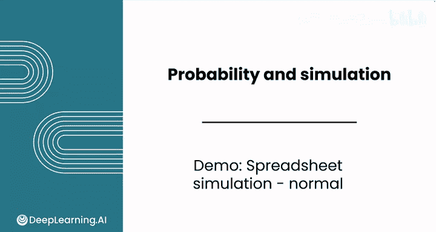
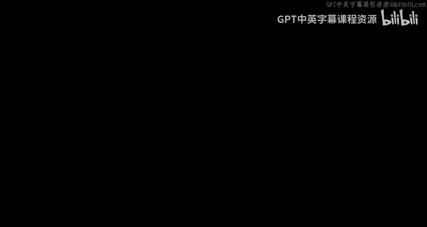

# 吴恩达《数据分析（数据分析基础／应用统计学，1-2课／共5课）｜DeepLearning.AI Data Analytics》中英字幕（claude-4-s - P117：46_演示：电子表格模拟正态分布.zh_en - GPT中英字幕课程资源 - BV1SCXrYuEwr

Let's see how you can generate random samples following the normal distribution using a spreadsheet。

 recall that mail heights are roughly normally distributed。

 Let's see how to randomly sample heights from that distribution。

 This allows you to see the distribution of heights。 For example。

 to order the right numbers of different diving suit sizes depending on the number of individuals on a given trip。

 and don't forget if you'd like to follow along with the demo you can find the spreadsheet and the solution in the downloads tab to kick off your simulation。

 you want to enter the parameters that describe the heights。

 The mean of this distribution is 172 centimeters with the standard deviation of 7。1 centimeters。

Next， you want to generate samples from the uniform distribution， similar to previous videos。

 you're going to use the random array function to generate 100 random samples。

You could generate thousands or tens of thousands if you'd like。

 noticeice that these results are all between 0 and1。

 Just remember that each time you enter a calculation， all of the random samples are regenerated。

 Next， you want to use the norm dot I N V function to transform the random samples into the normal distribution。

 This function has three parameters。 First， the random sample。

Then the mean of the normal distribution。Then the standard deviation of the normal distribution。

 A random sample of around 0。29 was transformed into a height of about 168 cm。

 The uniform random sample is less than 0。5。 Therefore。

 the corresponding height should be less than the mean。

 W the original formula in the array formula function。

 Remember that if you want to use the array formula function。

 You need to change the singular cell reference to the entire column。

You do not need to update the mean and standard deviation since those values will represent the same cells Next。

 you want to insert your checkbox so that you can easily refresh the results。

You can see that all the heights are roughly around the mean of 172 centimeters plus or minus a few standardard deviations。

 So next you might want to summarize the resulting heights that you simulated。

 select that column and then insert a chart。In this case， this is a little bit unusual results。

 as you have the general bell shape curve of the distribution。

 but there's not a clear peak in the middle， As you might expect。

 This is something that can happen with any sample of 100 observations。

 Another thing you can do with this distribution is calculate your sample statistics and see how closely they compare with the population parameters。

You have a sample mean that's almost exactly equal to the mean。 So now in this new distribution。

 you can see that there's a sample mean of 171， which is close to the mean and a sample standard deviation of around 7。

04， which is also close to the population standard deviation from the visual you can tell that this distribution looks a little more normal and bell shaped。

Again， you can use the refresh button to change your results。

 Here's an interesting case where you get a pretty extreme outlier。

 There's one person who had a height that landed somewhere between 191 and 195 cm。

 That person is around 6 ft，3 inches。 In this case。

 you had an outlier on the lower end of the distribution。

 Here's an example with several individuals on the lower end of the height distribution。

 Result like this suggests that you might want to stock a few suits on the extreme ends of the distribution。

 just in case you have customers who have more extreme heights。 It's cool， right。

 I encourage you to try out the simulation on your own。

 You can also try changing the parameters to simulate female heights。

 Foow me to the next video to learn more about LLM simulations。😊。

