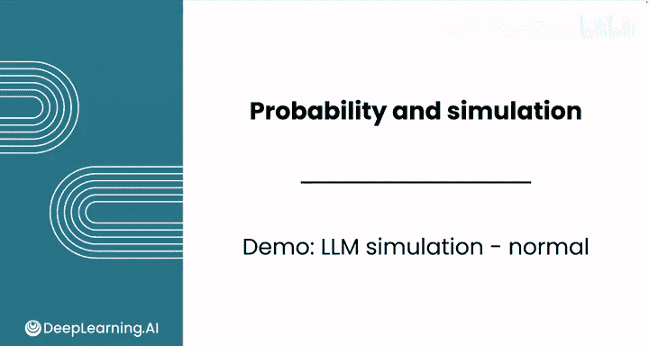
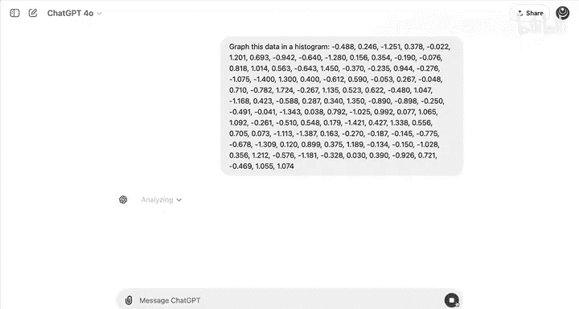
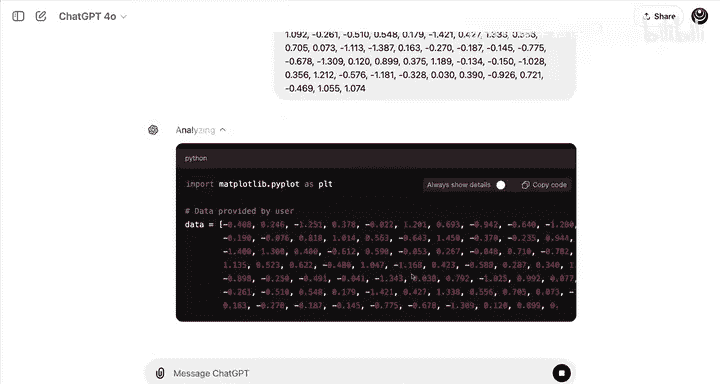
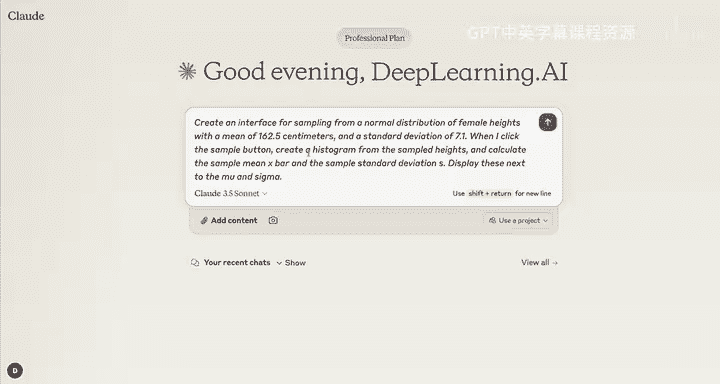

# 吴恩达《数据分析（数据分析基础／应用统计学，1-2课／共5课）｜DeepLearning.AI Data Analytics》中英字幕（claude-4-s - P118：47_演示：LLM模拟正态分布.zh_en - GPT中英字幕课程资源 - BV1SCXrYuEwr

LLMs are great thought partners for your work in data analytics Earl。

 you saw how to use them to create simulations。 Let's take a closer look at their limitations。

 as well as how to use them to generate random samples from the normal distribution。

 recall that you can't use LLMs for sampling unless they can write and run code。😊。

Let's investigate that claim more closely。 Let's start with chat GT 40 mini。

 This is a logged out account， not the paid version。 It can't run code， and it's very。

 very similar to what you'll work with in the Coursra labs that you'll see in this course。

 say you want to generate 100 samples from the standard normal distribution。

 you can ask chat GT to do that for you here， you can ask it something like simulate 100 samples from the standard normal distribution print them in a single comma separated list and it gives you 100 samples。

 considering a mu of0 and a sigma of one。 these all look， you know。

 pretty standard and normal What you want to do is actually test whether these come from a normal distribution。

 If you copy these data points and come over to the paid version of chat GT。

This is Cha G240 you can ask it to graph this data in a histogram。

 it has the advanced data analytics feature and it can actually write and run code。

You can see that it's writing some code to plot a histogram。

And there's your histogram。Let me ask you， does this look normally distributed to you？

You can see here that the distribution is roughly symmetric。

 but it doesn't seem to flatten out in the tails like you would expect a normal distribution to behave。

 Remember from the demo in the last video that it only took around 100 samples to generate a distribution that looked pretty normal So something seems a little bit off for this one This is beyond the scope of this course。

 but you can actually statistically test how likely it is that this data in fact。

 did come from a normal distribution。 we won't get into all the hair details。

 but as you may have guessed based on its histogram the LLM on its own doesn't have the tools to actually create random samples from the normal distribution so you shouldn't use an LLM to generate samples。

 A spreadsheet is better suited for that purpose。 Let's take this over to Cla which is capable of running some really cool simulations。

 remember that Cla can write and run code using its artifacts feature here you can give it a prompt asking it to create that interface for sampling from a normal distribution and then create a histogram visualization to summarize those results So what you're seeing again is clo actually writing code to create the application。

😊。

To generate the simulated heights。 So the population mean mu and the population standardan deviation Sigma are the values you already gave it。

 This simulation can help you see all the different possible scenarios you might get if you randomly sampled 100 females and measure their height。

 Okay， let's go ahead and generate a new sample。 There seems to be an issue since you're not seeing any data populate in the histogram。

 So what you can do is give Quad a second chance to try to fix the issue。

Notice that it has to rewrite the entire application in order to correct the issue。

So this has the chance of introducing new errors， you can also see that it summarized all the changes that it made in the code。

 let's go ahead and try to generate some more samples。

So you have your heights on the X axis and you have the frequency on the y axis and up top。

 you have the population parameters and on the right you have the sample statistics。

 So even with just 100 samples， the sample mean is super super close to the population mean mu Visually this seems to look very close to a normal distribution。

 Let's generate some more samples so that we can see how the distribution evolves。

 The prompt didn't specify the number of samples so the LLM decided to generate 100 samples from the distribution。

You can click the Gene sample button to generate more distributions， you can see that with each one。

 the distribution changes a little bit， but overall the sample statistics seem to align really well with the population parameters。

This is primarily due to the fact that a thousand samples will get you pretty close to the population parameters。

Here's a bit of an unusual looking sample where the peak of the distribution does not look as rounded as you would typically expect。

 It's possible to get this type of outcome with a simple random sample。Great work with the LLM。

 You'll get to practice with it in a moment。 Any LLM can help you devise the simulation and communicate results。

 but you should only run a simulation using an LLM that can write and run code。

 follow me to the next video to put it all together and learn how distributions can be used to make decisions。

