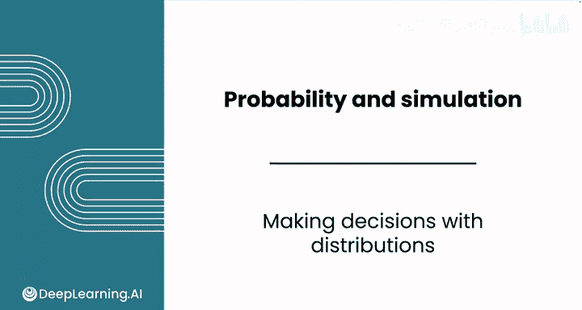
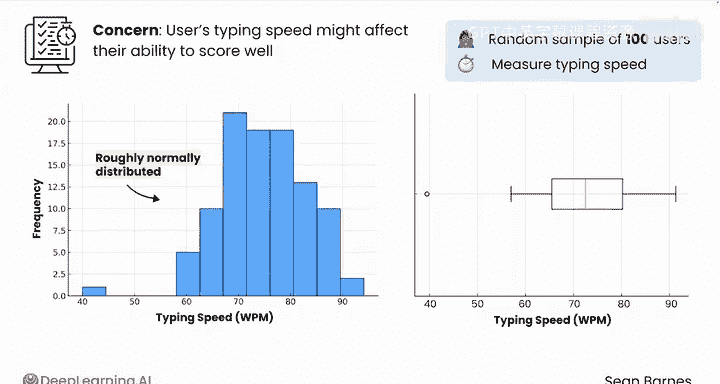
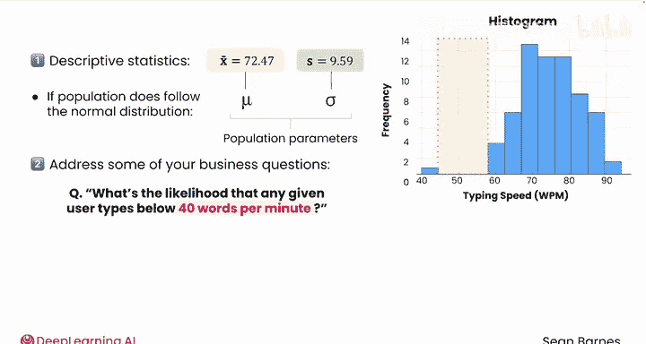
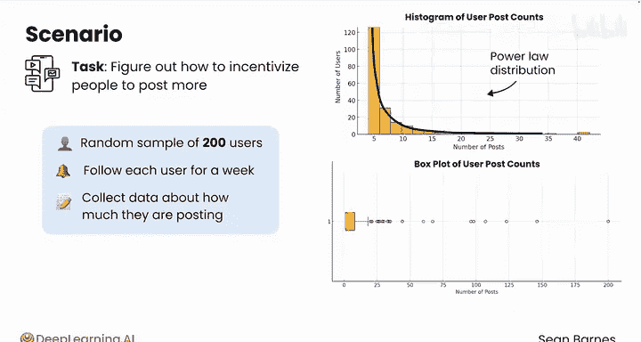
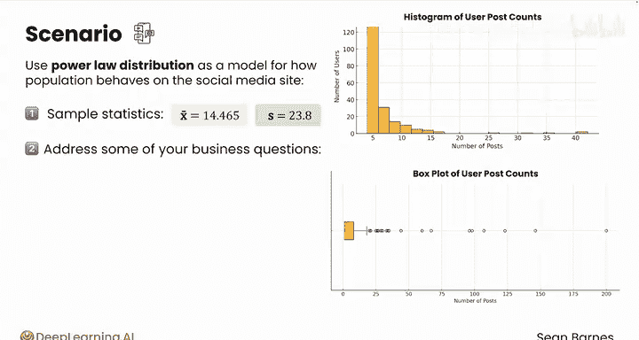

# 吴恩达《数据分析（数据分析基础／应用统计学，1-2课／共5课）｜DeepLearning.AI Data Analytics》中英字幕（claude-4-s - P119：48_基于分布进行决策.zh_en - GPT中英字幕课程资源 - BV1SCXrYuEwr

Let's put this all together and see how you can use distribution techniques to inform business decisions。

 Imaginem that you're working with a digital testing company that provides time standardized tests that users can take in their browsers。

 One concern the testing company may have is that a user's typing speed might affect their ability to score well in the test。

 even if they know the material well， you decide to take a simple random sample of 100 users and measure their typing speed。

 Your first step is to visualize the distribution。 So you create a histogram and a box plot。

 What kind of distribution do you see。😊。

It's not 100% clear， but the data does look roughly normally distributed。

 The sample size is only 100， so there is some variability from the typical bell curve。

 but you have some evidence based on the visual distribution of the data that the population may roughly follow a normal distribution。

 recognizingizing that you've made an assumption you can proceed with creating descriptive statistics for your data and try to address some of your business questions。

 First， calculate your sample mean X bar and standard deviation S。 They are 72。47 and 9。

59 words per minute respectively。 If your population does indeed follow the normal distribution。

 you can use your X bar and S as approximations from you and Sigma。 Your population parameters。

 The normal distribution provides assumed probabilities for the big gap in your data between 42 and 55 or so。

 In reality， you might also expect more extreme values than what your sample produced in the population using your population model。

 you can answer questions like。 What's the likelihood that any given user。

Below 40 words per minute， which is the critical threshold for being able to complete the test on time。

 even though you didn't sample anyone with a typing speed that low。

 the normal distribution can help you estimate the probability of observing that user given the parameters you estimate。

 you calculate that the probability that any given user types below 40 words per minute is about 0。

035% or1 and 2800 users。 That probability can inform whether you feel the test is valid given the current time limit。

 say a user files a complaint with the testing company saying the test timing was unfair due to their typing speed。

 if they say their typing speed is 80 words per minute。

 you can find the percentile of this individual's typing speed using the normal distribution。

 You calculate this user falls in the 78 percentile， meaning they type faster than 78% of users。

 This may be grounds for rejecting this individual's complaint By contrast。

 if another user complaints and their typing speed is tested at 51 words per minute。

 you can estimate that they are in the first percentile of。

Quite slow， which may qualify them for extended time。

Say you're working with a social media company and your tasked with figuring out how to incentivize people to post more often。

 you generate a simple random sample of 200 users， followow each user for one week and collect sample data about how much they are posting。

 Your first step is visualizing the distribution。 So you create a histogram and a box plot of the data。

 What kind of distribution do you see。It looks like it might follow a power law distribution since you have a large concentration of users near zero with a long tail in the positive direction。

 indicating a lot of positive skewness。 you can use the power law distribution as a model for how the population behaves on the social media site。

 there are some further steps needed to validate this hypothesis but just imagine you're able to confirm that this sample follows this distribution。

 First， you can calculate your sample statistics。 The power law distribution actually has different parameters from the normal distribution but you can still calculate the mean x bar。

 which is 14。465 and your sample standard deviation which is 23。

8 Just note that because this distribution isn't normal。

 you can't apply the set of sigma rules you learned previously using this probability distribution as a model for your population。

 you can start to address some of your business questions。

 keeping in mind that yourre operating under the assumption that your population behaves in this way。

 say the marketing team lets you know that a particular incentive causing。

Users in the bottom 50% of activity to create one more post per week using your model of the power law distribution。

 you note that the median number of posts would increase by 33% from 3 to 4。

 The mean number of posts would increase by 0。5 since you're adding one post to half of all users so it would be up about 5% from 10。

47 to 10。97。 This difference makes sense since the mean is heavily influenced by values in the tail of the distribution compared with the media and the total number of posts would also increase by the same percentage as the mean This shift helps you characterize the effect this incentive might have if it was implemented for the entire population。

Great work using distributions and descriptive statistics to make decisions That brings you to the end of this module。

 you've learned a ton about probability， distributions and simulations。

 You're practically pro of this Com up next are the graded assessment and lab for this module in the lab。

 you'll extend your analysis of the forest fire prevention data set to help estimate wildfire locations Once you've completed the lab and assessment。

 I'll see you in the next module confidencefi intervals。😊。

