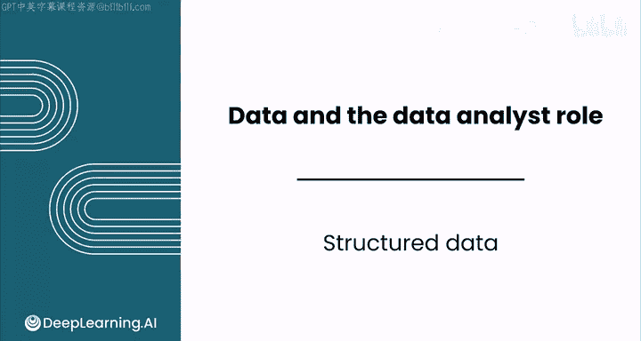
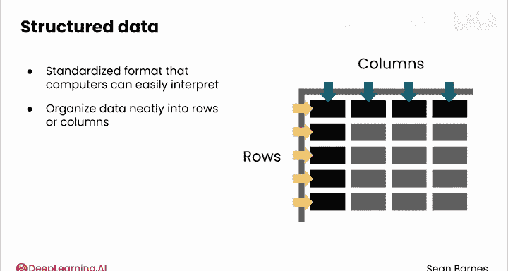
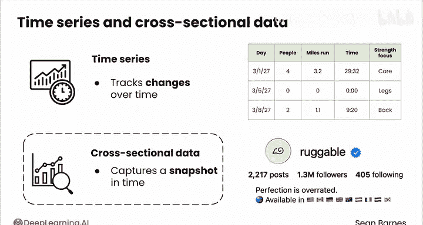
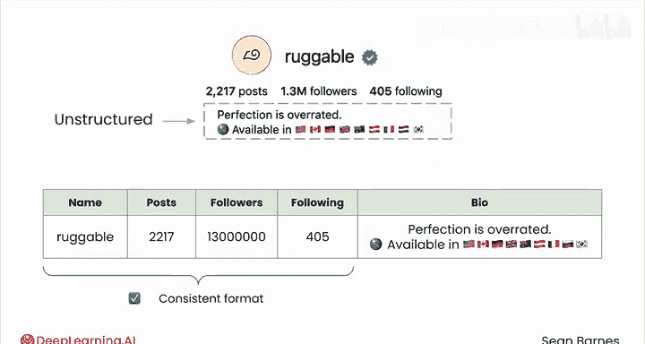
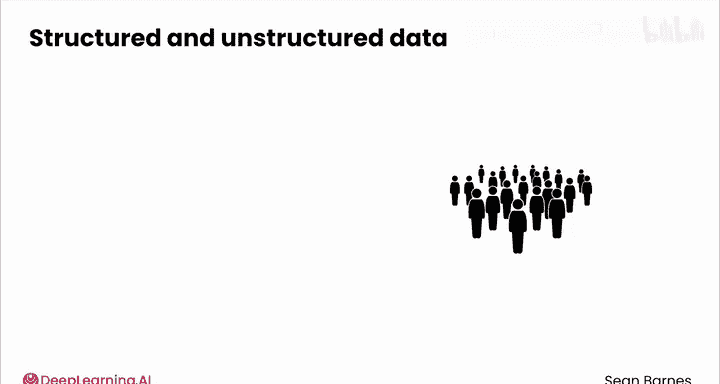
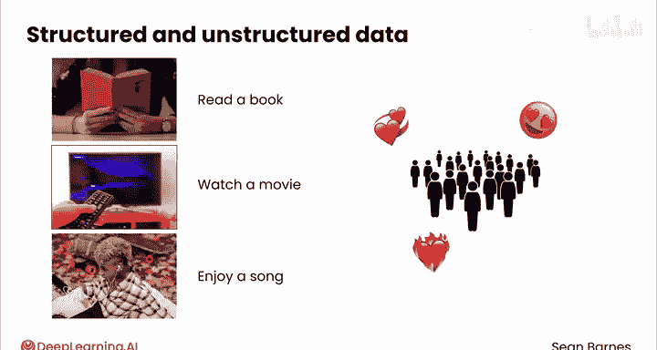
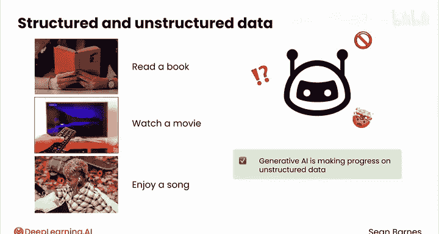

# 吴恩达《数据分析（数据分析基础／应用统计学，1-2课／共5课）｜DeepLearning.AI Data Analytics》中英字幕（claude-4-s - P11：10_结构化数据.zh_en - GPT中英字幕课程资源 - BV1SCXrYuEwr

When working with computers， you'll often find that you need to impose some structure on your data computers work most efficiently when data is organized in a predefined way。

 whereas humans are much more adaptable when information comes in an unexpected form One big idea I hope you take away from this video is that structured data essentially exist for computers to store process and analyze structured data is all about organizing information into a standardized format that computers can easily interpret most commonly that looks like organizing data neatly into rows and columns that organization itself contains a lot of information let's revisit the example of tracking your workouts here's the structured version of that information again and two more rows so that you can compare workouts in each column you or more accurately your computer can expect the same kind of information The time column will always have a time The Strfocus column will always have one of a few options like core legs back and。

There will never be a neck day， although to each th own， I guess。

 each row or day will contain information about each exercise， even if you didn't run at all。

 Miles run and people will never be negative these examples represent some of the information built into the organization of this data。

The mission of building in information often involves categorizing data into specific types。

 such as numerical or categorical numbers can be either discrete or continuous with discrete meaning a whole counting number example。

 Either you went running with one person or two There's no such thing as a person and half continuous means you can have fractional amounts as well For example。

 you can run a fraction of a mile like 3。2 or 1。1 you also have specialized numerical formats such as time。

 which can also be represented in discrete or continuous forms categororical data enables you to separate rows into distinct groups Co legs and back or categories of exercises that can be used to analyze different types of strength focus categorical data is most often represented as text。

 but there should be a finite number of distinct groups Free text like review comments has potentially infinite values that would not make for useful categorical data without further processing。

Data can also be represented numerically with a discrete number for each group for example maybe for efficiency's sake。

 you just write one for core， two for legs，3 for back still categorical even though the representation is with numbers One other key distinction in structured data is between time series and cross- sectional data time series data tracks changes over time while cross- sectional data captures a snapshot in time the workout data you just saw is considered time series data since you'll be able to analyze your mild times and strength focus over time plus monitor whether your friends are keeping their promise to train with you On the other hand。

 check out this Instagram bio which has data like the number of posts and followers plus username。

 image and a text bio is this cross- sectional or time series data。This is cross actionional。

 since it shows information about an account at one moment in time。

 you wouldn't be able to look at this data and say anything about followers over time or how often this person changes their profile picture。

You learned earlier that it's common to see unstructured data stored inside a table or spreadsheet。

 Here's another example using the same Instagram bio you just saw。

 you could represent the structured data from the bio in a table with columns for name， posts。

 followers and following Each of these columns has a consistent format they can be processed by a computer For example。

 you can calculate the ratio of followers to following The bio this description here is unstructured since it's unorganized text data that cannot be easily process by a computer to keep all this data together you can tack bio onto this table it's still unstructured data and will still need more work to process compared with the other columns but you can store it together with the other data just to keep things consistent to summarize different columns in a table can be structured or unstructured Now that you've seen the core components of both structured and unstructured data let's take a step back and think about the difference between these two types of data from a human perspective as。

sWe're pretty good at interpreting unstructured data。 We can read a book。

 watch a movie or enjoy an emotional song without much effort。 but for computers。

 it's a different story。 computers need data to be organized in a specific way in order to process it effectively。

 Although generated AI is making significant progress on interpreting unstructured data in general terms。

 nonaiI techniques are going to work best onstructured data。

 So to recap structured data is all about organizing information in a way that computers can use effectively。

 As a data analyst， you'll frequently derive insights from both structured and unstructured data In the next video。

 you'll explore big data big data isn't just a lot of data I promise there's more to it。😊。

Join me in the next video to learn more。