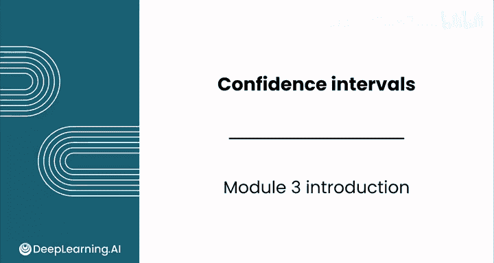
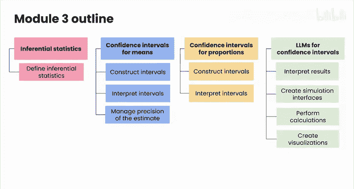

# 吴恩达《数据分析（数据分析基础／应用统计学，1-2课／共5课）｜DeepLearning.AI Data Analytics》中英字幕（claude-4-s - P120：49_模块3 简介.zh_en - GPT中英字幕课程资源 - BV1SCXrYuEwr

Welcome to a new module， confidencefi intervals。 In this module。

 you'll learn the first of two powerful techniques used to draw conclusions about populations based on a sample。

 The purpose of confidence intervals is to help you manage the inherent uncertainty involved in many business questions。

 You'll start out by defining inferential statistics。

 including how they differ from descriptive statistics。 Then you'll construct confidence intervals。

 a way to estimate population parameters like means and proportions with a measure of certainty。

 You'll learn how to interpret these intervals， which can be quite tricky。

 As well as manage the different levers you have for the precision of the estimate。 Finally。

 you'll use large language models as a thought partner for inferential statistics。

 You'll see how AI can help you interpret results， create simulation interfaces and even perform calculations and create visualizations for confidence intervals。

 Your hard work will culminate in the lab where you'll explore how diamonds are priced。

 I know you'll enjoy it by the end of this module。😊。

You'll be able to construct and interpret confidence intervals。

 enabling you to draw rigorous conclusions from your data。

 Foow me to the next video to learn more about inferential statistics。😊。

