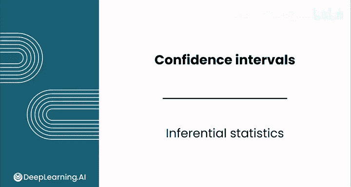
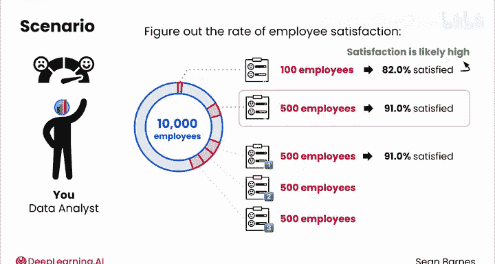
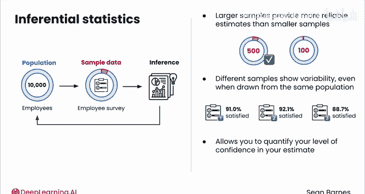
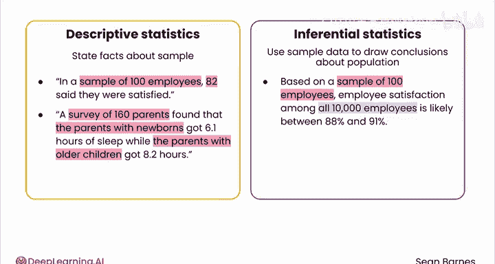
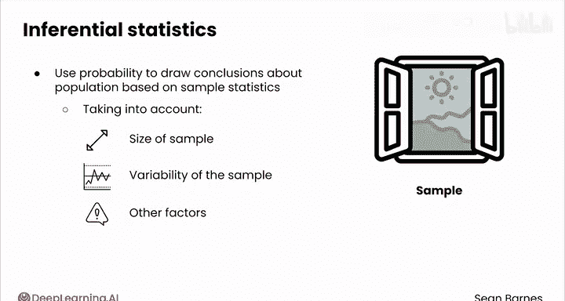
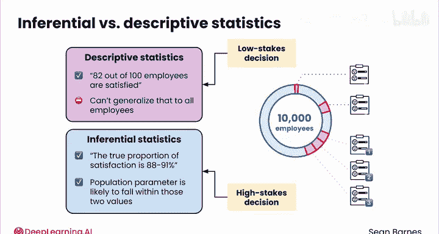

# 吴恩达《数据分析（数据分析基础／应用统计学，1-2课／共5课）｜DeepLearning.AI Data Analytics》中英字幕（claude-4-s - P121：50_推断统计学.zh_en - GPT中英字幕课程资源 - BV1SCXrYuEwr

So far you've been working with descriptive statistics。

 these describe the behavior of your sample data Now with inferential statistics。

 you'll level up your rigor significantly by using your sample to draw stronger conclusions about your population。

 Let's get started。I want to start by asking you some questions about confidence。

 say you're trying to figure out the rate of employee satisfaction at a company。

 There are 10000 employees。 You interview 100 of them and 82% say they're satisfied based on that information。

 What's your gut feeling about satisfaction among all employees。

You would likely say that satisfaction is pretty high。

 but how confident are you that your sample is representative of the entire company。

 Would you feel comfortable reporting this result to your boss。Okay。

 maybe you decide that you want to gather some more data so you expand your survey to 500 randomly selected employees。

 You find that 455 of them are satisfied or 91%。 How does this larger sample influence your confidence If you had to give a range of values to your CEO now。

 what would you say。Last set of questions say you take three independent surveys of 500 randomly selected employees。

 and you find these percentages of satisfaction on the first survey 91。0% on the second， 92。1%。

 and on the third， 88。7%， based on these 3 different samples。

 what would you now estimate the true rate of satisfaction to be。

This is the big idea behind inferential statistics。

 You have some sample data like your employee survey。

 and you're trying to make inferences about the population。 All 10000 employees。

 La samples provide more reliable estimates than smaller samples。

 Ask 500 employees is more reliable than asking 100。 Different samples show variability。

 even when drawn from the same population。 The rate of satisfaction is different in each independent survey。

 even though the underlying population satisfaction is the same。

 Inferential statistics allows you to quantify your level of confidence in your estimate。

 It's possible to say mathematically whether a certain estimate is more likely than another。

 descriptive statistics state facts about your sample data。

 insightights like in a sample of 100 employees，82 said they were satisfied。

 A survey of 160 parents found that parents with newborns got 6。

1 hours of sleep on average while the parents with older children got 8。2 hours of sleep per night。

 Inferential statistics， on the other hand， uses the sample。

SleData to draw conclusions about the entire population。

 So insights like based on a sample of 100 employees。

 employee satisfaction among all 10000 employees is likely between 88% and 91%。

 A survey of parents concluded that parents of older children sleep two hours more per night。

 compare with parents of newborns。 The first two examples describe the characteristics of a sample。

 While the second two use the characteristics of the sample to make conclusions about how the population behaves。

 All employees， all parents， you previously learn that your sample is a window into the truth。

 when you peer through that window， you won't necessarily see the truth。

 Inferential statistics is all about using probability to draw conclusions about the population based on your sample statistics。

 taking into account the size and variability of the sample。 Among other factors。Essential。

 you use inferential statistics to see the whole landscape， Even if it's beyond your current view。

 Inferential statistics provides a higher level of analytical rigor。

Compared with descriptive statistics in the employee satisfaction example。

 you're able to state that 82 out of 100 employees surveyed are satisfied using descriptive statistics。

 but you can't generalize that to all employees using inferential statistics。

 you might be able to infer with high confidence that the true proportion of satisfaction is 88 to 91%。

 even though you're less certain about the actual value。

 you're able to conclude that the true population parameter is likely to fall within those true values。

 if you're making a low stakes decision like understanding an athlete's performance then descriptive statistics may be completely fine for your use case。

 However， if you're making a more highs stakes decision like whether to invest millions of dollars into a certain product。

 inferential statistics provides a more robust basis for decision making。

 it allows you to quantify the uncertainty in your estimates。

There are two different types of estimates that you'll find yourself using regularly。

 point estimates and interval estimates， follow me to the next video to learn more about the difference。

