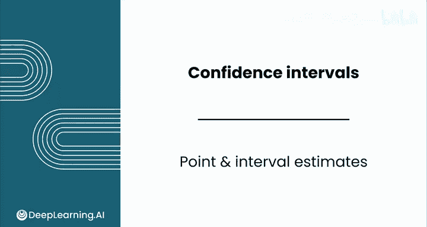
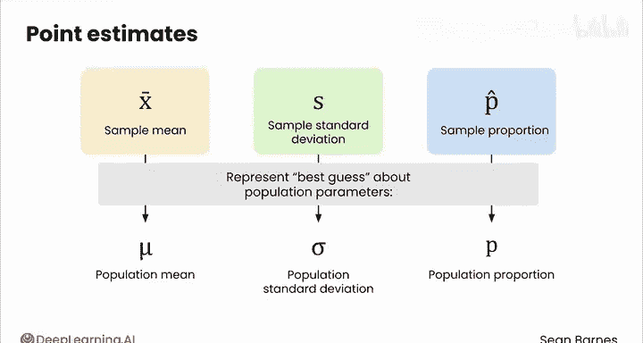
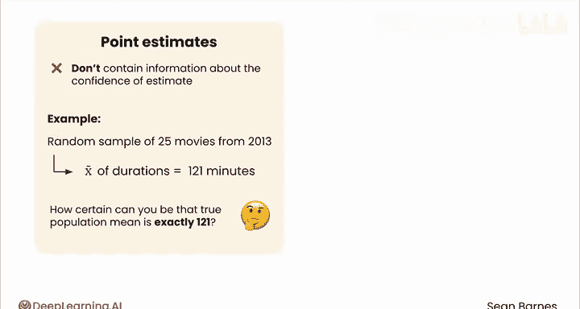
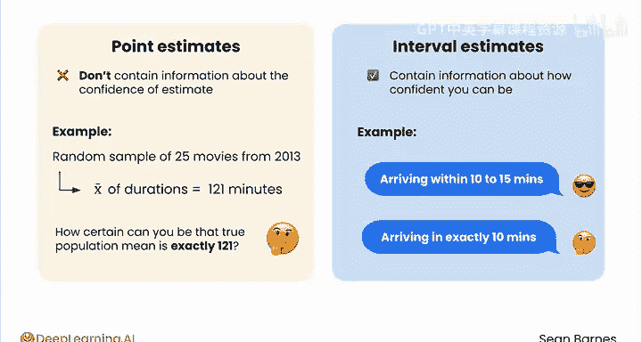
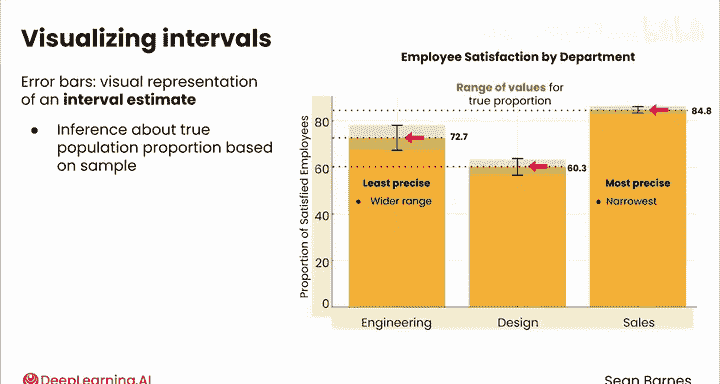

# 吴恩达《数据分析（数据分析基础／应用统计学，1-2课／共5课）｜DeepLearning.AI Data Analytics》中英字幕（claude-4-s - P122：51_点估计与区间估计.zh_en - GPT中英字幕课程资源 - BV1SCXrYuEwr

You're a few minutes away from the restaurant and your friend texts you to ask you how long you'll be。

 What do you say，10 minutes or 10 to 15。 I'm 10 to 15 minutes away is a kind of interval estimate。

 compared with just providing a single number。 you increase the chance that your estimate is correct by widening its range。

 Let's see how this works in statistics。You've already seen two point estimates in the previous modules。

 the sample mean X bar and the sample standard deviation S。

 Each of these is a single value that represents a best guess about the population parameters mu and sigma。

 Another point estimate you will explore later in this module is P hat。

 which represents a sample of proportion。 For example， P hat might be 0。82。

 representing the proportion of satisfied employees。 That would be P。 The population proportion。

 point estimates are useful， but they don't contain any information about the confidence of that estimate。

 say you have a random sample of 25 movies from 2013。

 and the sample mean of their durations is 121 minutes。

 How certain can you be that the true population mean mu is exactly 1 21 minutes。

 Inter estimates By contrast， do contain information about how confident you could be。 For example。

 you can be more confident of arriving within 10 to 15 minutes than you can be if you told your friend exactly 10 minutes。

You may have seen a graph like this before， which contains error bars。

 This is a graph of three different teams at a company on the X axis and the proportion that say they are satisfied on the Y axis。

 rather than having a point estimate， which would just be a plane bar at 72。7 for engineering，60。

3 for a design and so on。 This graph shows an interval that represents the range of values where the true proportion is estimated to fall。

 based on the intervals， Which estimate do you think is the most precise。

That would be the estimate for sales。 It has the narrowest interval。

 Sales may have the larger sample， or it may have less variability within that sample。 By contrast。

 engineering has the widest interval， indicating that there is a wider range of possible values for the true proportion。

 these error bars are just a visual representation of an interval estimate。

 an inference about the true population proportion based on the sample。

 if you repeated this sampling process many times。 you would expect the true population value to fall within this range most of the time。

Interval estimates grapple with the core complexity of statistics。

 If you take many samples of a population， you'll get different values for your sample statistics。

 For example， take a look at this distribution。If I flip the Galton board。Now I get a different one。

 join me in the next video to see that complexity in action with a simulation。

