# 吴恩达《数据分析（数据分析基础／应用统计学，1-2课／共5课）｜DeepLearning.AI Data Analytics》中英字幕（claude-4-s - P123：52_抽样分布与中心极限定理.zh_en - GPT中英字幕课程资源 - BV1SCXrYuEwr

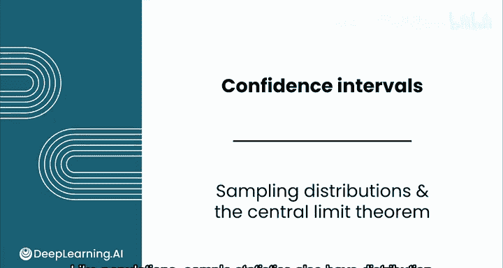

Like populations， sample statistics also have distributions。

 ranges of possible values they can take on， and different probabilities associated with each one。

 Let's walk through an example。Say your tasked with estimating the average score on a professional certification exam。

 possible scoresrs range from 0 to 100， if you take one sample。

 say by asking 50 random people what their scores were， you'll get one sample mean。

 but what if you take another sample， will you get the same value？

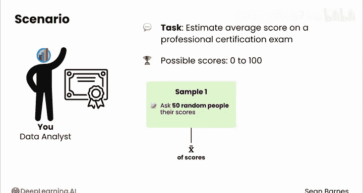

Let's run a quick simulation。 Let's generate one new sample。

 This simulates asking a random sample of 50 people what their score was on the certification exam。

 So up here， you can see some of the values that were sampled already。

 as well as the sample mean of 76。76 Each one of these represents a score from the certification exam in the next section。

 you'll see some statistics that summarize all of the sample means that have been generated so far。

 which is only one right now。 and to the right， you'll see a histogram of all the sample means。

 for the first sample， the sample mean was 76。76。 but if you generate a new sample。

 you get a different sample mean in this case，80。40。

 you just generated another sample of 50 scores on the certification exam。

 So now it's as if you've taken two different samples of 50 scores。

 And if you generate another sample， then you get 80。02。

 as you keep generating more and more samples， you'll start to see more and more values represented all of these are possible sample means you could get when sampling this distribution。

 say you took over 2000 samples of scores。😊。

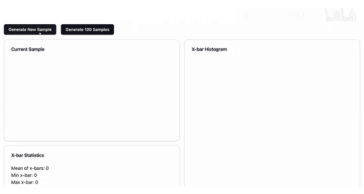

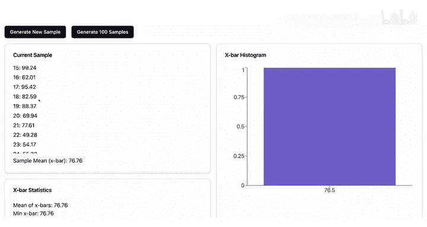

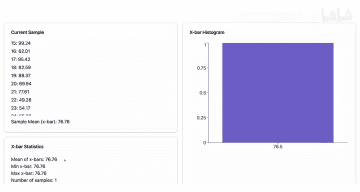

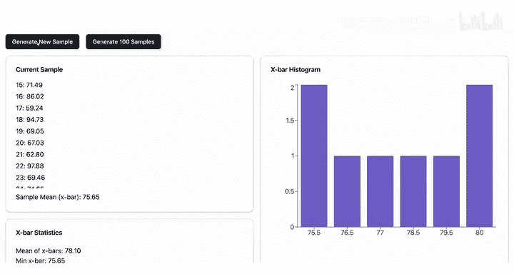

Each of which have 50 people， you calculated the sample mean of each one， so you have over 2。

000 sample means， and you graph the distribution of those means in this histogram on the right。

What distribution would you guess that this follows。

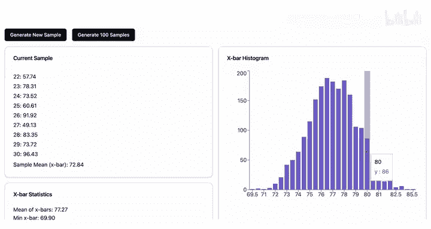

This curve suggests that the sample means are normally distributed。

 Can you guess mu the true population mean。Somewhere between 76 and 78 or so is probably a good guess。

 In this case， the true population mean is 77。2。 This is a sampling distribution。

 The range of possible values you can get for the sample mean X bar and the probability associated with each value。

 The idea behind sampling distributions is that you're more likely to get a sample mean that is close to your true population mean in this case。

77。2 as the values get further and further away from the true population mean。

 it becomes less likely。 If the true average score on this certification exam is 77。2。

 then if you ask 50 people their scores。 A sample mean near the true mean is more likely While one that's very low or very high is more rare。

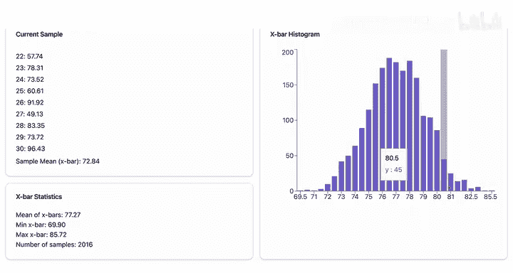

It turns out that these sample means are actually normally distributed。

 This tendency is explained by the central limit theorem。

 which states that if you take sufficiently large samples from any distribution and calculate their means。

 those sample means will be normally distributed。 a sufficiently large sample here typically means n greater than 30。

 In addition， the mean of that distribution will equal mu。

 the population mean of the distribution you sampled from。 That's great。

 That means that the central tendency of the sample mean is around the population mean to clarify what's happening here。

 because this can be a common point of confusion。 you take many samples of size N calculate the sample mean。

 and that's what gets graphed on this histogram。 So the number of samples you take and the size of each of those individual samples is different。

 The standard deviation of this sample distribution behaves a bit differently because as you increase your sample size。

 your estimate becomes more precise。 It's similar to improving at archery。

 as you take more and more shots， the center of your target doesn't change。

 but your shots will become clustered more tightly around it。

 The standard deviation of your sample mean also。

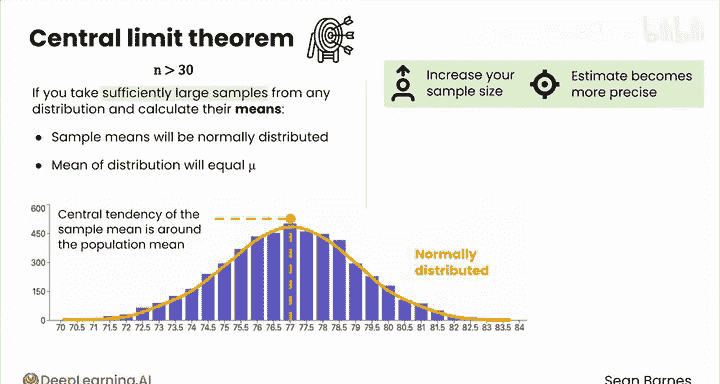

CaedThe standard error of the mean is equal to the true population standard deviation divided by the square root of your sample size Sigma over square root n notice that as n gets larger。

 square root of n also gets larger， but at a slower rate。

Here's a graph of that relationship for small sample sizes。 as N gets larger。

 square root of n grows quickly， reflecting that there are large gains in precision from adding a few more values。

 But as n gets larger and larger， square root of N levels off。

 indicating that there are diminishing returns for the precision of your estimate as your sample size gets larger。

 The central limit theorem also applies to the sample proportion P hat。

 and in some cases to the sample variance and sample standard deviation as well。 Additionally。

 even if your sample data is not normally distributed。

 your sample means will be normally distributed， as long as your sample size is sufficiently large。

 raininfall， for example， might follow a distribution like this one。

 which you saw in the previous module。 The distribution of the sample means will still be normally distributed。

 So even if you're not sure about the underlying distribution of the population。

 you can still perform inference about these sample statistics。

 Here's a quick simulation of how the central limit theorem applies to data that is not normally distributed。

 this simulator allows you to generate samples from。

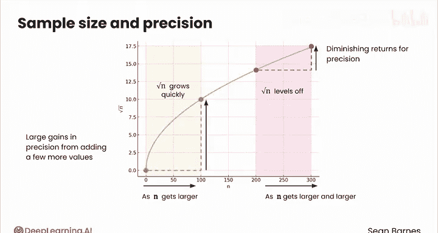

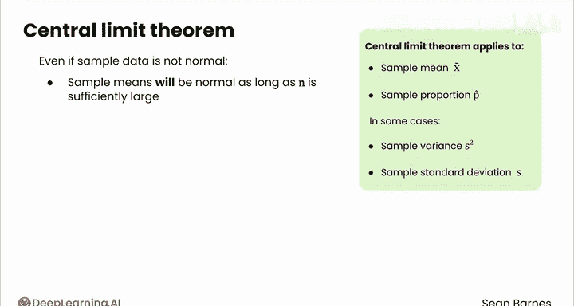

uniformform distribution。 It's just a random number generator that generates numbers from0 to 10。

 each with an equal chance of being generated。 The population mean of this distribution is known to be5 the middle。

 you can see that this first sample looks relatively uniform with a sample mean of 4。

58 and you can see all the values in the sample down here。 Now， if you generate a new sample。

 you get a distribution like this with an x bar of 5。13。 If you generate， say 10 more samples。

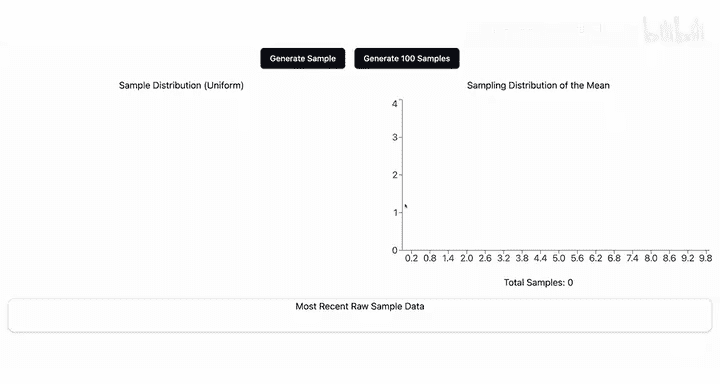

Check out the sampling distribution of the mean now。 What do you think。It looks normally distributed。

 so even though you're sampling from the uniform distribution。

 the sample means are all normally distributed around a true mean of5。

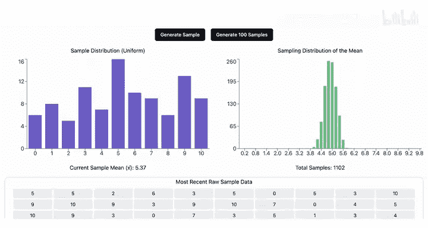

The central emmettheem is a pretty advanced concept。

 and if you're not feeling super comfortable with it yet， that's totally okay。

 The main thread here is that although samples have variability。

 you can use an interval to estimate the population parameters。

 even if you don't know the underlying distribution。 Great work so far in this module。

Once you've completed the practice assessment for this lesson。

 follow me to the next one to start building confidence intervals。

