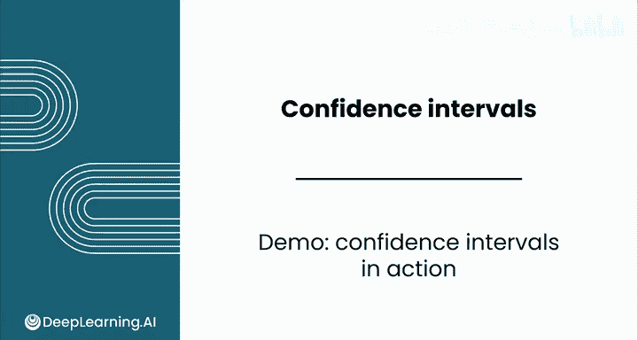
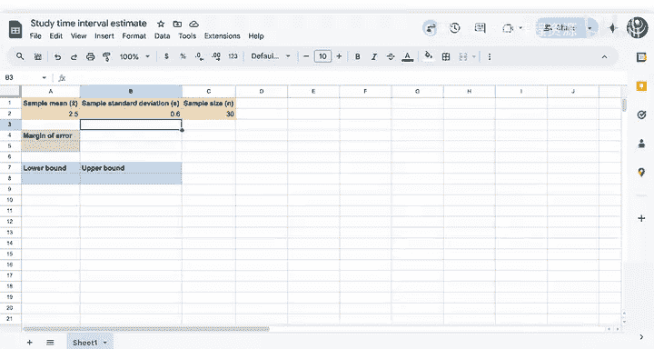

# 吴恩达《数据分析（数据分析基础／应用统计学，1-2课／共5课）｜DeepLearning.AI Data Analytics》中英字幕（claude-4-s - P124：53_演示：置信区间实战.zh_en - GPT中英字幕课程资源 - BV1SCXrYuEwr

Before getting into the weeds of how confidence intervals work。

 let's take a look at a quick example so you can get a sense of the angle。

 Suppose you've studied consistently every day for the past few years。

 both when you were in school and during your career to get a clearer picture of your longterm study habits。

 you decide to collect some data for 30 days， you meticulously track your time spent studying each day。

 This gives you a recent snapshot of your study habits。

 which you can use to estimate your longer term average。 After 30 days。

 you have a sample size of 30 with the sample mean of two and a half hours per day and a sample standard deviation of 0。

6 hours。 you could say your mean daily study time is two and a half hours。 That's a point estimate。

 While this statistic is useful。 It doesn't tell you how precise this estimate is nor how much your study time typically varies to understand the possible range of your true hours daily study time over the years。

 you could construct a confidence interval。 you'll see a few values and calculations that won't make a ton of sense right now。

 but you'll learn each step in detail in the following videos。😊。

Trying to focus on the big picture。 First， you'll calculate the margin of error。

You can see the margin of error involves your sample standard deviation and your sample size。

 as well as a number close to2。 You'll investigate each of these components carefully in the coming videos。

 This number represents the uncertainty of the interval that you're developing to estimate your mean study time。

 In general， a smaller value means more certainty about the population parameter that you are estimating。

 and the larger value means more uncertainty。 You'll use the margin of error to calculate the lower and upper bounds of the interval for the lower bound。

 you'll take the sample mean and subtract the margin of error。 And for the upper bound。

 you'll take the sample mean again。 And this time add the margin of error。

 margin of error literally means the error you are estimating on either side of your point estimate。

 You just constructed a 95% confidence interval。 So your mean time spent studying is between 2。

29 and 2。71 hours with 95% confidence。 If you were to repeat this experiment。 Many， many times。

 logging your study time every day。 Then around 95% of the time。

 The interval you found would contain the true mean value of your daily study time。

It's cool to see how you can use just a 30 day sample to create a plausible re for your average study time over the past few years。

 This demo shows just one way confidence intervals can be useful。

 Folow me to the next video to learn more about how to calculate confidence intervals yourself。😊。

