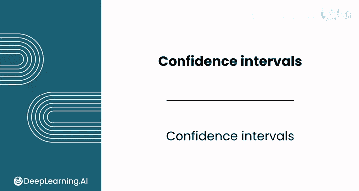
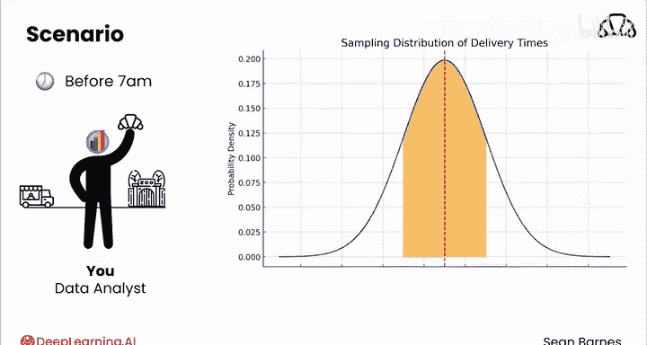
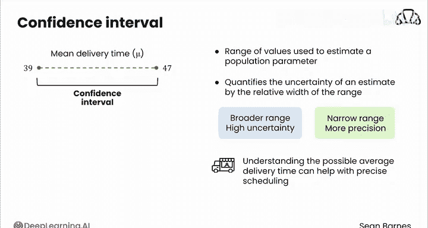

# 吴恩达《数据分析（数据分析基础／应用统计学，1-2课／共5课）｜DeepLearning.AI Data Analytics》中英字幕（claude-4-s - P125：54_置信区间.zh_en - GPT中英字幕课程资源 - BV1SCXrYuEwr

Now that you've seen how confidence intervals can help you develop powerful estimates。

 Let's work through an example calculation and interpretation together。

 Sa you're working as a data analyst at a bakery that delivers fresh pastries to a local zoo each morning。

 the items must arrive before 7 AM， which is when the zoo opens each day。

 you can task with figuring out how long it takes to deliver the pastries in order to help with scheduling。

 Now， rather than guessing or using your magic ape ball。 First。

 you'll want to collect some sample data。 you monitor the delivery truck for 30 days each day recording the time it takes to get from the bakery to the local zoo where the pastries are sold from your sample。

 you calculate a sample mean of 43 minutes and a sample standard deviation of 11 minutes。

 you could just stop there and say your average delivery time is 43 minutes。

 which is a point estimate。 But for a more rigorous analysis， you can create an interval estimate。

 which takes into account the variability in your sample。 Maybe just due to random chance。

 your deliveries in those 30 days were unusually fast or unusually slow。😊。

But you only have this one sample。 So how can you estimate the true mean delivery time to help understand the uncertainty captured in this estimate and how it relates to the true population mean。

 let's visualize what it would look like if you took thousands of samples instead of just one。

 You would get a sampling distribution of the mean like this one。

 Remember that it will be normally distributed and centered around the true population mean According to the central limit theem。

 If you add in the standard deviations， these are all the sample means within one standard deviation of the mean above or below 2 standard deviations and 3。

 your sample of 30 delivery times where you calculated the sample mean of 43 minutes is just one of these thousands of possible samples。

 maybe 43 minutes falls here。 It's a longer than average set of times。

 Remember that one property of the normal distribution is that 50% of the values are above the mean and 50% or below。

 So there's a 50% chance of 43 minutes being a longer than average sample mean。

 or maybe 43 minutes is here。 It's much faster than the。

True average delivery time。 After all， there's a 50% chance that it's a below average time。

 Here's one way to think about it。 What is the probability that your sample mean 43 minutes is within two standard deviations of the true mean。

Based on the two sigma rule you learned in the previous module， that would be 95%。

 Another way of saying that is if you choose any random value in this distribution。

 there's a 95% chance that it's within two standard deviations of the true mean。

 The tricky part is you don't know what the true population mean is。

 That's what you're trying to estimate。 a confidence interval helps you quantify the uncertainty of your estimate since you don't know where your sample mean falls in this distribution。

Let's walk through the steps to calculate a confidence interval。

 Your goal is to estimate the average delivery time for all deliveries。

 not just summarize the ones in your sample。 Your best guess for average delivery time is your sample mean 43 minutes。

 However， you know this estimate is unlikely to be exactly the same as the population mean。

 So you want to create an interval estimate to quantify your uncertainty。

 Now you can build your confidence interval。 Start with your sample mean of 43 minutes。

 You can then add and subtract a certain amount to create your interval estimate。

 This amount is based on three factors。 The variability in your sample。

 sample size and how confident you want to be in your estimate。

 You' will use the standard error of the mean to take into account both the variability and sample size when constructing your interval。

 You saw that the standard error， which is the standard deviation of this sample distribution is sigma over square root of n。

 You don't know Sigma， since you don't know the true population parameters。

 Youll have to use your best estimate。 the sample standard deviation。

 So now you have S over the square root of n。😊，Which is equal to 11 minutes divided by the square root of 30。

 which is right around 2。 Next， you need to decide how confident you want to be。

 A common threshold is 95% confidence， reflecting a 5% chance of error。

 You calculate the sample mean minus 2 times the standard error as the lower bound and the sample mean plus  two times the standard error as the upper bound。

 You use two times the standard error， because according to the two sigma rule。

 you know that 95% of the possible means fall within two standard errors of the mean。

 You have other options， but 95% confidence is quite useful。 reducinging that down。

 The sample mean is 43-2 times 2 equals 39 on the lower bound。 and 43 plus 2 times 2。

 which is 47 on the upper bound。 Pu it all together。

 you can say with 95% confidence that the true mean delivery time is between 39 and 47 minutes。

 This is a confidence interval。 It's a range of values used to estimate a population parameter。

 It also quantifies the uncertainty of an estimate by the relative。

WithOf the range broad ranges are associated with relatively high uncertainty。

 whereas narrow ranges offer more precision in the estimate。

 you can bring this confidence interval back to your colleagues at the bakery to help with decision making。

 understandinging the possible average delivery time can help develop more precise scheduling。

You just calculated a 95% confidence interval， even though you can't be certain how unusual your sample is。

 your confidence interval helps you make an informed estimate。

 Confid intervals can be tricky to interpret。 follow me to the next video to learn more about what they represent。

