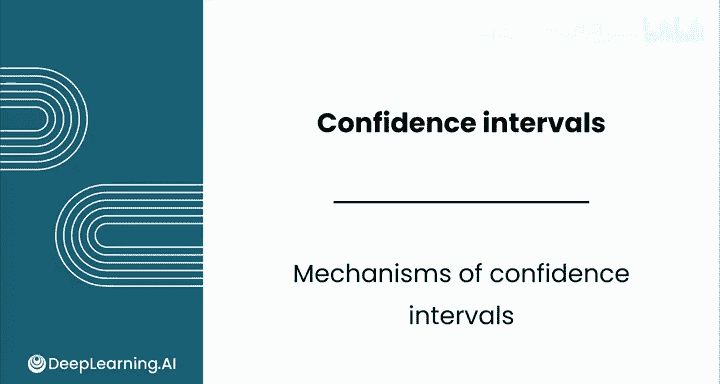
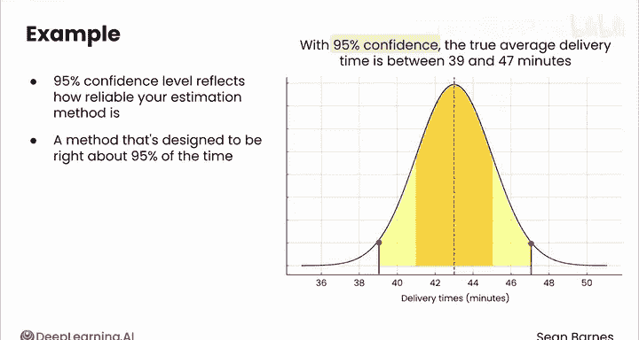
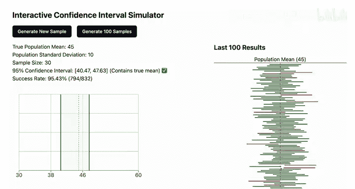
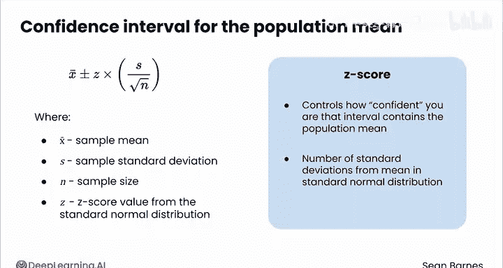
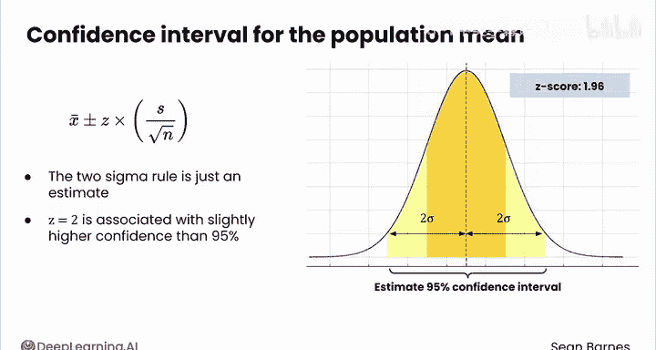
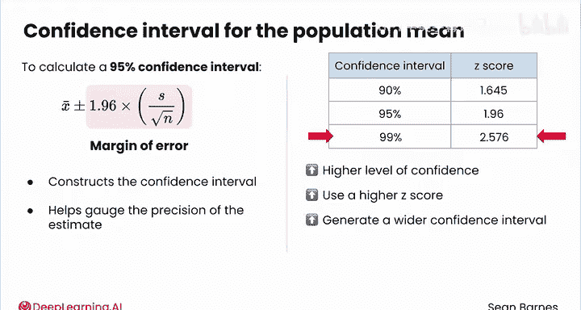
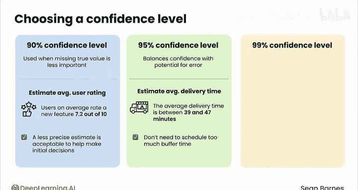

# 吴恩达《数据分析（数据分析基础／应用统计学，1-2课／共5课）｜DeepLearning.AI Data Analytics》中英字幕（claude-4-s - P126：55_置信区间机制.zh_en - GPT中英字幕课程资源 - BV1SCXrYuEwr

You've calculated a 95% confidence interval， but what does it mean in this video。

 you'll see what the 95% part of a confidence interval really means and where it comes from。

Let's step back and look at this statement with 95% confidence。

 The true average delivery time is between 39 and 47 minutes。

 The 95% confidence level reflects how reliable your estimation method is。

 You're using a method that's designed to be right about 95% of the time in the long run。

 Remember that the population parameter is fixed。 but unknown to you。

 So it's either in this particular interval or it's not。 Let me show you what I mean。

 This simulator generates 30 random samples from a normal distribution with the population mean of 45 and the population standard deviation of 10。

 And then it's going to calculate a confidence interval based on that sample。

 Let's generate one new sample。 on the x axis of this graph。

 These are all the possible values for the population mean。

 The red line here is the true population mean of 45。

 The confidence interval is the like gray area between these two green lines。

 which represents a range of values that are estimated to contain the true mean。 In this case。

 this confidence interval is between 43。10 and 50。26。

Which does， in fact， contain the true population mean。 So now you have a success rate of 100%。

 but you can generate more samples。 This one also contains the population mean。 And also this one。

 as you generate more samples， you can see the summary chart on the right side。

 This chart shows each confidence interval that you generated as it relates to the true population mean again showed here in the dashed red line。

 Each time the green bar overlaps with the dashed red line tells you that the true population mean was contained within that interval。

 you can see an example here where the confidence interval just barely overlap with the dashed red line。

You finally generated a confidence interval that did not contain the true population mean。

 The entire confidence interval was actually lower than where the true population mean is。

 which you can also see on this chart on the left。 you can generate 100 samples。

 and you can see that getting a confidence interval that does not contain the true mean is a relatively rare event in this case。

 only two out of the 100 samples that were generated did not contain the true population mean。

 and if you generate a bunch more， you can see that the success rate eventually settles around the 95% that you would expect。

 what the simulation is showing you is that when you calculate a confidence interval for the mean based on a sample。

 you have a 95% chance that the confidence interval will in fact contain the true mean and that's the whole purpose of confidence intervals。

 you have some uncertainty in your sample， you don't know how far or how close the sample mean you calculated actually is from the true population mean。

 but using inferential statistics， you can calculate a range of values that if you repeated the process many times would contain the true value 95% of the time。

Not looking directly at the truth， but a powerful estimate of that truth。

 Now that you've developed some intuition for confidence intervals。

 Here's the formula to calculate a confidence interval for the population mean X bar plus or minus z times s over the square root event。

 you've seen all these values before。 X bar and S are your sample statistics and N is your sample size。

 Z represents a z score value from the standard normal distribution and it controls how confident you are that the confidence interval contains the population mean。

 recall that the z score is the same as the number of standard deviations from the mean in a standard normal distribution。

 In the previous video， you use two standard deviations from the mean to estimate a 95% confidence interval。

 The actual value that represents this level of confidence is 1。96。

 and that's because the two sigma rule is just an estimate2 standard deviations above and below the sample mean is actually associated with slightly higher confidence than 95%。

 So in practice， you'll use a z score of 1。96 to be more precise。 So to put all this together。😊。

To calculate a 95% confidence interval， you have this formula X bar plus or minus 1。

96 times S over the square root event。 The term on the right is called the margin of error。

 It's the part that constructs the confidence interval and helps you gauge the precision of the sample estimate you can calculate confidence intervals with different levels of confidence as well。

 What confidence levels do you think might be useful。

The most common are a 90% confidence interval with the Z score of 1。645。

95% confidence with the z score of 1。96， which you just saw and a 99% confidence interval with the z score of 2。

576。 Note that the higher level of confidence means that you use a higher z score and therefore generate a wider confidence interval。

 So to increase your confidence that your interval contains the true mean。

 you broaden in the range of the interval estimate。

 choosing the confidence level for a particular estimate depends on a few factors。

95% is the most commonly used confidence level because it balances confidence with the potential for error。

 For example， the average delivery time is between 39 and 47 minutes。

 It's important to arrive on time to keep your contract with the U。

 So you try to balance certainty about the average delivery time with the precision of your estimate。

 an 8 minute range means that you don't need to schedule too much buffer time into your scheduled departure。

 A 90% confidence level might be used for preliminary studies。

 or when missing the true value is less important。

For example， if you're working with a product research team。

 you may use a 90% confidence interval to estimate that users， on average， rate a new feature a 7。

2 out of 10 in the early stages of development， a less precise estimate is acceptable to help make initial decisions。

 a 99% confidence level is used when you want to minimize the risk of error。 For example。

 if you're working with a team of scientists estimating pollution in a river。

 it may be important to have a high confidence level to pass regulatory testing calculating the pollutant concentration in a river with 99% confidence can help your team reduce the risk of harmful environmental impact。

 Keep in mind that all these estimates， even the 99% confidence interval carries some chance of error。

Great work going through the simulations of confidence intervals and the general formula in the past few videos。

 you've seen that confidence intervals depend on your sample size and confidence level。

 How do these terms interact？Follow me to the next video to take a look。

