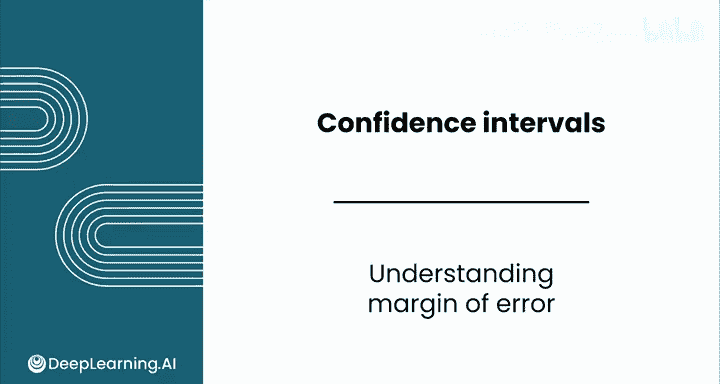
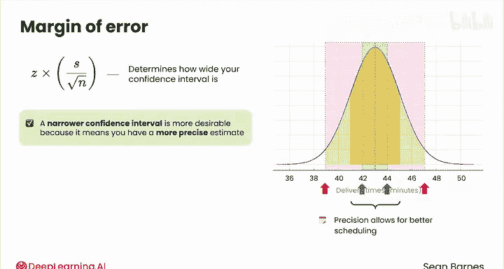
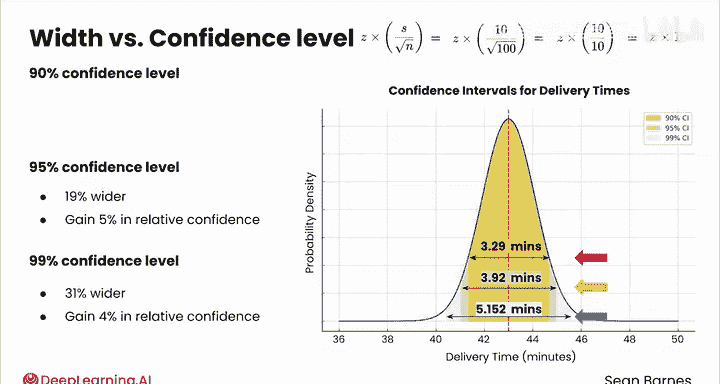
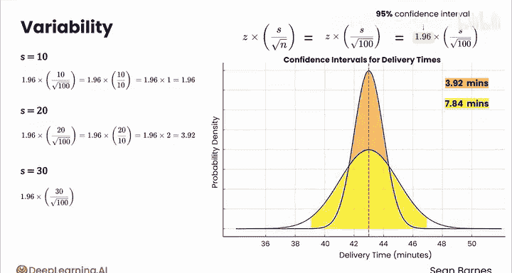
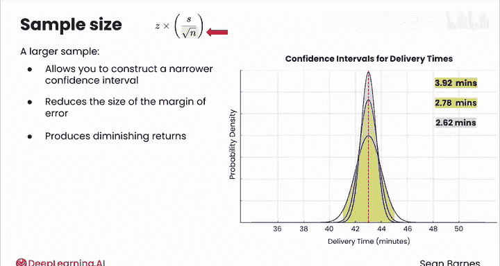
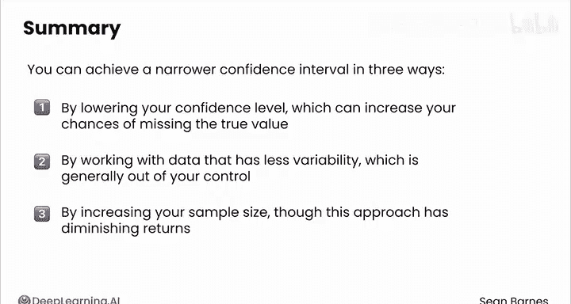

# 吴恩达《数据分析（数据分析基础／应用统计学，1-2课／共5课）｜DeepLearning.AI Data Analytics》中英字幕（claude-4-s - P127：56_理解边际误差.zh_en - GPT中英字幕课程资源 - BV1SCXrYuEwr

So what makes the confidence interval narrower or wider。

 Some of the factors depend on your sample data， and one depends on a decision that you get to make。

 Let's zoom in on the margin of error。 This term， as you saw in the previous video。

 determines how wide your confidence interval is。 In general。

 a narrower confidence interval is more desirable because it means you have a more precise estimate。

 For example， rather than saying the average delivery time is somewhere between 39 and 47 minutes。

 Would it be nice to say it's between 42 and 44 minutes。

That level of precision would allow for better scheduling。 based on its formula。

 you can see that margin of error depends on three different factors。 Your desired confidence level。

 your standard deviation。 That is the amount of variability in your data and your sample size。

 Note that the margin of error uses S as an estimate for the population standard deviation。

 Let's take a look at how changes in each of these factors impacts the margin of error。 First up。

 the desired confidence level。 you saw in the previous video that some common confidence levels you'll use are 9095 and 99%。

 and the corresponding z scores are 1。645，1。96 and 2。576， respectively。

 Let's do some quick calculations based on the delivery driver example。

 If you hold S and n constant with an S of 10 and n of 100。

 That means this part of the margin of error term， S over square root of n will come out to 10 over 10 or1。

 starting with a confidence of 90%。 That gives you a z score of 1。645。 The margin of error。

Be equal to 1。645。 So the width of the full 90% confidence interval would be twice that or 3。

29 minutes wide。 Next up， the 95% confidence interval Z is now 1。96。

 making the confidence interval 2 times 1。96 or 3。92 minutes wide。 Then finally。

 the 99% confidence interval。 Z is 2。576。 That times 2 gives you a width of 5。152 minutes。

 This example illustrates the tradeoff between level of confidence and the width of your interval。

 High confidence means a wider interval。 Notice that the width of the interval is not proportional to the relative increase in confidence。

 95% confidence interval is about 19% wider than the 90%1。

 even though you can only gain about 5% and relative confidence。 Similarlyly。

 the 99% confidence interval is 31% wider than the 95%1。

 and you only get a 4% gain and relative confidence。

 This relationship is related to the shape of the normal distribution， which as you know。

Accumulates less probability in the tails。 as you move further from the mean。

 you need to cover an increasingly larger range to capture an additional percentage of confidence。

 Let's now zoom in on the impact of variability on the confidence interval。 For now。

 let's hold n constant at 100 again and use a z of 1。96 for a 95% confidence interval。

 with S equals 10， you have 10 over 10， which equals 1 times 1。96。

 So the width of this confidence interval is 2 times 1。96 or 3。92 minutes wide。 If s is 20。

 the variability in your data is twice as large。 So the margin of error is 20 over 10 times 1。

96 equals 3。92。 that makes your confidence interval 2 times 3。92 or 7。84 minutes。

 double the variability makes the confidence interval twice as y。 Finally， for an S of 30。

 you get 30 over 10 times 1。96 equals 5。88 times 2 gives you a range of 11。76。

 Notice that the relationship between this。

In deviation and the margin of error is linear。 as S goes up。

 the margin of error increases proportionally， and the same when S decreases。

 the main consequence for business applications is that if your data has a lot of variability。

 you can expect a less precise estimate。 For example。

 arrival times for a city bus system may be significantly more reliable than for a suburban bus system。

 Which one do you think will be easier to estimate。That would be the city bus system。

 The smaller variability makes it easier to estimate the true average arrival time compared with the suburban bus system。

 In other words， sample size and confidence levels being equal。

 your confidence interval for the city bus system will be narrower。

 sampleple size has a bit more of a complicated relationship with margin of error。

 Since yourre dividing by its square root。 Here's a concrete comparison。 for a constant z of 1。

96 and S of 10。 imagine a sample size of 100。 your margin of error works out to be 1。

96 times 10 over 10， which is1。 So the width of this confidence interval would be 2 times 1。96。 or 3。

92 minutes。 Then you could have a sample size of 200。

 So double the number of delivery times recorded。 That works out to 1。

96 times 10 over the square root of 200。 Square root of 200 is around 14。1。 So 10 over 14。

1 equals about 0。710。71 times 1。96 equals 1。39。 Ma the width of your confidence。

intervalterval 2 times 1。39 or 2。78 minutes wide。 Finally， with the sample size of 300。

 you have 10 over the square root of 300， which is around 17。3。 that gives you 0。58 times 1。96。

 which is 1。31 times 2 gives you a range of 2。62 minutes。

 What these numbers mean is that a larger sample allows you to construct a narrower confidence interval with the same variability and level of confidence。

 yourre dividing the standard deviation by square root of n。

 So a larger n reduces the size of the margin of error。 However。

 larger sample sizes produce diminishing returns。 I your sample size by 100% reduce the size of the confidence interval you could calculate by 29%。

 Then adding 100 more deliveries only reduce the interval by about 6%。

 Here's a graph of the relationship between sample size and margin of error。

 you can see that the relationship is negative Since a larger sample size decreases your margin of error。

 but there are diminishing returns as the slope flattens out the higher end。

Using this graph， can you estimate where the benefit from a larger end seems to level off？

You might say that somewhere between 100 and 200， there is an inflection point in the graph。

 This relationship is a basic fact of statistics， and it helps explain why you often need a relatively small sample size。

 even to estimate a very large population like the opinions of everyone in the country of France。

 The consequences in your work will be that generally adding more and more data will narrow your interval。

 once you get into the very high sample sizes in the hundreds or thousands。

 you will observe a diminishing impact of more samples， So to summarize。

 you can achieve a narrower confidence interval in three ways， by lowering your confidence level。

 which can increase your chances of missing the true value by working with data that has less variability。

 which is generally out of your control， or by increasing your sample size。

 though this approach has diminishing returns。

Create work studying these relationships， follow me to the next video to learn more about how to calculate confidence intervals yourself。

