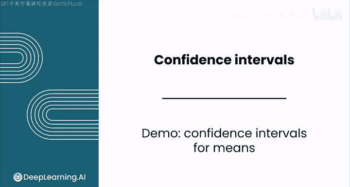
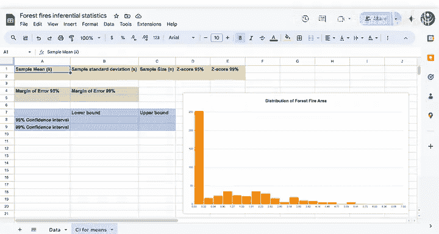

# 吴恩达《数据分析（数据分析基础／应用统计学，1-2课／共5课）｜DeepLearning.AI Data Analytics》中英字幕（claude-4-s - P128：57_演示：均值置信区间.zh_en - GPT中英字幕课程资源 - BV1SCXrYuEwr

Let's take a closer look at confidence intervals in action。

 You'll use the forest fires data set you worked with earlier。

 The National Park Service of Portugal has asked you to create a more rigorous estimate for the mean area of forest fires based on the sample data。

 They plan to use your estimate to stock fire fightingight supplies and want to make sure they have enough supplies to account for a potentially inaccurate estimate。

 recall that the forest fire area is skewed towards small values。

 Even though this distribution of values is skewed。 However。

 the central limit theorem states that the sample distribution of its mean will be normally distributed。

 So you can construct a confidence interval for the area。

 What components will you need to calculate the confidence interval for the area。

 you'll need the sample mean sample standard deviation number of samples and the Z score。

 Let's compute these values。 First， you want to get the center of your interval also known as the sample mean。

😊。

The mean area is around 12。85。 Next， you can calculate the sample standard deviation。

And the sample standard deviation is around 63。66。 That very large sample standard deviation is indicative of the strong variability in your data。

 Next， you can calculate your sample size。Now， you have to make a decision。

 What confidence do you want。 It's a good idea to start with 95%。 That's often kind of the default。

 It's a good balance between confidence and precision。 So the Z score corresponding to 95% is 1。96。

 Next， you can calculate the margin of error。 Remember that the margin of error equals the z score times the sample standard a deviation S divided by the square root of the sample size N。

 In this case， the margin of error is around 5。49。 Now。

 to find the lower bound of a confidence interval， you can subtract the margin of error from the sample mean。

 And you can add these two values together to calculate the upper bound。 That's it。

 you just calculated your first。 Well， second confidence interval。

 The way you would interpret this result with 95% confidence the true population mean area will fall between 7。

36 and 18。33 hectares。 Hectares is just a unit of area。 Now。

 imagine that the park service has come to you and said， hey。

 we need to be even more certain about our fire preparedness plants。 Can you。😊。

Give us an estimate that you're more confident in， even if it has a wider range。

 we want to be as prepared as possible for these fires。 How would you proceed。

 Your next step could be to create a 99% confidence interval。 The sample statistics are the same。

 You just need to change the z score to 2。576 and then update the margin of error and bounds of a confidence interval。

 How do you expect this margin of error to compare to the version calculated for 95%。

 for the margin of error， it's now your new z score of 2。576。

 times your sample standard deviation again， divided by the square root of your sample size。

 You can see here that the margin of error is larger。

 given the higher confidence that you've selected， and then you can go ahead and calculate your lower and upper bounds again by subtracting and adding the margin of error to the sample mean。

 What happened with the length of the interval。 The margin of error increase from 5。49 to around 7。

21。 Therefore， the width of the 99% confidence interval is larger with 99% confidence。 the true。

Mean areaa is between 5。64 and 20。06 hectares。 Nice work calculating confidence intervals for the mean。

 Spreadsheets make the task so much easier than doing it by hand。

 That takes you to the end of this lesson。 you've learned a ton already。

 Once you've completed the practice assessment and practice lab for this lesson。

 Foow me to the next one to construct confidence intervals for proportions。😊。

