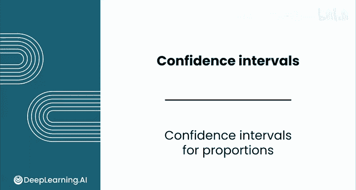
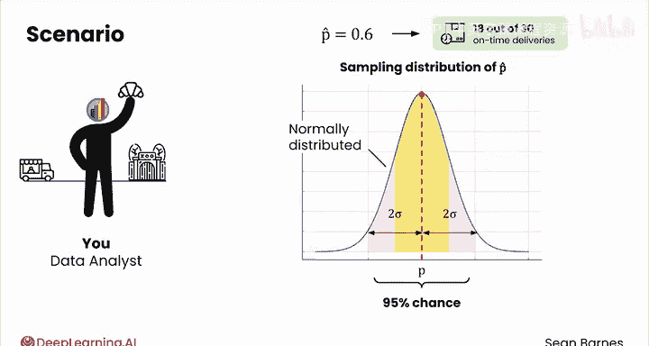
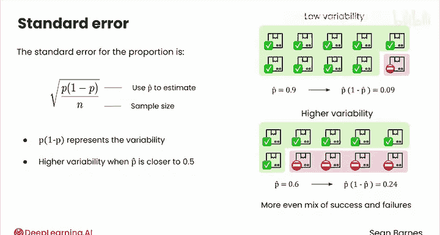
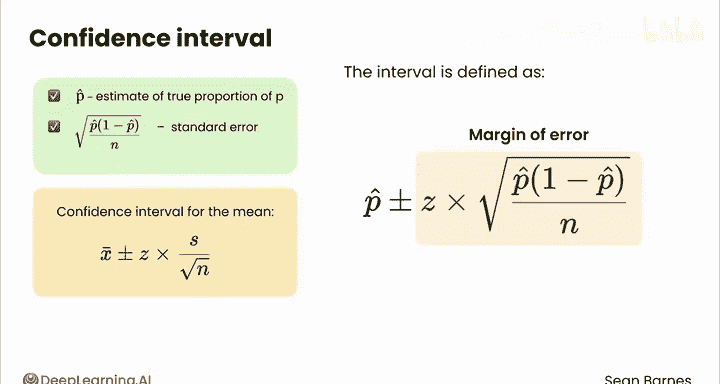
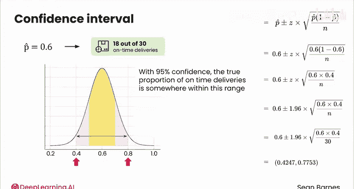

# 吴恩达《数据分析（数据分析基础／应用统计学，1-2课／共5课）｜DeepLearning.AI Data Analytics》中英字幕（claude-4-s - P129：58_比例置信区间.zh_en - GPT中英字幕课程资源 - BV1SCXrYuEwr

It's useful to estimate the mean of a population， but the mean isn't the end all be of statistical inference。

 You're often interested in some other aspect of your population， like the population proportion。

Let's reconsider the example of analyzing delivery times for the bakery delivery scenario。

 while estimating the mean delivery time is useful。

 you might also be interested in investigating the rate of on time deliveries。

 You may ask a question like what proportion of deliveries are on time。

 Those are the deliveries that made it to the zoo by 7 AM。 You can represent this proportion as P。

 The true proportion of on time deliveries。 Suppose you collect a sample of 30 deliveries and record if they were on time or not。

 The proportion of on time deliveries in your sample is represented by P hat。

 which is your estimate for the true proportion P。 hat is just a funny term for an estimate。

 Let's imagine that you measured the proportion of on time deliveries in your sample as 0。6。

 which would be 18 out of 30 on time deliveries and could be improved。 similar to the sample mean。

 The sampling distribution of P hat is also normally distributed。 This time。

 with the mean equal to the true proportion P。 So if you took many。

 many samples of 30 deliveries and calculated the proportion of on time deliveries for each sample。😊。

Those proportions would be normally distributed。 Your P hat of 0。

6 falls somewhere within this distribution。 What do you think is the chance of P hat falling within two standard deviations of the true proportion P。

Just like with means， there's a 95% chance that P hat is within two standard deviations of P。

 according to the two sigma rule。 Now， let's talk about the standard error。

 The standard error for the proportion is written as the square root of p times 1 minus p over n。

 Since you don't know the true proportion P。 you can use the sample proportion P hat to estimate it。

 Let's break this formula down of it。 Just like standard deviation。

 P times 1 minus p represents the variability in your data。

 Let's visualize how p times 1 minus p quantifies variability for a scenario with 10 deliveries。

 Suppose you observe9 on time deliveries and one late delivery。

 This sample data would have low variability because only one out of the 10 outcomes was different from the others。

 contrasttra that with these 10 deliveries from your sample， where 6 or on time and 4 or late。

 This data has higher variability because there is a more even mix of success and failures。

 In the first scenario， P hat is 0。9。 So P hat times 1 minus P hat equals 0。

For the second scenario， P hat equals 0。6。 so P hat times 1 minus P hat is 0。24。

 so mathematically the data has higher variability when P hat is closer to 0。5。 Next。

 you'll divide this quantity by your sample size， which again represents the idea that a large sample size gives you a more precise estimate。

 and lastly， you'll take the square root to make sure this quantity matches the original scale of your data。

 Now you have your P hat and standard error， so you can construct a confidence interval for this proportion。

 similar to how you would construct a confidence interval for the mean The interval is defined as P hat plus or minus z times the standard error。

 which is the square root of P hat times 1 minus P hat over N。

 Do you remember the name of this term on the right。

It's called the margin of error， just like the confidence interval for the mean。

 Remember that it represents the uncertainty in your estimate。

 Here's the 95% confidence interval for the proportion of on time deliveries for your sample scenario。

 P hat is 0。6， So 1 minus P hat is 0。4。 Z is 1。96 for 95% confidence interval， and n is 30。

 The resulting confidence interval ranges from 0。4247 to 0。7753， meaning that with 95% confidence。

 the true proportion of on time deliveries is somewhere within this range。

 This wide interval is reflected in the high variability of the data as well as the relatively small sample size。

 Oftentimes， you need a larger sample size to calculate precise intervals for a proportion。

So there you have it， you've now calculated confidence intervals for means and proportions。

 there are a broad range of business questions that you can approach with estimates。

 followow me to the next video to get hands on with calculating sample means and proportions and spreadsheets See there。

