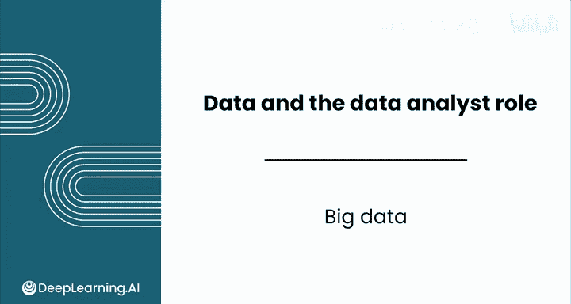
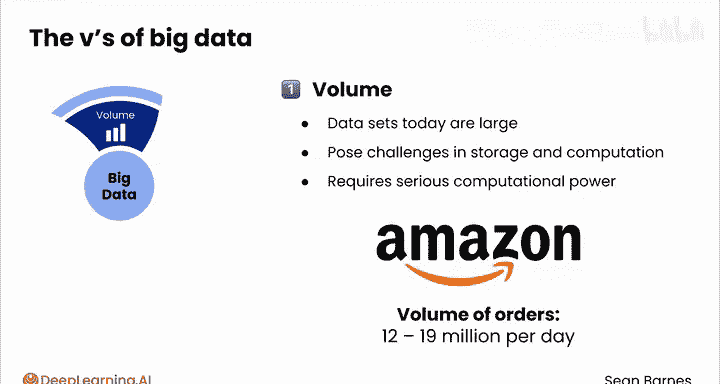
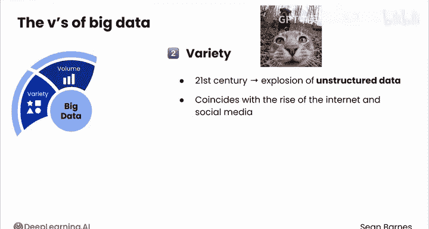
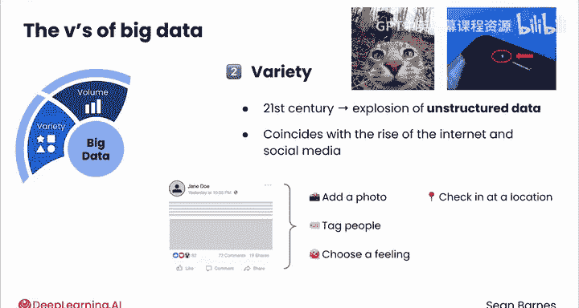
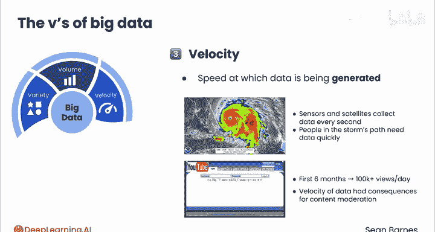
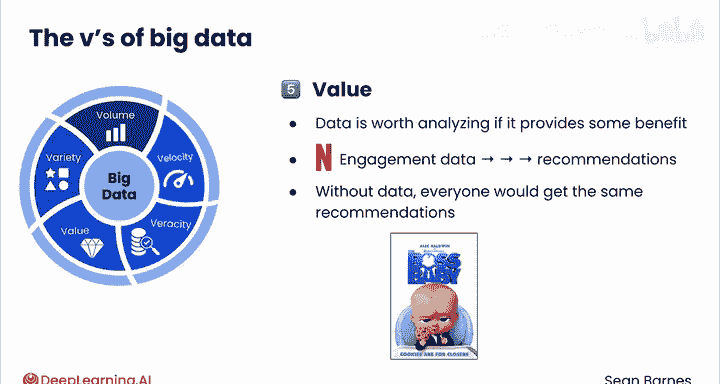
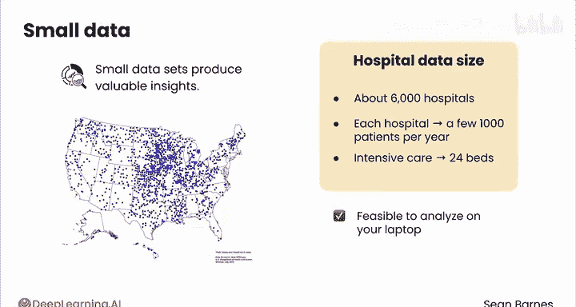

# 吴恩达《数据分析（数据分析基础／应用统计学，1-2课／共5课）｜DeepLearning.AI Data Analytics》中英字幕（claude-4-s - P12：11_大数据.zh_en - GPT中英字幕课程资源 - BV1SCXrYuEwr

You may have heard the term big data thrown around。

 but what does that actually mean You might hear the term and think， well。

 that just means dealing with large volumes of data That's certainly a part of it。

 but there's more to it than that。 Big data is defined by three key attributes known as the three Vs volume。

 variety and velocity。 Let's start with volume， this is probably the most straightforward characteristic of big data data sets nowadays are often so large。

 they pose significant challenges in terms of storage and computation。

 Think about a company like Amazon and the sheer volume of orders they process around 12 to 19 million of them every day。

 In fact， since you started watching this video， Amazon has probably process more than 6000 orders。

 volume matters because storing and analyzing that data requires some serious computational power If you are working at Amazon and wanted to analyze transactions even from a single day you wouldn't be able to do so on your laptop at home nor would you be able to manually copy and paste the transaction data from one location to another。

Then there's variety in the past， the data that analysts work with tended to be structured。

 meaning it fit neatly into databases or spreadsheets。

 but the 21st century has seen an explosion of unstructured data like images， text。

 video and even augmented reality data from products like the Apple Vision Pro This explosion coincides with the rise of the Internet and social media in particular there are way more selfies now than about 20 years ago because the first smartphone with the front- facingcing camera only came out in 2010 on a platform like Facebook。

 for example， when a user goes to create a new post， they can add a photo。

 tag people chooseose a feeling， check in in a location start a fundraiser or even stream live video Each of these post types requires its own methods for preprocessing and analysis if you want to answer a seemingly simple question like what is a particular user typically post about you would need to analyze an extremely diverse set of data。

The third V is velocity。 This refers to the speed at which data is being generated。

 You saw the rate at which Amazon must process orders a moment ago。

 but it's not just a tech thing During a hurricane sensors and satellites collect massive amounts of data every second which must be rapidly analyzed to predict the hurricane's movement pattern if analysts can't wangle that data quickly people in the storm's path could get delayed information the sheer velocity of data on social media in particular is staggering within YouTube's first six months the site was getting over 100000 video views per day So。

 so many videos were uploaded that human moderation simply wasn't feasible and YouTube turned to automated techniques。

 In other words， the velocity of data had consequences for how YouTube moderated its content which has had continued ripple effects on content moderation today So that's the original threes and you could stop there but there's a bit of a movement to add even more viewss to the framework while the first three vs you just saw are the most important。

That differentiate big data from what you might call small data。

 Let's take a look at the additional vs。 The fourth V is veracity。

 This refers to the quality of the data， and it's a crucial consideration。

 especially as the volume variety and velocity of data increase I the data coming from a trustworthy source could it have been corrupted along the way as the saying goes garbage in garbage out。

 if your data is of poor quality， your insights and consequently your business decisions will also be poor the fifth V is value。

 the idea here is that data is only worth analyzing if it actually provides some benefit。 at Netflix。

 for example， the vast amount of engagement data we collect feeds into the recommendation system allowing for personalized suggestions without that data。

 everyone would just get the same generic recommendations like that Netflix account your whole family shares know the one where boss baby is recommended right next to screen too While big data is prevalent in today's world of data analytics there are plenty of situations where relatively。

Small data sets produce valuable insights。 It might surprise you to learn that there are only about 6000 hospitals in the US That's not a lot compared to the 290。

000 tender matches every minute。 Each hospital might only serve a few thousand patients each year。

 an intensive care unit might only have a couple of dozen beds。

 It's perfectly feasible to analyze that data on your laptop and the data generated in these contexts can still be incredibly valuable for improving patient outcomes。

 As a data analyst， your job is to consider the data in the context of the problem you're trying to solve Sometimes that will mean working with massive。

 complex data sets and other times it will mean investigating a smaller， more focused data。

 Great work completing this lesson。 You've seen the many types of data you'll be working with as an analyst in the upcoming practice lab。

 you'll work with both structured and unstructured data in an e-comce case study for a gift shop。

 I know you'll enjoy it Once you finish the practice lab and practice assessment join me in the next lesson。

To see how data fits into the bigger picture of an organization。

 we'll be talking about data teams and data ecosystems。Intriguing， I'll see you there。

