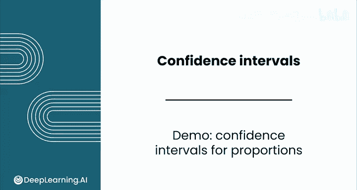
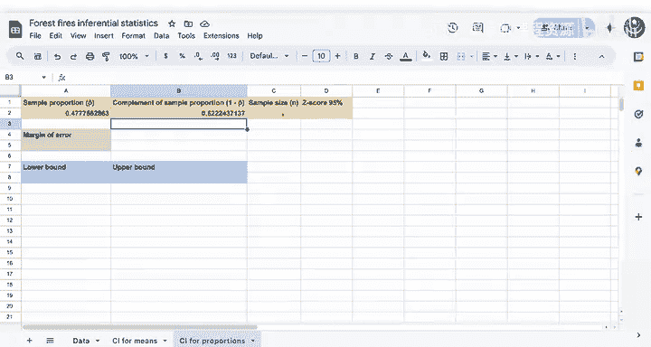

# 吴恩达《数据分析（数据分析基础／应用统计学，1-2课／共5课）｜DeepLearning.AI Data Analytics》中英字幕（claude-4-s - P130：59_演示：比例置信区间.zh_en - GPT中英字幕课程资源 - BV1SCXrYuEwr

Let's calculate a confidence interval for the proportion using the forest fires data set。

 The steps are very similar to those for the mean。 say the parks departments stay cost effective by preparing differently for forest fires that are considered small。

 for small fires， they staff smaller crews and allocate hand tools rather than power tools。

 The parks department is interested， in an estimate of the proportion of fires that they considered small to solve this problem。

 You can use the is small column to find the confidence interval for the proportion of fires that are considered small。

 You can explore the distribution by inserting a quick chart just to get a sense of the balance between small and not small areas。

 You can see that the distribution of small and not small areas is roughly equal。

 So given that the proportion of small areas is closer to 0。5。

 you should expect that the variability of this distribution will be higher。 First。

 you can calculate the value of P hat from the column is small。 In this case。

 because the column contains values of 0 and1。 you can use the average function to calculate this proportion。

And the result that you get is that the sample proportion is around 0。48 Next。

 you can get the value for 1 minus P hat。 just by calculating the complement of the value in the cell to the left。

 and that result is around 0。52。 Next， you can calculate the sample size in the data again by using the count function。

 These values shouldn't be bold。 So I'm just going to unbol them。 Now， let's divide the z score。

 And with that the margin of error and the confidence interval bound。

 say you want to calculate a 95% confidence interval for P。 So in the z score cell。

 you want to enter in a value of 1。96。 Next， you can calculate the margin of error。

 The formula changes a bit from the mean as the standard error is now the square root of P hat times 1 minus P hat over n。

 So for the margin of error calculation， you want to take the z score times your P hat times your1 minus P hat divided by your sample size N。

 and then you want to wrap all of that inside square root。

Lastly， you can calculate the lower bounds and upper bounds of your confidence intervals。

 So for the lower bound， you can take your sample proportion and subtract your margin of error and for the upper bound。

 you will take your sample proportion and add the margin of error can also simplify these results to make them a little easier to read。

 and the resulting confidence interval is 0。4347 to 0。

5208 so with 95% confidence the true proportion of small areas is between 0。4347 and 0。

5208 you may also notice that 0。5 exactly half of the forest fires being small is contained within this confidence interval。

 So that would be a reasonable value for the true population parameter。 Therefore。

 the parks department may be able to take advantage of smaller resourcing to cover this relatively large volume of small fires。

 So how does this confidence interval help the fire department make better decisions。 In this case。

 suppose they plan for sample proportion of around 47。8% of small fires but。

Suppose the true population proportion was closer to the lower bound of around 43。4%。 In that case。

 the fire department would have underestimated the proportion of not small fires and then inadequately resourced to mitigate the issue。

Excellent job calculating that confidence interval。 even though the statistic is different。

 the underlying principles are the same。 That takes you to the end of this shorter lesson on confidence intervals for proportions。

 Once you've completed the practice assessment and practice lab。

 follow me to the next lesson to apply large language models to confidence intervals。

