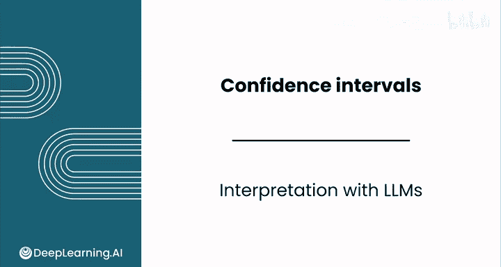
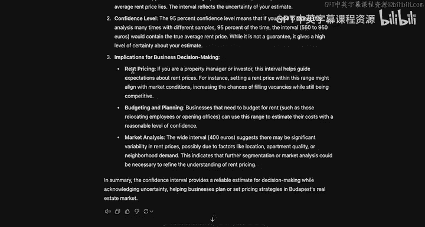
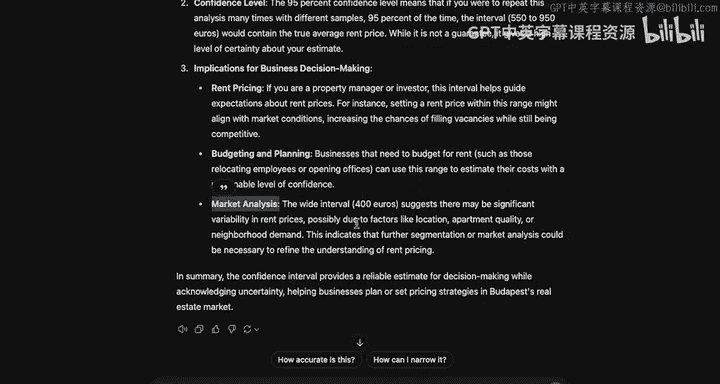
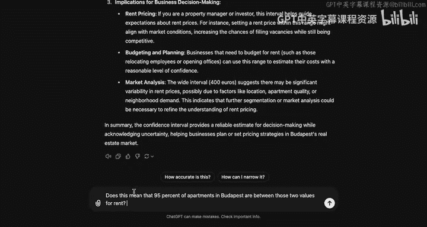
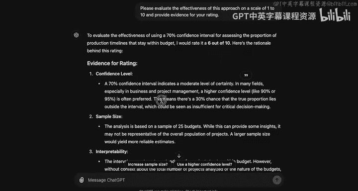
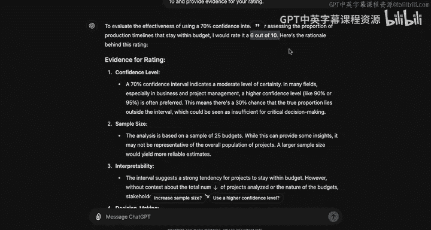
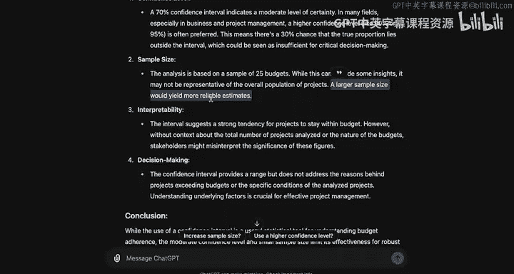

# 吴恩达《数据分析（数据分析基础／应用统计学，1-2课／共5课）｜DeepLearning.AI Data Analytics》中英字幕（claude-4-s - P131：60_使用LLM进行解释.zh_en - GPT中英字幕课程资源 - BV1SCXrYuEwr

Now that you've seen how to construct confidence intervals for means and proportions。

 you may be wondering how large language models can help you with these tasks。

 Let's start a new chat with Chad GT40。 Here's the scenario。

 Suppose you say I constructed a 95% confidence interval for the mean rent price of a 1 bedroom apartment in Budapest Hungary。

 I calculated the interval as 550 to 950。 Explain what these results mean in business terms。

It says that the 95% confidence interval you constructed for the mean rent price of a one- bedroom apartment in Budapest ranges from 550 to 950 and then it tells you what this means in business rooms First it talks about uncertainty and estimation it highlights that your estimating the average rent price but due to the variability in rent price you cannot pinpoint an exact number so instead you use a range to estimate the true average rent price It also speaks about the confidence level and tells you that the confidence level of 95% means that if you were to repeat this analysis many times with different samples 95% of the time the interval would contain the true average rent price it also tells you that it's not a guarantee but it does give you a high level of certainty about your estimate Next it tells you some implications for business decision making it talks about how you might use this information to set prices if you're a property manager it also tells you how you might inform budgeting and planning for businesses who need to rent spaces it also tells you that you can use this data to inform market analysis to。

St variability and rent prices within a given location Again。

 you can follow up and ask questions like does this mean that 95% of apartments in Budapest are between those two values for rent？

It says no， it does not mean that it tells you that this is a common misconception， and I agree。

 and it reinforces the true definition of a confidence interval。

 which is the estimated range for the average rent of a one bedroom apartment。

 not the range for individual apartment prices。 Okay a couple other cool things I want to show you。

 Let's start a new chat and get a clean slate。 LLm can help you double check your work。

 but you should also be very mindful of their potential for errors。 So say you had this scenario。

 your product lead ask you to investigate the proportion of production timelines that stay within budget。

 You investigate 25 budgets and calculated a 70% confidence interval for the proportion as 91% to 94。

5%。 and you wanted to help you succinctly interpret this result for your boss。

So here you can see that it provided a very succinct response at the interval you calculated means that you were 70% confident that the true proportion of production timelines that stay within budget fall between 91% and9 4。

5% and that it suggests that a significant majority of the projects are likely to remain on budget In this case the 70% confidence interval that you calculated is very uncommon in this case the LLM did exactly what you wanted to do it did not evaluate the quality of your approach and give you some feedback to help you improve overall but what you can do is ask it a follow-up question to evaluate the effectiveness of your approach asking the LLM to respond on a scale of1 to 10 is a helpful approach to help you easily evaluate what the LLM says。

So here it actually does comment on the 70% confidence interval that you selected and tells you that the 70% confidence interval only provides you with a moderate level of certainty and that in many cases confidence levels like 90% or 95% is often preferred。

 the 70% confidence interval actually tells you that there's a 30% chance that the true proportion lies outside the interval which could be seen as insufficient for critical decision making。

 notice that the LLM rated your overall approach as a6 out of 10。

 which suggests that it has sub reservations， it also comments about the sample size。

 so while it acknowledges that you use a sample of 25 budgets。

 it suggests that a larger sample size would yield more reliable estimates。

Follow me to the next video to see how you can get an LLM that can write and run code to create a sampling simulation for you。

