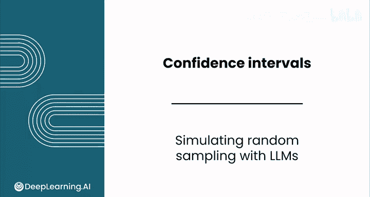
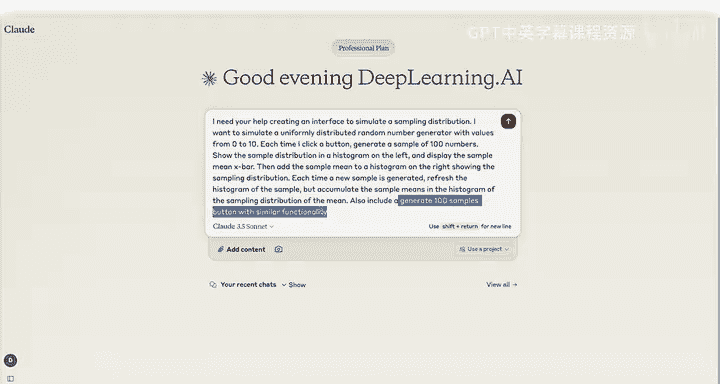
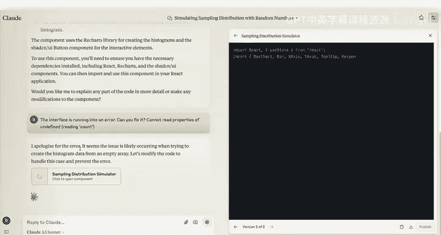
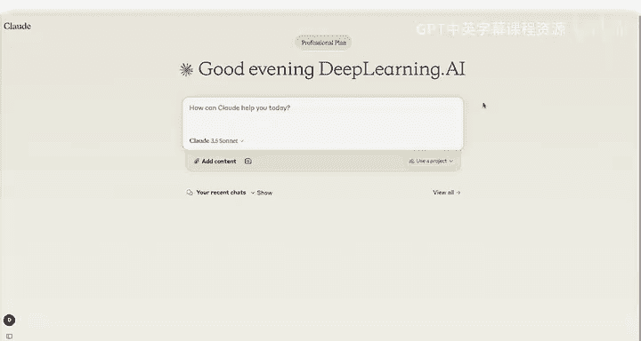

# 吴恩达《数据分析（数据分析基础／应用统计学，1-2课／共5课）｜DeepLearning.AI Data Analytics》中英字幕（claude-4-s - P132：61_使用LLM进行随机抽样模拟.zh_en - GPT中英字幕课程资源 - BV1SCXrYuEwr

Large language models are great at coding tasks， even if you're not familiar with coding。

 they can help you whip something up quickly。 One cool coding task they can help you with is creating an interface to simulate sampling。

The sampling distribution simulations you saw earlier in this module were actually created with Quad。

 This process sometimes can involve a bit more back and forth with the LLM。

 and you'll see why in a moment。 you'll notice in a moment that the prompt is quite long and detailed。

 which is part of your prompting best practices。 You want to make sure the LLM has enough information to build exactly what you want。

 Here's the prompt。 You're telling the LLM that you need its help creating an interface to simulate a sample distribution。

 You want to simulate a uniformly distributed random number generator with values from0 to 10。

 and each time you click a button， you want it to generate a sample of 100 numbers。

 You want it to visualize the sample distribution in the histogram on the left and display the sample mean X bar。

 You also want to add the sample mean to a histogram on the right， showing the sample distribution。

 Each time a new sample is generated， refresh the histogram of the sample but accumulate the sample means in the histogram of the sampling distribution of the meat。

 You also want a button that generates 100 samples with similar functionality。

It tells you it's happy to help。 You can see all of the code that it's writing on the right-hand side to generate this interface that you ask for。

 This code is a part of the model's response， and it's quite long。

 Anytime you ask it to regenerate parts currently， it actually has to rewrite the entire website within our website to test out the website that the LLM created。

 you can start by generating a new sample to see if it's working properly。

 In this case you receive an error it's having problems running the artifact that was created。

 It says something about an error but it's hard to understand what it really means rating count。

 so you can copy this error into a new prompt and tell it that you're running into an error with this message and can you fix it。

 It apologizes for the error it feels really bad。 it seems like the issue is likely occurring when you're trying to create the histogram data from an empty array the empty array is just referring to not having any data to correspond to you can see that it starts writing new code to generate a new version of the application。

 you don't have to understand what this error means or what this code is doing in order to create this application so now that the new application。

Ha been created， you can go ahead and generate a new sample to see if it's now working properly again。

 it's coming back with the same error so it didn't seem to fix it this time。

 a good technique is literally to just try again。 Sometimes the model can get stuck in one pattern of thinking remember there's some randomness in the model so starting over will give you a clean slate and allow you to maybe move away from the error that was generated in the previous conversation So here you can refresh your page。

 resubmit the original question and then see if things work properly。

So here's the new version。 You can see that it has a sample mean and a number of samples down below。

 Let's generate a new sample to see if things are working properly。

 So this looks a little more promising。 on the left is the sample distribution。

 This distribution looks roughly uniform with the sample mean below it around 5。41。

 which is similar to what you saw in an earlier video and then on the right in the histogram you can see this number 5 with a count of one。

 This represents the one singular sample that you've generated so far。 Let's generate another sample。

 So this appears to be working correctly， which is great。 And now let's try to generate 100 samples。

 Think about what you expect to happen。 You should see the same type of graph on the left。

 it will just maybe show the most recent distribution。 But on the right。

 you should see a histogram of means that is normally distributed and centered around 5。😊。

Which is exactly what you see here。 So let's generate a few more hundred samples and see what the sampling distribution looks like。

 You may notice something a little funny about the X axis labels。

 you can reply to Cla and tell it to create a column chart on the lefthand side and not bin numbers together。

 You may also notice that on the right side you don't have much resolution and the bins in the histogram so given that you know the true population mean is around 5。

 you can tell it to reduce the range of the x axis values to 3 and 7 and use smaller bin sizes This way you should be able to see the full shape of the distribution more clearly。

 You can also tell it to keep everything the same so that it doesn't introduce any new errors into the application。

 note again that each time you prompt it， it has to rewrite the code for the entire application so that introduces the possibility of it creating new errors。

 the new application has been generated， you can see on the right hand side it's reduced the range of the x axis limits to between3 and7。

 but it's still doing something a little funny with the bin sizes you can generate a new sample and see how things look。

You can see the app is still not perfect， which just reflects the complexity of the task Cla is attempting。

 You've seen in this video how an iterative approach can help you fix errors and get to a good final result。

 Cool， follow me to the next video to see how you can get an LLM that can write and run code to actually help you construct and visualize confidence intervals。

 See there。😊。