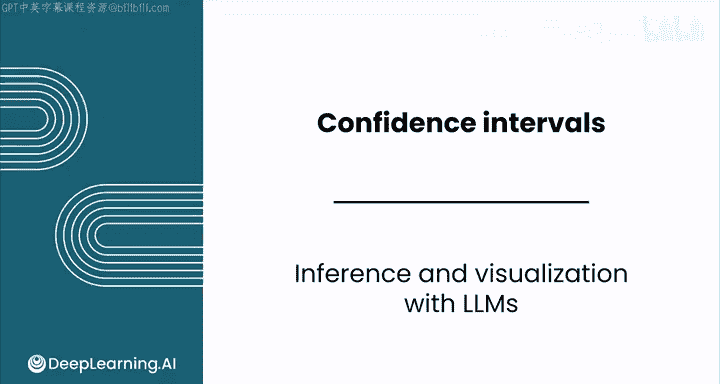
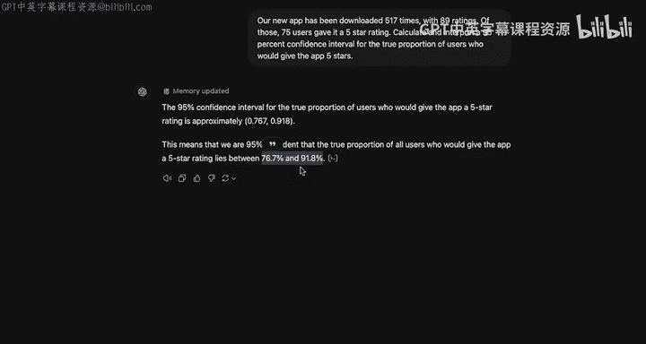
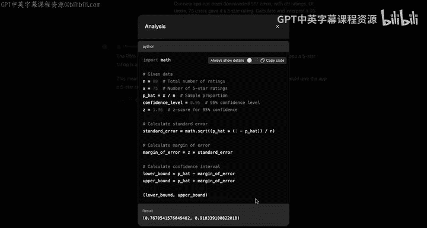
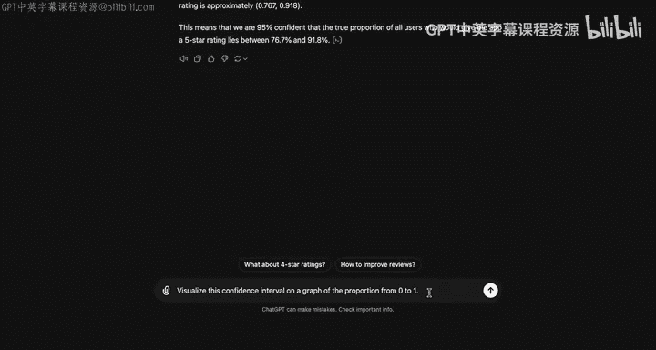
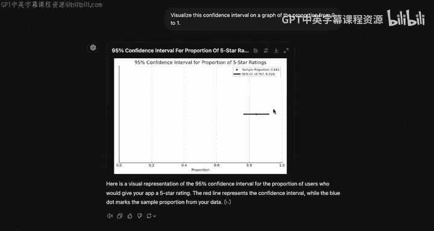
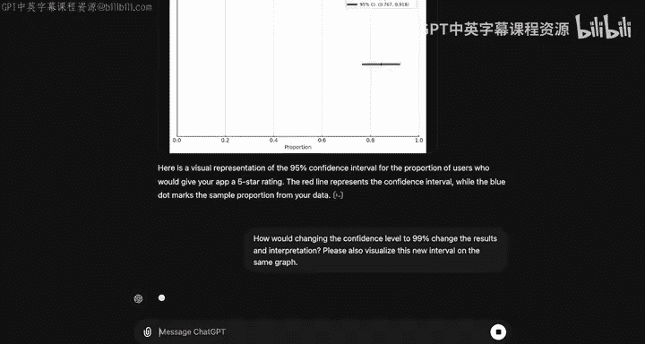
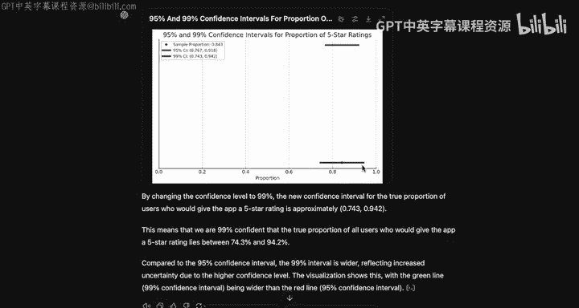

# 吴恩达《数据分析（数据分析基础／应用统计学，1-2课／共5课）｜DeepLearning.AI Data Analytics》中英字幕（claude-4-s - P133：62_使用LLM进行推断与可视化.zh_en - GPT中英字幕课程资源 - BV1SCXrYuEwr

How can you get a large language model to actually construct a confidence interval for you。

 Let's take a look at a couple of examples。Alright， let's test out this prompt。

 You're going tell the LLM that the new app has been downloaded 517 times with 89 ratings and of those 75 users gave it a five star rating。

 you wanted to calculate and interpret a 95% confidence interval for the true proportion of users who would give the app5 stars。

 Now this is a really interesting sample you're taking all of the ratings and using that sample to try to understand all of the users Also calculate calculate means the LLM has to write and run code。

 it has to actually do math。 if you're working with the traditional large language model when you ask it to calculate a confidence interval like this。

 it will just write out all the steps and you will have to go off and do the calculations yourself。

 but since this is using chatt Ept40 which can actually write and run code with its advanced data analytics feature。

 it will go ahead and do those steps for you。 if you are just going to use a vanilla LLM such as the one in Cora。

 you wouldn't want it to calculate for you。So here it tells you that the 95% confidence interval for the true proportion of users who would give the app a five star rating is approximately from 0。

767 to 0。918 and then it offers you the interpretation。

 which means that we are 95% confident that the true proportion of all users who would give the app a  five star rating lies somewhere between 76。

7% and 91。8%。 make sure to double check that it actually ran some code。

 you can look for this code symbol here， and if you click that it will show you the code that it ran。

 you don't need to read all of this code， just double check that it actually had a way to get the correct values。

 Although even if you have' a written code before you'll likely recognize most of these calculations So you can see here that it's defining the total number of ratings。

 it's defining the number of five star ratings which is 75 it's calculating the sample proportion as the number of 5 star ratings divided by the total number of ratings it's also defining the confidence level as 95% and then it's also defining a z score of 1。

96 which you've。

See throughout this module。 and then you can see it doing some math to calculate the standard error and the margin of error。

 And then finally， you can see that it's calculating the lower bounds and upper bounds of the confidence interval。

 These are all very similar steps to what you've completed yourself in a spreadheet environment Next。

 you can ask the LLM to visualize this confidence interval on a graph of the proportion from0 to1 this way you can see what this range looks like this is an interesting graph。

 The blue dot represents P hat。 that is the sample proportion and the center of your confidence interval and on either side you have plus or minus1 margin of error。

 and that span is represented by the redm So no matter what this is quite a high proportion。

 maybe the true proportion could be below 80% or it could be above 90% but either way it's a high proportion。

 Now suppose you want to add one more followup prompts。

 How would changing the confidence level to 99% change the results in the interpretation。

 please also visualize this new interval on the same graph。

 So it produces the new confidence interval， which is actually wider than the original 95% confidence。

terThat's because a higher confidence level requires a larger range to ensure that the true proportion is captured within the interval It also adds this confidence interval to the chart above where you can clearly see that the new 99% confidence interval is in fact wider than that 95% confidence interval that the LLM originally generated One thing to note here is that the sample proportion is the same for both confidence intervals the middle of each confidence interval lines up exactly only difference is that the margin of error is wider for the 99% confidence interval。

Okay， so you've seen how large language models can help you actually calculate confidence intervals。

 They're quite useful。 Again， you have to make sure you're double checking their output at every step。

 I hope you go ahead and try these techniques out yourself in the following large language model lab and then follow on to the next graded lab。

 which is all about constructing confidence intervals for diamond prices。

 I know you'll enjoy it and I'll see you once you're done in the next module。

 which is all about hypothesis testing。😊。