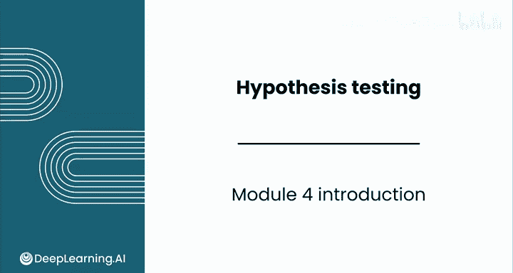
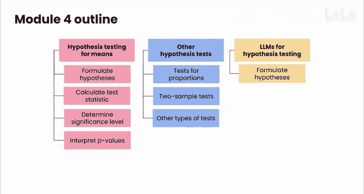

# 吴恩达《数据分析（数据分析基础／应用统计学，1-2课／共5课）｜DeepLearning.AI Data Analytics》中英字幕（claude-4-s - P134：63_模块4 简介.zh_en - GPT中英字幕课程资源 - BV1SCXrYuEwr

Welcome to the final module of this course Hypoth testing In this module。

 you'll dive into one of the most powerful and widely used tools and inferential statistics throughout these lessons。

 you'll see how hypothesis tests can help you make data-driven decisions and real world business scenarios。

 answering questions like does a free trial improve user retention and our delivery times really faster than 45 minutes you'll start by exploring the fundamental concepts of hypothesis testing for means you'll learn how to formulate your hypothesistheses calculate the test statistics determine your desired significance level and interpret P values then you'll expand your toolkit with hypothesis tests for proportions and to sample tests you'll discover how to compare different groups and evaluate whether observed differences are statistically significant you'll also briefly explore other types of hypothesis tests you might encounter in your work as a data analyst Throughout the module you'll get hands-on practice performing various。

😊，Hypothesis test and spreadsheets as well as interpreting the results to answer important business questions In the final lesson。

 you'll explore how large language models can assist you in the hypothesis testing process you'll learn to leverage AI to help formulate hypotheses interpret results and even run tests for you。

Follow me to the next video where you'll jump right into hypothesis testing with a practical example。

