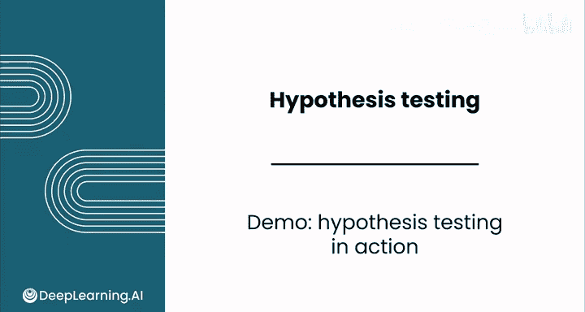
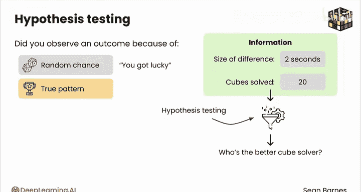

# 吴恩达《数据分析（数据分析基础／应用统计学，1-2课／共5课）｜DeepLearning.AI Data Analytics》中英字幕（claude-4-s - P135：64_演示：假设检验实战.zh_en - GPT中英字幕课程资源 - BV1SCXrYuEwr

Your former college roommate challenges you to see who can solve a Rubi's cube faster。

 you think you're evenly matched， so you agree。You saw the cube in 92 seconds。

 but he solves it in 71。 You lost the first match， but that doesn't make you a loser。

 You decide to keep going and end up solving 20 cubes each。 Your fingers are dumb。

 but you've achieved an average time of 80 seconds。 While your friend has an average time of 82。

 Your friend says you just got lucky。 That's nothing。 My cubes were more scrambled。

 I'll totally beat you next time。 But you're thinking， hey， I be you by two seconds on average。

 Fair and square。 So who's right。😊，Hypothesis testing can help you answer just this type of question。

 Did you observe a particular outcome because of random chance。

 That's what your friend is suggesting that you just got lucky。 or is there some true pattern here。

 And you are， in fact， the better cube solver。 The size of the difference is pretty small。

 You only won by two seconds。 And you did only solve 20 cubes。

A hypothesis test can take all this information into account and help you reach a conclusion with high confidence。

 Who's the better cube solver。 Let's see hypothesis testing in action on this example so you can get a feel for how it works。

 you have the first 20 solves here in orange and then you have the differences between your solving times。

 Poitive values mean that you solve the cube faster than your friend。 So in the cell here。

 you can calculate the average difference。

This is the average difference that you just saw that you were two seconds faster on average over the first 20 solves。

 Now， say you were actually evenly matched。 What's the probability that you could observe these results where you were faster than your friend by two seconds。

 all calculate it using a hypothesis test， which you'll learn how to do over the next few videos。

 So this will involve the use of the Z test function， which you'll learn more about。

 Select the observations in your data， then enter your hypothesisthesized mean value。

0 represents no difference or the idea that you and your friend are equally skilled。Okay。

 so this says the probability of observing a difference this large or larger。

 if you are equally skilled is 24。6%。 So if you are evenly matched。

 this kind of result would be pretty common。 there is a lot of variability in the data。

 and it's only 20 solves， and it's only a two second difference， which is pretty small。

 So it looks like you're solving faster， but you don't have a ton of strong evidence。 Now。

 say after finding these results。 You wanted to settle this once and for all。

 You go on to do 100 solves and record your results。So here you can see the data from all 100 solves。

 in some cases you solved the cube 24 seconds faster and in other cases。

 your friends solved it much faster than you did。So again。

 you can calculate the average difference This time your average is faster by three seconds。

 given that this result is based on more tries， could this be evidence that you are actually faster。

 you can calculate the probability of observing a three second difference or larger if you're equally skilled by again using the Z test function。

And now you get a result of only 0。37%。 So if you were， in fact， equally skilled。

 this difference would be rare。 and that rarity reflects that you were able to maintain an average of a three second advantage over your friend across 100 solves。

 Let's face it after 100 chances。 If your friend hasn't started solving faster than you。

 It doesn't seem likely that he's truly better than you。😊。

The hypothesis test you just conducted gives you reason to believe that you are in fact faster than your friend。

 even if it's only by three seconds on average， now that you've seen how hypothesis tests can evaluate the likelihood of certain events。

 follow me to the next video to see what's happening under the hood。

