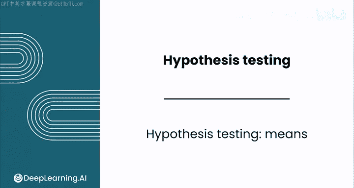
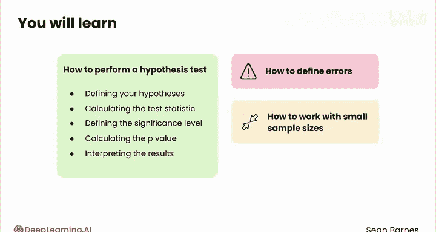

# 吴恩达《数据分析（数据分析基础／应用统计学，1-2课／共5课）｜DeepLearning.AI Data Analytics》中英字幕（claude-4-s - P136：65_均值假设检验.zh_en - GPT中英字幕课程资源 - BV1SCXrYuEwr

In data analytics foundations， you saw that data analytics has a lot in common with other investigative fields like science。

 one powerful investigative tool you have is hypothesis testing for Me。

 which allows you to rigorously evaluate whether your sample mean is significantly different from a particular value。

Let's return to the example where you are working with the music streamaming service。

 your team has rolled out the free trial to more users and you're working on a new project to figure out if giving users a free trial improves user retention。

 You decide to investigate whether users who receive a free trial stay subscribed for longer on average previous analytics have shown that users who don't receive a free trial tend to stay subscribed for about 10 months。

 You collect a sample of 100 users who receive the free trial and calculate the following descriptive statistics。

 The sample mean is 10。4 months。 The sample standard deviation is two months。 That's close。

 What do you think is the difference of 0。4 months large enough to convince you that the free trial is effective。

You can't be sure just yet。 what you don't know based on these descriptive statistics is where this mean of 10。

4 falls in your sampling distribution。 you know from studying the central limit theorem that the sampling distribution for means is normally distributed。

 There are infinitely many possible scenarios， but here are three for you to consider。

 the true population mean muu is 10 months， So 10。4 months falls here in the sampling distribution。

 muu is 9。6 months and 10。4 months falls around here in the sampling distribution。 And lastly。

 muu is 9 months and 10。4 months falls here in the sampling distribution。

 based on what you know about the normal distribution， which of these outcomes is most likely。

The first outcome is more likely than the other two。

Recall that the standard error is S over the square root of n。

 So here it's 2 over the square root of 100， which is 2 over 10 or 0。2。

 Remember that standard error is a special term for the standard deviation of the sampling distribution。

 In the first case， x bar is two standard errors from the mean。

 In the second X bar is four standard errors away。 And in the last x bar is7 standard errors away。

 You know， from the three sigma rule that 99。7% of the data lies within three standard errors of the mean。

 So getting an outcome that is a whopping 7 standard errors above the mean is extremely unlikely。

The tricky part is you can never know the true population mean to compare with。

But what you can do is calculate how likely it is that you would observe the sample mean you calculated if the population mean is。

 in fact， the value you suspect。 the idea here is that if your true population mean was actually 9 months。

 it would be extremely， extremely unlikely for you to take a sample of 100 users。

 And fine that the sample mean was 10。4 months。 whereasas if the true population mean is 10 months。

 it's much more likely。 Now， in this case， it's so tempting to say 10。4 is higher and call it a day。

 But these numbers are close。 It is absolutely possible that the true mean is actually 10 and the free trial costs you money while giving you no benefit。

 or maybe it's 9。6， and the free trial is slightly worse for retention。

 this level of precision is important for your conclusions。

 What a hypothesis test allows you to do is to evaluate whether your sample mean for free trial users 10。

4 months。 it' significantly different from the known population mean for existing users，10 months。

Given the variability in your data and your sample size。

 it distinguishes between two possible scenarios， first that the observed difference between the sample mean of free trial users and the mean of existing users is due to random chance。

The values are too close for you to tell if they're actually different or that the observed difference reflects a genuine difference between the true population mean of free trial users and the mean of existing users。

 This distinction is called statistical significance。 If the difference is due to random chance。

 its not statistically significant， it doesn't help you draw any meaningful conclusion。

 On the other hand， if the observed difference reflects a genuine difference between the hypothesized mean and the sample value。

 That is statistically significant。 The difference is likely real and can provide evidence for your hypothesis。

It's very common for you to collect the sample and calculate a mean that's different from the true population mean。

 For example， when rolling two dice multiple times， the population mean of their sum is 7。

 which is also the most common roll。 But if you take a sample of， say。

10 rolls and calculate the mean， you're very unlikely to get 7 exactly。

 you will get values that vary around 7。 So just observing that two values are different。

 isn't enough to conclude that the difference is meaningful。

 That's just how the cookie cruumbles sometimes Hy tests only work effectively under certain conditions。

It's crucial that your data is a representative sample， Idely， a random sample。

 A majority of statistical tests assume random sampling， because if your sample isn't random。

 you have no way of knowing what biases your sampling method introduced。

 The observations in your data must also be independent。 Additionally。

 your data must meet one of two conditions。 Either it is normally distributed。

 or your sample size must be large。 Typically large means 30， but 50 or more is ideal。

That's because of the central limit theorem， which states that the sampling distribution of the mean approaches a normal distribution as the sample size increases。

 You've already seen this in action during the previous module。 over the next few videos。

 you'll see how to perform a hypothesis test for means。 You'll cover these steps。

 defining your hypothesistheses， calculating the test statistic。Defining the significance level。

 calculating the P value， and interpreting the results。

 you'll also learn how to define errors and work with small sample sizes。

 Don't worry about all the terminology For now。 you'll be a pro at hypothesis testing by the end of this lesson。

Your first step in hypothesis testing is defining the hypothesis。

 It's crucial for making sure you construct and interpret your test correctly。

 follow me to the next video to learn how。

