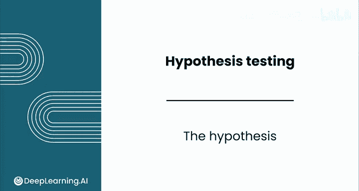
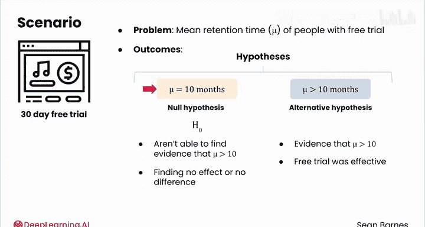
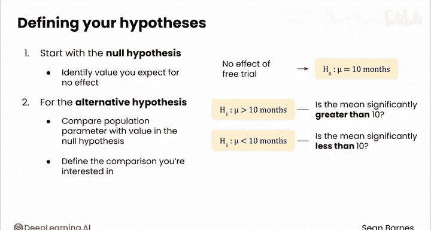
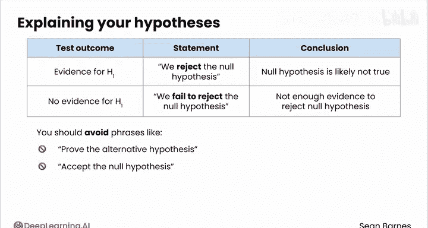
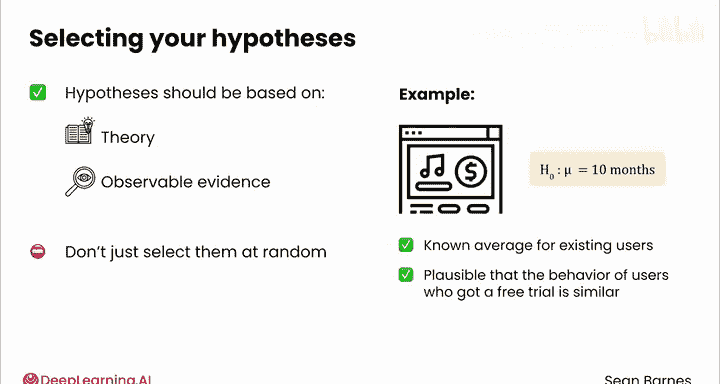

# 吴恩达《数据分析（数据分析基础／应用统计学，1-2课／共5课）｜DeepLearning.AI Data Analytics》中英字幕（claude-4-s - P137：66_假设设定.zh_en - GPT中英字幕课程资源 - BV1SCXrYuEwr

In statistical hypothesis testing， you'll need to define two related hypotheses。

 the null hypothesis and the alternative hypothesis。 These two hypotheses complement each other。

Breaking down the music subscription service scenario。

 you were investigating the mean retention time of people who got a free trial。

 There were two possible outcomes of your test。 mu equals 10 months。

 and mu is greater than 10 months。 These are your hypotheses。 Now。

 let me ask you which of these hypotheses corresponds with the idea that getting a free trial has no effect on subscriptionly。

That would be mu equals 10。 This hypothesis is called the null hypothesis。

 and it represents the condition where you are able to find evidence that mu is greater than 10。

 It's associated with finding no effect or no difference。

 This hypothesis is written as H sub0 or h not。Alternatively。

 if you could find evidence that mu is greater than 10 months， That would be great。

 That evidence would indicate that the free trial was effective in getting users to subscribe for longer。

 This hypothesis is called the alternative hypothesis。 If's the alternative to the null。

 and it's written as H sub1。😊。

In general， when defining your hypothesistheses， start with the null hypothesis。

 identify the value you would expect if there is no effect。 For example。

 if there was no effect of getting a free trial， you would expect the mean subscription length of 10 months。

 The same as existing subscribers that gave you H of mu equals 10 for your alternative hypothesis。

 you'll always compare the population parameter with the value in the null hypothesis。 In this case。

10， Def the comparison than you're interested in。 Are you looking for evidence that the mean is greater than Small than or just different than the expected mean。

 your options would be H sub1 is mu is greater than 10。 Is the mean significantly greater than 10。

 H sub1 is mu is less than 10 Is the mean significantly less than 10。

 or H sub1 is mu is not equal to 10。 Is the mean significantly different than 10。

 You can only have one alternative hypothesis。 So in the example from earlier。

 mu is greater than 10 is most appropriate。 Since you were hoping to find evidence that the free trial increased。

Subscriptionally when you're explaining these hypotheses to your business stakeholders。

 it's important to use exactly the right terms。 If your test indicates evidence for the alternative hypothesis。

 more on the specifics of how later， you would say you reject the null hypothesis。

 The data suggests that the null hypothesis is likely not true。

 if you don't find evidence for the alternative hypothesis。

 then you would say that you fail to reject the null hypothesis。

 It doesn't mean that the null hypothesis is true。 just that you don't have enough evidence to reject it。

 The language of statistics is important here。You should avoid phrases like prove the alternative hypothesis and accept the null hypothesis。

 It may feel like you're being deliberately vague。 but remember that inferential statistics is all about managing uncertainty。

 There's always a chance that your conclusions are incorrect。

 This terminology helps avoid overstating your conclusions。

 and reminds your stakeholders that these tests can never prove with absolute certainty。

 As in science， your hypotheses should be based on some theory or observable evidence。

 In other words， don't just select them at random。 For example。

 when dealing with the music subscription service。 It makes sense to choose the null hypothesis that subscription length equals 10。

 Since that's the known average for existing users。

 It's plausible that the behavior of users who got a free trial is similar。

Hypotheses are the foundation of your testing strategy， and they must be defined first。

 In the next video， you'll get practice identifying hypotheses depending on your business problem。

 I'll see there。