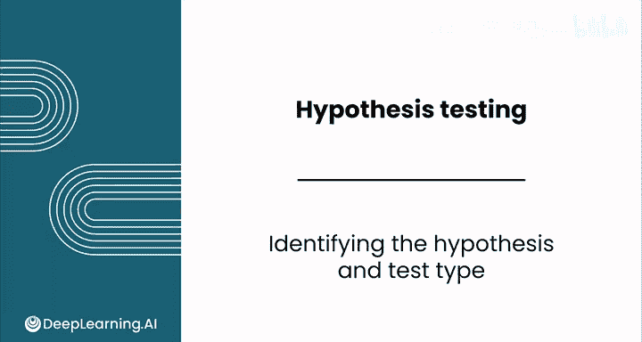
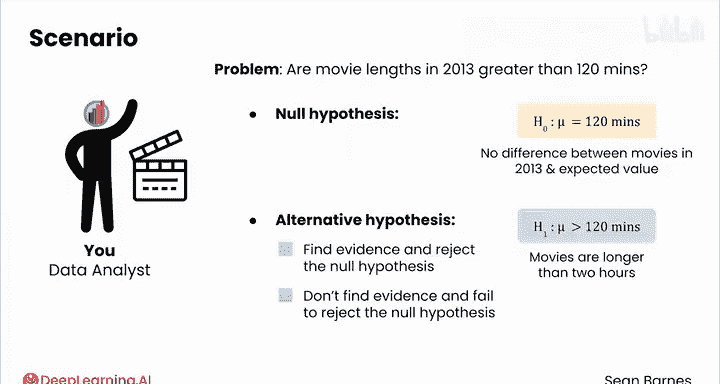
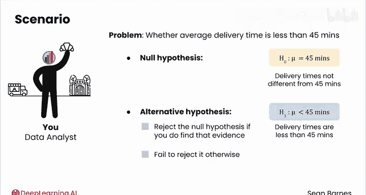
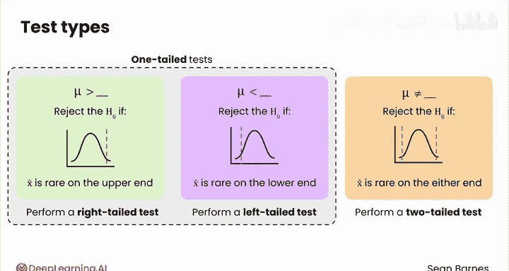
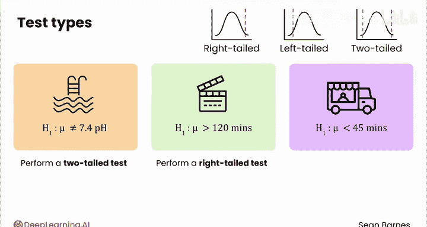

# 吴恩达《数据分析（数据分析基础／应用统计学，1-2课／共5课）｜DeepLearning.AI Data Analytics》中英字幕（claude-4-s - P138：67_识别假设与检验类型.zh_en - GPT中英字幕课程资源 - BV1SCXrYuEwr

Let's take a look back at some of the business problems you've seen in this course so far and formulate hypotheses for them。

 you'll also see how to determine which type of hypothesis test is appropriate for a given use case。

First， is the water in a swimming pool safe， say you were testing the pH of a swimming pool for which the ideal pH level is 7。

4 any significant difference from 7。4 is unsafe， whether it's higher or lower。

 pause the video for a moment and see if you can dropt down the hypotheses you would test。

Your null hypothesis H would be mu equal 7。4， This value represents the status quo your alternative hypotheses would be for unsafe pH levels In this case。

 H sub1 of mu is not equal to 7。4 If the pH differs significantly either above or below 7。

4 you would reject the null hypothesis you also investigated business questions related to movie links For example。

 our movie links in 2013 greater than 120 minutes。I encourage you to pause the video for a moment and see if you can work out the hypotheses。

Your null hypothesis would be that mu equals 120 minutes。

That value represents no difference between the movies in 2013 and what you expected。

 Your alternative hypothesis would be that muw is greater than 1020 minutes。

 You're looking for evidence that movies are longer than two hours。

 Either you find that evidence and you reject the null hypothesis or you don't find that evidence。

 and you fail to reject the null hypothesis。 In the previous module。

 you also constructed confidence intervals for bakery delivery times。

Recall that you recorded delivery times for 30 days and measured the average time at 43 minutes you could use a hypothesis test to investigate whether the average delivery time is less than 45 minutes。

 pause the video one more time and try to figure out the hypotheses。

The null hypothesis would be that mu equals 45 minutes。

 that's the status quo if delivery times weren't different from 45 minutes。

 the alternative hypothesis would be mu is less than 45 minutes。

 You're interested in finding evidence that the delivery times are less than 45 minutes。

You can reject the null hypothesis if you do find that evidence or fail to reject it otherwise。

 notice that your hypothesized mean delivery time is different from the sample mean you calculated。

 which was 43 minutes。Your goal is to use that sample mean to understand how likely it is that the population mean is under 45 minutes。

 Once you've defined your hypothesis， you'll need to select the appropriate test type you saw in the previous video that you can select from three types of alternative hypotheses。

 mu is greater than some number mu is less than some number and mu is not equal to some number。

 These hypotheses are each associated with a different type of test。 In the first case。

 you'll reject the null hypothesis if your sample mean is rare on the upper end of the distribution you should perform a right tail test since you're only interested in the upper tail of values In the second case。

 you'll reject the null when your sample mean is rare on the lower end。

 you should perform a left tail test since you're interested in rare values only below the mean Both left and right tail tests are considered one tailed tests。

 Since you're only checking if a value falls on one side of the distribution In the final case。

 you're actually interested in both possibilities So you'll reject the null。

 if you find that your sample mean is。

Unusual on either the upper or lower end， you should perform a two tail test because you're interested in whether X bar falls in either the upper or lower tail of values。

 Let's see how that shakes out with the three examples you just saw if you're testing the water in a pool with the alternative hypothesis H sub1 that mu the average pH does not equal 7。

4。

What type of tests would you want to perform？You would want a two tail test。

 since either a pH that's too high or too low would be unsuitable for testing movie lengths。

 recall that your alternative hypothesis was that mu is greater than 120 minutes or on average。

 movie durations are above that value。 What type of test would that be。

You should perform a right tail test， since you want to check if the sample mean would be unusually high。

 and if you're checking whether the average delivery time is below 45 minutes。

 you're interested in a left tail test。

Great work defining your hypotheses and determining your test types。

 follow me into the next video to see how to complete the next step of your hypothesis test。

 calculating the test statistic。