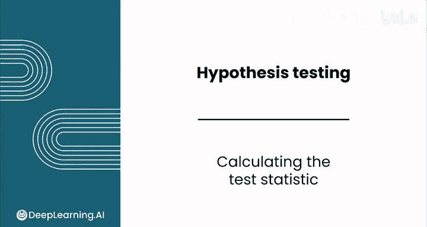
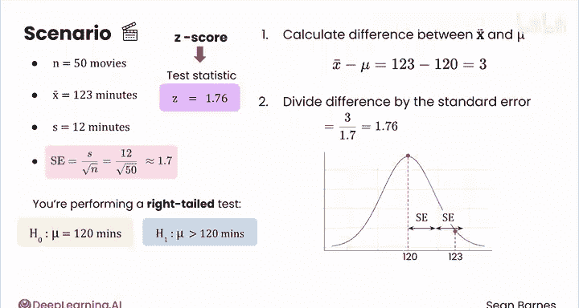
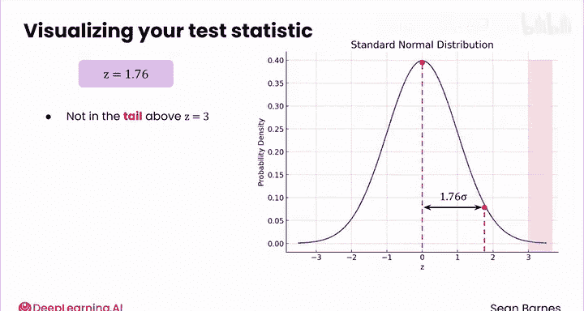

# 吴恩达《数据分析（数据分析基础／应用统计学，1-2课／共5课）｜DeepLearning.AI Data Analytics》中英字幕（claude-4-s - P139：68_计算检验统计量.zh_en - GPT中英字幕课程资源 - BV1SCXrYuEwr

How do you make a decision about your hypothesis， given them the sample data that you've collected to answer that question。

 you'll need to calculate your test statistic。Your client is a theater。

 and you're working with them to better understand these durations to help with scheduling。

 Your client has asked you to determine whether movies are longer than 120 minutes on average。

 You've collected a random sample of 50 movies and calculated a sample mean of 1 23 minutes and a sample standard deviation of 12 minutes。

 You're performing a right tailed test with the hypothesisses H the null hypothesis states that mu equals 120 minutes。

 and a sub1， the alternative hypothesis states that mu is greater than 120 minutes。

 Here's the sample distribution of the mean from movie duration。

 centered around your null hypothesis of mu is 120 and the standard error is 12 over square root of 50。

 which equals about 1。7。 Is your sample mean different enough from your hypothesisthesized mu to confidently reject the null hypothesis。

 It's hard to tell specifically because both variability and sample size affect your conclusions。

 If your data is highly variable， you can't be as confident that these means are truly different。

 the larger your sample。izeThe more precision your test has。 But if your sample size is lower。

 you may not be certain your results really reflect the population。

 The test statistic accounts for the variability and size of your sample data。

 Once you've calculated it， you can determine how rare of a result it really is First。

 you'll calculate the difference between x bar and mu， which gives you three。

 This step centers your calculations around 0。 then you'll divide this difference by the standard error。

 which tells you the number of standard errors between this test statistic and the hypothesized mean Since you don't know the population standard deviation。

 you will use the formula S over the square root of n， which gives you about 1。7。 altogether。

 the test statistic is 3 over 1。7， which equals 1。76。

 did this calculation look familiar to something else you've done with the normal distribution。

You just calculated a z score。

Recall that a Z score is the number of standard deviations from the mean on the standard normal distribution。

 Essentially， you're translating your sample mean into a value on a standardized scale where the mean is 0 and each step represents one standard deviation。

 Let's visualize this value。 Here's the standard normal distribution。

Can you spot where your test statistic Z equals 1。76 falls？It's right here，1。

76 standard deviations above the mean。 How rare would you say this test statistic is。

 It's tough to say just by looking at the graph。 It's not in one of the tails above a z score of 3。

 but it's also not in the middle set of common values where Z is between 0 and 1。

Is this Z score rare enough for you to reject your null hypothesis， That depends。

 Join me in the next video to see how to answer that question by determining your significance level and rejection region。

