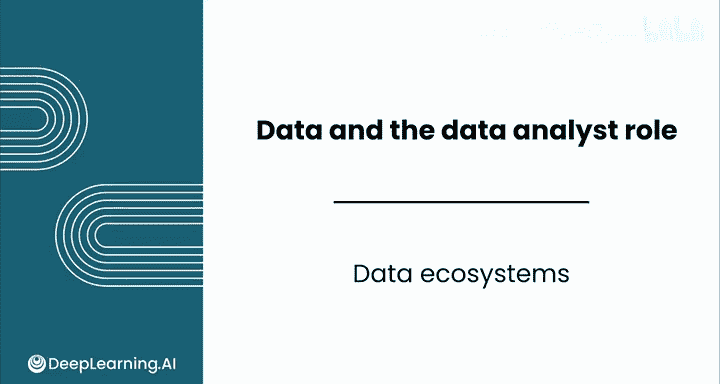
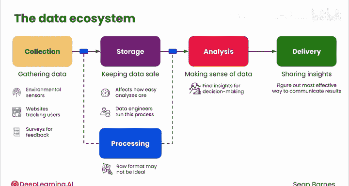
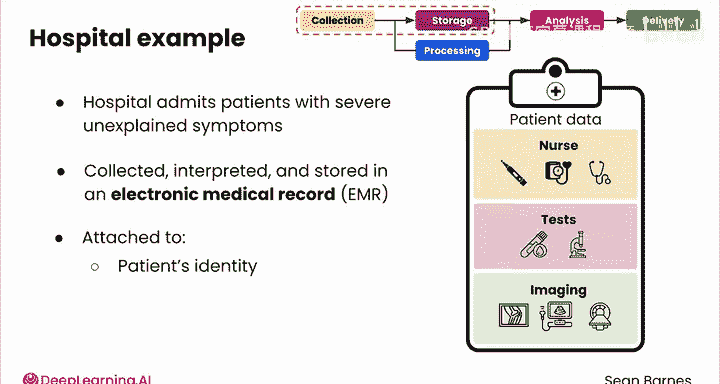
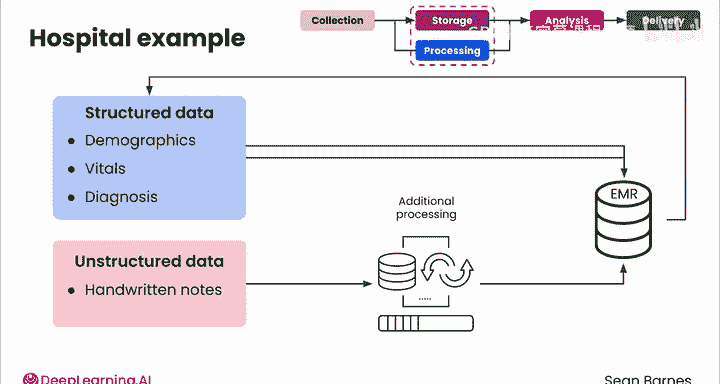
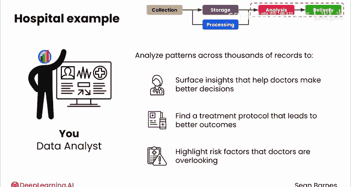

# 吴恩达《数据分析（数据分析基础／应用统计学，1-2课／共5课）｜DeepLearning.AI Data Analytics》中英字幕（claude-4-s - P13：12_数据生态系统.zh_en - GPT中英字幕课程资源 - BV1SCXrYuEwr

Just like electricity， data doesn't stay at the place， it was generated。

 it flows through various systems to eventually power insights。

 let's take a high levell look at that flow， which is called the data ecosystem。

 the end to end process that data undergoes from the moment it's generated to the point where you can use it to drive decision making。

First， collection gathering data as you saw in earlier videos。

 data needs to be captured in order to be used effectively This could look like sensors collecting environmental data。

 websites tracking user interactions or surveys gathering customer feedback storage。

 keeping data safe the way it is stored affects how easy different analyses are to perform data engineers typically run this process you'll learn more about their role in a moment processing in most cases the raw format in which data is collected may not be ideal for storage or analysis so processing can actually happen between the collection and storage stages as well as between storage and the next stage analysis。

 making sense of data， you will investigate the data to find insights that can inform decision making delivery。

 sharing insights you'll need to figure out the most effective way to communicate the results of your analysis such as in a report or dashboard。

The core data team， including you as a data analyst， will own these steps。

 others will depend on your work， including any users who generate the data。

 plus business stakeholders like product managers， engineers and so on。

 You are most accountable to your data engineers and business stakeholders Since those are the roles directly upstream and downstream More on this in the next videos。

 Let's make this concrete with an example。 consider a hospital that admits patients with severe unexplained symptoms for diagnosis Each patient generates a lot of data about their health and the initial diagnosis phase involves capturing it。

 For instance， a nurse will measure their vitals temperature with the digital thermometer and breathing patterns with a stethoscope they may also perform a blood or urine test which has to be processed in a laboratory or they might order imaging such as an X-ray。

 ultrasound or an MRI which generate images that must be interpreted by an expert This data is stored in an electronic medical record。

Or EMR attached to the patient's identity， along with data about when the information was collected and by whom the way data is stored and processed depends a lot on its type。

 structured data like a patient's demographic information or vitals might be easily stored in a traditional database unstructured data like a doctor's handwritten notes might be stored in the database after additional processing such as handwriting recognition with AI or manual data entry After all of this data flows into the EMR。

 the patient's doctor can combine it with their own expertise to make a diagnosis。

 which itself becomes yet another data point captured in the EMR At this point。

 you as the data analyst come in you won't diagnose any single patient but by analyzing patterns across thousands of similar patient records。

 you might be able to surface insights that help doctors make better decisions Maybe there's a treatment protocol that's consistently leading to better outcomes or maybe there are certain risk factors that doctors are overlooking。

You're not alone in this process in the next two videos。

 you'll meet your key collaborators from business stakeholders who read your reports to the data engineers you talk with daily。

 see you there。