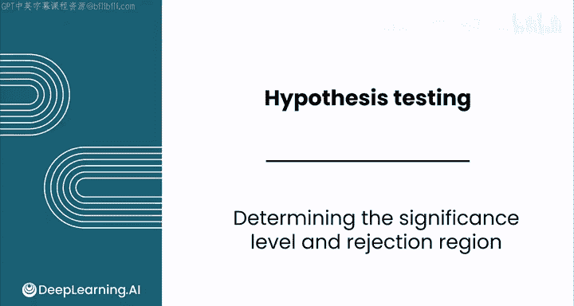
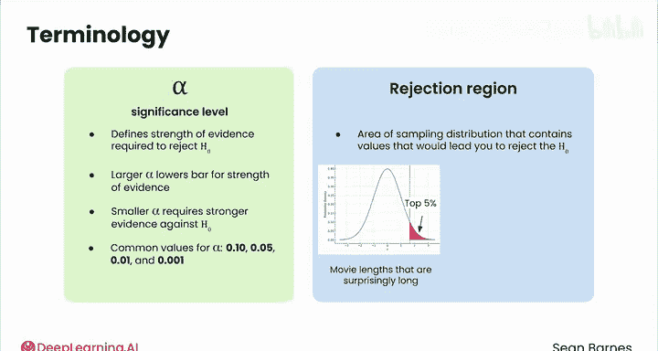

# 吴恩达《数据分析（数据分析基础／应用统计学，1-2课／共5课）｜DeepLearning.AI Data Analytics》中英字幕（claude-4-s - P140：69_确定显著性水平与拒绝域.zh_en - GPT中英字幕课程资源 - BV1SCXrYuEwr

In addition to calculating your test statistic， you'll need to determine how precise you want your test to be。

 what do you consider a sufficiently unlikely value that would lead you to reject your null hypothesis？

Consider the movie duration example， where you want to test whether movies in 2013 were longer than 120 minutes on average to help you schedule movie times in theater。

 how high stakes is this decision？Are you okay coming to the wrong conclusion 5% of the time。

 Only 1% of the time in your previous work with confidence intervals。

 you encountered the concept of confidence or the level of certainty you have in your conclusions。

 You learn that you could construct an interval with 9095 or 99% confidence or some other value as well。

 Your choice depends on how precise your estimates need to be。

 If you needed to be very sure about your results。 Would you choose 90% or 99% confidence。

You'd choose 99%。 Hypoth tests rely on a similar intuition As a data analyst。

 you will have to make this call to determine what confidence level you are comfortable with。

 Remember， as with all inferential statistics， you are trying to manage uncertainty it can never be fully eliminated as a recap here are the descriptive stats for your sample and here or your hypothesis。

 Since you've already calculated the z score for your test statistic。

 youre working with the standard normal distribution。

 If you wanted to be 95% confident that you correctly reject the null hypothesis。

 you would look for test results above the mean that you expect to occur 5% of the time or less。

 this shaded region represents the values of Z that should occur 5% of the time or less it's called the rejection region because any test statistic that falls into this region would lead you to reject the null hypothesis。

 That conclusion may lead you to adjust the theater' scheduling practices when performing a onetailed hypothesis test with 95% confidence level。

 your ability to reject the null hypothesis depends on the size of the reject。which has an area of 0。

05 This value is called the level of significance and is represented by the Greek letter alpha and alpha of 0。

05 is quite common and is often used in initial studies for medical research。

 manufacturing quality control and the social sciences Notice that the confidence is the complement of the level of significance。

 If you want to be 95% confident you set your alpha to 0。05 representing a 5% chance of error。

 Imagine that the theater's schedules are expensive to adjust choosingos to show fewer movies in a day may reduce revenue and cause employee schedule changes。

You want to be absolutely certain that movies on average are indeed above 120 minutes before adjusting the schedule。

 in that case， would you want a higher or lower level of significance。For a more precise test。

 you can lower your alpha to 0。01， which corresponds to having 99% confidence。

So you would reject the null hypothesis if the test statistic is in the top 1% of all means in this distribution。

 an alpha of 0。01 is often used in clinical trials。

 environmental impact studies and financial audits when the risk caused by incorrectly rejecting the null hypothesis is higher In this case。

 you start with the same distribution Do you expect this rejection region for an alpha of 0。

01 to be smaller or larger than an alpha of 0。05。Your rejection region gets smaller。

Here's what it looks like。You want to be more confident so you'll only reject the null for values in the top 1% of the distribution in the movie theater scenario。

 this smaller rejection region means that you'd need even stronger evidence that movies are longer before changing the suling。

There's one final nuance that you should be aware of。

 You just saw the rejection region for a right tail test。

 The process is quite similar for a left tail test， which also has just one rejection region。

 However， for a two tail test， you're interested in values above and below the mean for movie links。

 your null hypothesis would remain the same。 But this time， your alternative hypothesis。

 H sub1 would be that mu is not equal to 120。 Here's what that would look like on the distribution。

Same distribution， different hypothesis， and therefore different rejection region。

 Take a look at the upper rejection region for a moment。

It's smaller for the two tail tests compared with just the right tail test。In fact。

 it's half a small。 Your rejection region contains 2。5% of the data on either side， U and lower。

 totaling 5%。 That's because you want to maintain the same precision with errors only 5% of the time。

 but you have two rejection regions。 if they both contain 5% of the values。

 that would actually lead to an error rate of 10%， not 5%。Okay。

 that was a lot of info to recap the terminology you learned， Al， your significance level。

 helps define the strength of evidence required in order for you to reject the null hypothesis。

 larger alphas make it easier to reject than null with less evidence。

Whereas smaller alphas require stronger evidence against the null to reject it。

Common values for alpha include 0。10，0。05 and 0。01。

 The rejection region is the area of the sampling distribution that contains the improbable values that would lead you to reject than null hypothesis for alpha equals 0。

05。 You saw this rejection region was the top 5% of the distribution in the movie theater example。

 the rejection region represents the range of average movie linkss that are so surprisingly long。

 you conclude movies are indeed longer than 120 minutes on average。

 You also saw that you can have a two tail test with two rejection regions。 For example。

 when testing whether a pool's ph is significantly higher or lower than 7。4 for alpha equals 0。05。

 This test will have 2 rejection regions。 Each covering 2。5% of the distribution in either tail。

Alpha， your significance level helps you quantify the amount of uncertainty you're comfortable with。

 it's used to determine whether your test statistic is rare enough for you to reject the null hypothesis。

 follow me to the next video to see how to calculate that rarity using a P value。

 which you can then compare with alpha to perform your hypothesis test。

