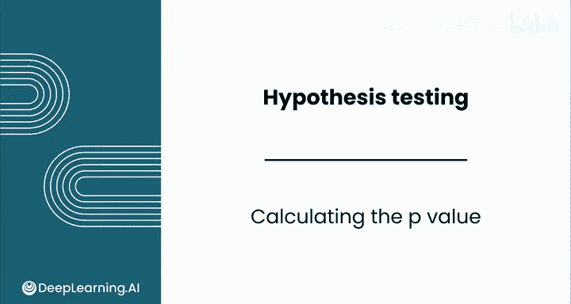
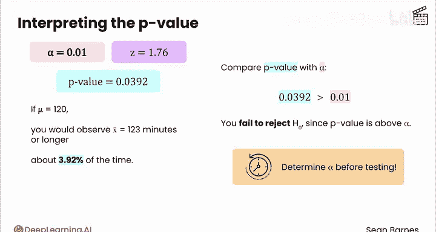
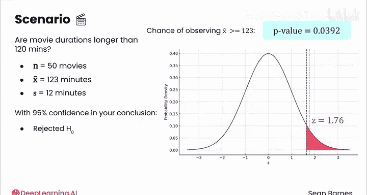

# 吴恩达《数据分析（数据分析基础／应用统计学，1-2课／共5课）｜DeepLearning.AI Data Analytics》中英字幕（claude-4-s - P141：70_计算p值.zh_en - GPT中英字幕课程资源 - BV1SCXrYuEwr

Your next step is to figure out whether your sample mean is rare enough for you to reject your null hypothesis。

 This is your final step before interpretation。Suppose the movie theater decided to select an alpha of 0。

05 Earl you calculated your test Staistic Z equals 1。76。How rare is this valued。

 Let's visualize this idea by seeing if this value falls within your rejection region。

 You can see that Z does fall within the rejection region， slightly above the boundary。

 So the sample mean of 123 minutes would happen less than 5% of the time if the true mean was。

 in fact，120 minutes。You can now calculate exactly how rare this value is using a P value short for probability value。

 The P value represents the probability of getting a sample mean as rare or rarer than Z and the direction of your alternative hypothesis。

 So in other words， the probability of getting Z of 1。76 or higher For this step。

 you'll need one of two things。 Either a lookup table or a spreadsheet or programming language that can calculate it for you。

 Let's talk through how to calculate the P value for a movie example。Again。

 you'll need to calculate the probability of observing a Z score of 1。

76 or higher on the standard normal distribution， recall the cumulative distribution function or CDF。

 which represents the probability of observing a Z score less than or equal to a specific value that means that you can find the probability of getting a Z score of less than or equal to 1。

76 using the CDF， so how might you use the CDF to calculate the probability that you're interested in。

You need to use the complement rule。The probability of z is greater than 1。

76 equals 1 minus the probability that z is less than or equal to 1。76。

 which is what the CDf tells you if you calculated this z score manually you can use a spreadsheet function to calculate the P value In this case。

 the probability that z is less than or equal to 1。76 is about 0。9608。

 the complement of this probability is then 1 minus this value or 0。

0392 that gives you the p value the probability of observing a more extreme test statistic than the one you've observed。

 By the way， you won't typically need to do this step in a spreadsheet when you're working directly with your sample data as opposed to calculating the z score yourself。

 you'll use the z do test function to do all the steps you previously saw except defining your hypothesis。

 Since p equals 0。0392。 If the true average duration of all movies is 120 minutes you would observe a sample mean of 123 minutes or longer about 3。

92。P of the time What do you think is this rare enough to reject the null hypothesis？

Compare your P value with your significance level， in this case， 0。05。

Since your P value is below your significance level。

 you will reject the null hypothesis intuitively what you're doing with this comparison is asking whether this event is expected to happen less than 5% of the time。

 and that's the case here。Now， consider the case you saw in the previous video where movie schedules are difficult to adjust。

 So what if you instead required a 1% level of significance for your hypothesis test。

 Is this event rare enough to reject the null hypothesis when alpha equals 0。01。In this case。

 you would not reject the null hypothesis because the P value， which hasn't changed。

 is greater than alpha。 You would not have observed strong enough evidence that the mean movie length is greater than 120 minutes。

 It's crucial that you determine your level of significance before you conduct your test。

Avoid adjusting it in order to make the decision that you want to make。

 That adjustment would introduce analysis bias。 Let's step back and put everything together。

 You had a business question about whether movie durations were on average longer than 1 20 minutes。

 you collected a sample of 50 movies and found their mean duration was 1 23 minutes。

 with the standard deviation of 12 minutes。 You wanted to know is there sufficient evidence that movie durations are above 1 20 minutes。

 then via the test statistic。 You calculated the chance of observing a sample mean of 1 and 23 minutes or above if the true mean is actually 1 and 20 minutes。

 based on your P value， You found that you would observe a value as extreme as 1 and 23 minutes or more extreme than that about 3。

92% of the time。 Since you wanted to be 95% confident in your conclusion。

 You rejected the null hypothesis。 concluding that there was sufficient evidence to believe that the true mean is above 1 20 minutes。

 Great work calculating and interpreting your first。

There's a lot going on here and I don't expect you to remember everything followow me to the next video to see this process play out in a spreadsheet。

 which will help you develop your intuition for how hypothesis testing works in practice。

